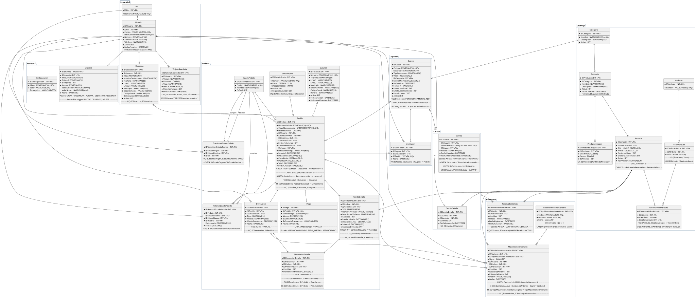
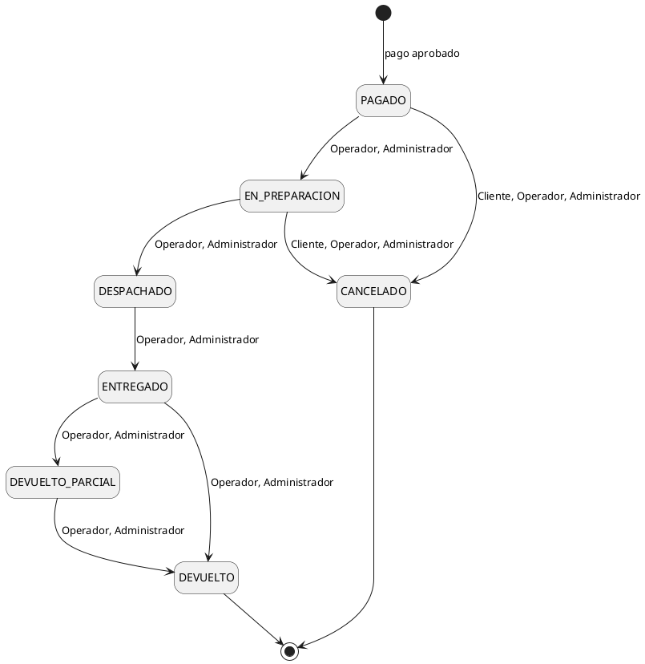

# Base de datos de ShopCart

Base de datos SQL Server de ShopCart: cómo crearla, sus datos iniciales y el diseño del modelo (tablas, reglas de integridad, normalización, stored procedures, vistas, funciones e índices). Todos los objetos se crean con scripts SQL escritos a mano; no se usa ORM.

El backend (arquitectura, Redis y sus pruebas) está en [Backend/README.md](../Backend/README.md), Docker Compose y el despliegue en el [README principal](../README.md) y la referencia de endpoints, con el stored procedure que ejecuta cada uno, en [Backend/API.md](../Backend/API.md).

## Índice

1. [Resumen](#resumen)
2. [Estructura de la carpeta](#estructura-de-la-carpeta)
3. [Crear la base de datos](#crear-la-base-de-datos)
   - [Con Docker Compose](#con-docker-compose)
   - [Con `docker-init.sh`](#con-docker-initsh)
   - [Con `script.sql`](#con-scriptsql)
   - [Cambios de esquema](#cambios-de-esquema)
4. [Datos iniciales](#datos-iniciales)
   - [Catálogos del sistema](#catálogos-del-sistema)
   - [Datos semilla](#datos-semilla)
5. [Tablas por módulo](#tablas-por-módulo)
6. [Diagrama entidad-relación](#diagrama-entidad-relación)
7. [Estándar de nomenclatura](#estándar-de-nomenclatura)
8. [Ciclo de vida del pedido](#ciclo-de-vida-del-pedido)
9. [Reglas de integridad en la base](#reglas-de-integridad-en-la-base)
10. [Normalización](#normalización)
    - [Copias históricas](#copias-históricas)
    - [Saldos y contadores](#saldos-y-contadores)
    - [Totales derivados](#totales-derivados)
    - [Cupón aplicado](#cupón-aplicado)
    - [Columnas repetidas para proteger reglas entre tablas](#columnas-repetidas-para-proteger-reglas-entre-tablas)
    - [Otras dependencias aceptadas](#otras-dependencias-aceptadas)
    - [Validación en el SP y en la base](#validación-en-el-sp-y-en-la-base)
11. [Patrón de los stored procedures que escriben](#patrón-de-los-stored-procedures-que-escriben)
12. [Vistas y funciones](#vistas-y-funciones)
13. [Índices principales](#índices-principales)
14. [Pruebas de integridad](#pruebas-de-integridad)

---

## Resumen

| Aspecto | Detalle |
| :--- | :--- |
| Motor | SQL Server 2019 o superior (Docker Compose usa SQL Server 2022 Developer) |
| Base | `ShopCart`; las pruebas del backend crean `ShopCart_Test` con los mismos scripts. Collation `Modern_Spanish_100_CI_AI` (búsquedas y `UNIQUE` sin distinguir mayúsculas ni tildes) y `READ_COMMITTED_SNAPSHOT ON` (las lecturas no bloquean a las escrituras) |
| Objetos | 29 tablas, 94 stored procedures, 14 funciones tipo tabla, 4 vistas y 3 triggers |
| Acceso | El backend solo ejecuta stored procedures. El login `shopcart_app` tiene únicamente `GRANT EXECUTE` sobre el esquema `dbo`, más `DENY UPDATE, DELETE` explícito sobre `Bitacora` y `MovimientoInventario`: la base rechaza cualquier `SELECT`, `INSERT`, `UPDATE` o `DELETE` directo sobre una tabla. Las vistas y funciones se usan desde los SPs por encadenamiento de propiedad (mismo dueño `dbo`) |
| Montos y fechas | Montos en `DECIMAL(12,2)`, cantidades en `INT`, fechas en `DATETIME2(3)` UTC |
| Errores de negocio | Los SPs los señalan con `THROW 50xxx` y el backend los traduce con `sqlErrorMapper`. El catálogo de códigos está en [Backend/API.md §4](../Backend/API.md#4-catálogo-de-códigos-de-error) |
| Redis | No guarda datos de negocio: sesiones, revocación de tokens, bloqueo de login y caché viven en Redis (ver [Redis](../Backend/README.md#redis) en el README del backend); existencias, reservas, idempotencia, cupones y pedidos solo en SQL Server |

## Estructura de la carpeta

```
Database/
├── scripts/
│   ├── 001_crear_base_datos.sql     # Elimina y crea la base (collation Modern_Spanish_100_CI_AI, READ_COMMITTED_SNAPSHOT)
│   ├── 002_tablas.sql               # 29 tablas con PK, FK (algunas compuestas), UNIQUE, NOT NULL, CHECK y DEFAULT
│   ├── 003_indices.sql              # Índices de búsqueda, filtros, reportes y FKs; únicos filtrados
│   ├── 004_triggers.sql             # Bitácora y kardex inmutables; el pedido nace en PAGADO y cambia solo por transiciones válidas
│   ├── 005_funciones.sql            # Funciones tipo tabla (FU_): existencia disponible, búsqueda, catálogo, cupones, totales del carrito, reserva del checkout y JSON para la bitácora
│   ├── 006_vistas.sql               # Vistas (VW_): existencias, historial de pedidos, ventas netas y ventas por categoría
│   ├── 007_sp_auth.sql              # SPs de autenticación, perfil, usuarios y direcciones
│   ├── 008_sp_catalogo.sql          # SPs de catálogo, categorías, productos, variantes y atributos
│   ├── 009_sp_inventario.sql        # SPs de existencias, kardex, ajustes y reservas
│   ├── 010_sp_carrito.sql           # SPs de carrito y cupón aplicado
│   ├── 011_sp_cupones.sql           # SPs de gestión de cupones
│   ├── 012_sp_pedidos.sql           # SPs de checkout, pedidos, estados y devoluciones
│   ├── 013_sp_reportes.sql          # SPs de reportes y dashboard
│   ├── 014_sp_bitacora.sql          # SPs de bitácora, configuración y sistema
│   ├── 015_sp_tarjetas.sql          # SPs de tarjetas guardadas del cliente
│   ├── 080_permisos.sql             # Login shopcart_app con permiso EXECUTE únicamente
│   ├── 085_datos_catalogos.sql      # Roles, estados y transiciones, tipos de movimiento, métodos de envío, configuración
│   └── 090_datos_semilla.sql        # Usuarios de prueba, productos, cupones y 7 pedidos de ejemplo
├── pruebas/
│   └── integridad.sql               # Intenta romper cada regla de integridad y verifica qué restricción lo impide; no deja datos
├── diagrama/
│   ├── diagrama_er.svg              # Diagrama entidad-relación (vectorial; GitHub lo muestra directamente)
│   └── diagrama_er.png              # El mismo diagrama en PNG
├── docker-init.sh                   # Ejecuta los scripts en orden con sqlcmd; lo usan db-init (compose), la opción manual y las pruebas del backend
├── script.sql                       # Los 18 scripts de scripts/ en un solo archivo, para crear la base desde SSMS o sqlcmd
└── README.md                        # Este documento
```

## Crear la base de datos

Las tres formas crean lo mismo: la base, sus objetos, el login de la aplicación y los datos iniciales. Docker Compose y `docker-init.sh` ejecutan los scripts numerados de `scripts/`, que son la fuente de verdad; `script.sql` es una copia de esos scripts en un solo archivo.

### Con Docker Compose

Desde la raíz del repositorio, con el `.env` creado a partir de `.env.example` (`MSSQL_SA_PASSWORD` y `APP_DB_PASSWORD` son obligatorias):

```bash
docker compose up -d db-init
docker compose logs -f db-init
```

`db-init` espera a que el servicio `sqlserver` esté sano, ejecuta `docker-init.sh` y termina. Cuando muestra *Base de datos ShopCart creada correctamente.*, la base está lista en `localhost:1433` (`SQL_PORT`). Los datos viven en el volumen `sqlserver-data`.

| Comando | Para |
| :--- | :--- |
| `DB_RESET=true docker compose run --rm db-init` | Borrar y volver a crear la base con los datos iniciales |
| `DB_PRUEBAS=true docker compose run --rm db-init` | Ejecutar las [pruebas de integridad](#pruebas-de-integridad); no deja datos |
| `docker compose down -v` | Detener todo y borrar los volúmenes, también el de la base |

### Con `docker-init.sh`

`docker-init.sh` (el mismo que usa docker compose) ejecuta en orden todos los archivos de `scripts/`: crea la base `ShopCart`, sus tablas, índices, triggers, funciones, vistas, stored procedures, el usuario de la aplicación y los datos semilla. Requiere `sqlcmd` (`mssql-tools18` o el `sqlcmd` de Go) y un usuario administrador del servidor.

```bash
cd Database
DB_SERVER=localhost,1433 \
DB_USER=sa \
DB_PASSWORD='ShopCart#Local2026' \
APP_DB_PASSWORD='ShopCartApp#2026' \
./docker-init.sh
```

| Variable | Uso |
| :--- | :--- |
| `DB_SERVER` | Servidor y puerto (`host,puerto`) |
| `DB_USER`, `DB_PASSWORD` | Usuario administrador con el que se crean los objetos |
| `APP_DB_PASSWORD` | Contraseña del login `shopcart_app` que usará el backend |
| `DB_NAME` | Opcional; nombre de la base (por defecto `ShopCart`) |
| `APP_DB_LOGIN` | Opcional; login de la aplicación (por defecto `shopcart_app`) |
| `DB_RESET` | Opcional; `true` para borrar y volver a crear la base aunque ya exista |
| `DB_PRUEBAS` | Opcional; `true` para ejecutar `Database/pruebas` al terminar. Comprueba que la base rechace los datos que rompen las reglas y no deja filas |

> Si la base ya existe, el script la conserva (con `DB_PRUEBAS=true` solo ejecuta las pruebas). Con `DB_RESET=true`, `001_crear_base_datos.sql` **la elimina y la vuelve a crear** en su estado inicial con los datos semilla.

Si no tienes `sqlcmd` instalado, puedes ejecutarlo dentro del contenedor de SQL Server (`shopcart-sql`, del paso [2. Levantar SQL Server](../Backend/README.md#2-levantar-sql-server) del README del backend), desde la raíz del repositorio:

```bash
docker cp Database shopcart-sql:/tmp/Database
docker exec -it \
  -e DB_SERVER=localhost -e DB_USER=sa \
  -e DB_PASSWORD='ShopCart#Local2026' -e APP_DB_PASSWORD='ShopCartApp#2026' \
  shopcart-sql bash /tmp/Database/docker-init.sh
```

Cada script recibe el nombre de la base por la variable de sqlcmd `$(DbName)`, así las pruebas del backend crean `ShopCart_Test` con los mismos scripts (`DB_NAME=ShopCart_Test`).

### Con `script.sql`

`script.sql` reúne en un solo archivo los 18 scripts de `scripts/` (001 a 090), copiados en orden y sin cambios en el commit `b14e7b5`, para crear la base sin `docker-init.sh`, por ejemplo desde SSMS. No incluye `pruebas/integridad.sql`, y ni `docker-init.sh` ni las pruebas lo usan: si cambia un script numerado, `script.sql` queda desactualizado.

Se ejecuta en **modo SQLCMD**, con un login con rol `sysadmin`: usa las variables `DbName`, `AppLogin` y `AppPassword` (se cambian en sus líneas `:setvar`) y se detiene en el primer error. Sin modo SQLCMD se detiene al inicio con un aviso, sin crear nada.

| Herramienta | Cómo ejecutarlo |
| :--- | :--- |
| sqlcmd | `sqlcmd -S localhost,1433 -U sa -P '<contraseña>' -C -I -f 65001 -i Database/script.sql` |
| SSMS | Menú Consulta > Modo SQLCMD y luego F5 |
| Azure Data Studio | Botón "Enable SQLCMD" y luego Run |

> Igual que `docker-init.sh` con `DB_RESET=true`, **elimina la base si ya existe** y la vuelve a crear con los datos semilla. `AppPassword` debe coincidir con `DB_PASSWORD` del `.env` del backend y cumplir la política de contraseñas del servidor (`CHECK_POLICY = ON`).

### Cambios de esquema

No hay migraciones. `docker-init.sh` crea la base solo si no existe, así que `docker compose up` conserva los datos entre arranques y el despliegue (`docker compose --profile app up -d --build`) tampoco migra una base existente. Un cambio en las tablas se aplica recreando la base con `DB_RESET=true`, que **borra los datos** y vuelve a cargar los catálogos y la semilla.

Después de cambiar un script numerado hay que actualizar también `script.sql` y, si cambian tablas o relaciones, el [diagrama entidad-relación](#diagrama-entidad-relación).

## Datos iniciales

`085_datos_catalogos.sql` carga los catálogos que la aplicación necesita para funcionar y `090_datos_semilla.sql`, los datos de ejemplo para probarla.

### Catálogos del sistema

Datos que crea `085_datos_catalogos.sql`:

| Catálogo | Valores |
| :--- | :--- |
| Roles | Cliente, Operador, Administrador |
| Estados del pedido | `PAGADO`, `EN_PREPARACION`, `DESPACHADO`, `ENTREGADO`, `DEVUELTO_PARCIAL`, `CANCELADO` (final), `DEVUELTO` (final) |
| Transiciones | `PAGADO → EN_PREPARACION → DESPACHADO → ENTREGADO → DEVUELTO_PARCIAL → DEVUELTO` (Operador, Administrador); `ENTREGADO → DEVUELTO`; `PAGADO` o `EN_PREPARACION` → `CANCELADO` (también el Cliente) |
| Tipos de movimiento | `INVENTARIO_INICIAL`, `ENTRADA_COMPRA`, `AJUSTE_ENTRADA`, `DEVOLUCION`, `CANCELACION` (+1); `SALIDA_VENTA`, `AJUSTE_SALIDA` (−1) |
| Métodos de envío | Estándar Q25.00 (3 días), Express Q45.00 (1 día), Recoger en tienda Q0.00 |
| Configuración | `MinutosReserva` 15, `HorasCarritoAbandonado` 24, `PorcentajeIVA` 12.00, `UmbralBajoStock` 5 |

### Datos semilla

`090_datos_semilla.sql` crea 6 usuarios de prueba (Administrador, Operador y cuatro clientes, uno inactivo) con direcciones y tarjetas guardadas, un catálogo de 4 categorías con los atributos Talla y Color, 7 productos y 16 variantes con su existencia inicial en el kardex, 6 cupones y 7 pedidos de ejemplo en distintos estados. Las contraseñas, los cupones y los pedidos se listan en [Credenciales de prueba](../README.md#credenciales-de-prueba) del README principal.

Los SPs graban la fecha actual; la semilla reescribe las fechas como `sa`, con los triggers de inmutabilidad deshabilitados dentro de su transacción y habilitados otra vez antes del `COMMIT`, y mueve a 30 días atrás el `INVENTARIO_INICIAL` de las variantes vendidas para que el kardex quede en orden cronológico. Al final comprueba que cada existencia coincide con su kardex y sus reservas, y cada `UsosActuales` con `UsoCupon`. Las variantes y los clientes de las pruebas (`CAM-LIM-NEG-M`, `BIENVENIDA10`, `AGOTADO5`, clientes 3 y 4) no se tocan.

## Tablas por módulo

| Módulo | Tablas | Propósito |
| :--- | :--- | :--- |
| Seguridad | `Rol`, `Usuario`, `Direccion`, `TarjetaGuardada` | Usuarios, roles, direcciones de entrega y tarjetas guardadas para el checkout (titular, marca, tipo y últimos 4; nunca el número completo ni el CVV). Las sesiones viven en Redis |
| Catálogo | `Categoria`, `Producto`, `ProductoImagen`, `Atributo`, `ValorAtributo`, `Variante`, `VarianteValorAtributo` | Productos con variantes vendibles (SKU, precio y existencia propios) |
| Inventario | `TipoMovimientoInventario`, `MovimientoInventario`, `ReservaExistencia` | Kardex de entradas, salidas y ajustes; reservas temporales del checkout |
| Carrito | `Carrito`, `CarritoDetalle` | Carrito de cliente o de invitado (por token) |
| Cupones | `Cupon`, `UsoCupon` | Reglas de descuento y registro de cada uso |
| Pedidos | `MetodoEnvio`, `EstadoPedido`, `TransicionEstadoPedido`, `Pedido`, `PedidoDetalle`, `Pago`, `HistorialEstadoPedido`, `Devolucion`, `DevolucionDetalle` | Pedidos con precios congelados, ciclo de vida, pagos y devoluciones |
| Auditoría | `Bitacora`, `Configuracion` | Bitácora inmutable y parámetros del sistema |

## Diagrama entidad-relación

[](diagrama/diagrama_er.svg)

Las 29 tablas con sus columnas, las 44 llaves foráneas (las compuestas en rojo) y los `UNIQUE`, índices únicos filtrados y dominios `CHECK` de cada tabla. El color del encabezado indica el módulo. También está en PNG: [`diagrama/diagrama_er.png`](diagrama/diagrama_er.png).

La misma estructura en PlantUML:

```plantuml
@startuml ShopCart_ER
!pragma layout smetana
hide circle
skinparam linetype ortho
skinparam shadowing false
skinparam entity {
  BackgroundColor #FDFDFD
  BorderColor #2B4A6F
}
skinparam package {
  BorderColor #8AA1B9
}

' ============ Seguridad ============
package "Seguridad" {
  entity Rol {
    * IDRol : INT <<PK>>
    --
    * Nombre : NVARCHAR(30) <<UQ>>
  }

  entity Usuario {
    * IDUsuario : INT <<PK>>
    --
    * IDRol : INT <<FK>>
    * Correo : NVARCHAR(150) <<UQ>>
    HashContrasena : NVARCHAR(255)
    * Nombre : NVARCHAR(100)
    * Apellido : NVARCHAR(100)
    Telefono : NVARCHAR(20)
    * Activo : BIT
    * FechaCreacion : DATETIME2
    FechaModificacion : DATETIME2
  }

  entity Direccion {
    * IDDireccion : INT <<PK>>
    --
    * IDUsuario : INT <<FK>>
    * Alias : NVARCHAR(50)
    * NombreDestinatario : NVARCHAR(150)
    * Telefono : NVARCHAR(20)
    * Linea1 : NVARCHAR(200)
    Linea2 : NVARCHAR(200)
    * Municipio : NVARCHAR(100)
    * Departamento : NVARCHAR(100)
    CodigoPostal : NVARCHAR(10)
    Referencias : NVARCHAR(300)
    * Activo : BIT
    .. UQ (IDDireccion, IDUsuario) ..
  }

  entity TarjetaGuardada {
    * IDTarjetaGuardada : INT <<PK>>
    --
    * IDUsuario : INT <<FK>>
    * Titular : NVARCHAR(150)
    * Ultimos4 : CHAR(4)
    * Tipo : NVARCHAR(10)
    * Marca : NVARCHAR(20)
    * Predeterminada : BIT
    * FechaCreacion : DATETIME2
    .. UQ (IDUsuario, Marca, Tipo, Ultimos4) ..
    .. UX (IDUsuario) WHERE Predeterminada = 1 ..
  }
}

' ============ Catálogo ============
package "Catalogo" {
  entity Categoria {
    * IDCategoria : INT <<PK>>
    --
    * Nombre : NVARCHAR(100) <<UQ>>
    Descripcion : NVARCHAR(500)
    * Activo : BIT
  }

  entity Producto {
    * IDProducto : INT <<PK>>
    --
    * IDCategoria : INT <<FK>>
    * Nombre : NVARCHAR(150)
    Descripcion : NVARCHAR(MAX)
    * Activo : BIT
    * FechaCreacion : DATETIME2
    FechaModificacion : DATETIME2
  }

  entity ProductoImagen {
    * IDProductoImagen : INT <<PK>>
    --
    * IDProducto : INT <<FK>>
    * Url : NVARCHAR(500)
    * Orden : TINYINT
    * EsPrincipal : BIT
    .. UX (IDProducto) WHERE EsPrincipal = 1 ..
  }

  entity Atributo {
    * IDAtributo : INT <<PK>>
    --
    * Nombre : NVARCHAR(50) <<UQ>>
  }

  entity ValorAtributo {
    * IDValorAtributo : INT <<PK>>
    --
    * IDAtributo : INT <<FK>>
    * Valor : NVARCHAR(50)
    .. UQ (IDAtributo, Valor) ..
    .. UQ (IDAtributo, IDValorAtributo) ..
  }

  entity Variante {
    * IDVariante : INT <<PK>>
    --
    * IDProducto : INT <<FK>>
    * SKU : NVARCHAR(50) <<UQ>>
    * Precio : DECIMAL(12,2)
    * ExistenciaFisica : INT
    * ExistenciaReservada : INT
    * Activo : BIT
    * RowVersion : ROWVERSION
    .. CHECK Precio > 0 ..
    .. CHECK 0 <= ExistenciaReservada <= ExistenciaFisica ..
  }

  entity VarianteValorAtributo {
    * IDVarianteValorAtributo : INT <<PK>>
    --
    * IDVariante : INT <<FK>>
    * IDAtributo : INT <<FK>>
    * IDValorAtributo : INT <<FK>>
    .. FK (IDAtributo, IDValorAtributo) → ValorAtributo ..
    .. UQ (IDVariante, IDAtributo): un valor por atributo ..
  }
}

' ============ Inventario ============
package "Inventario" {
  entity TipoMovimientoInventario {
    * IDTipoMovimientoInventario : INT <<PK>>
    --
    * Codigo : NVARCHAR(30) <<UQ>>
    * Nombre : NVARCHAR(100)
    * Signo : SMALLINT
    .. CHECK Signo IN (-1, 1) ..
    .. UQ (IDTipoMovimientoInventario, Signo) ..
  }

  entity MovimientoInventario {
    * IDMovimientoInventario : BIGINT <<PK>>
    --
    * IDVariante : INT <<FK>>
    * IDTipoMovimientoInventario : INT <<FK>>
    * Signo : SMALLINT
    * IDUsuario : INT <<FK>>
    IDPedido : INT <<FK>>
    IDDevolucion : INT <<FK>>
    * Cantidad : INT
    * ExistenciaAnterior : INT
    * ExistenciaNueva : INT
    * Motivo : NVARCHAR(300)
    * Fecha : DATETIME2
    .. CHECK Cantidad > 0 AND ExistenciaNueva >= 0 ..
    .. CHECK ExistenciaNueva = ExistenciaAnterior + Signo * Cantidad ..
    .. FK (IDTipoMovimientoInventario, Signo) → TipoMovimientoInventario ..
    .. FK (IDDevolucion, IDPedido) → Devolucion ..
  }

  entity ReservaExistencia {
    * IDReservaExistencia : INT <<PK>>
    --
    * IDCarrito : INT <<FK>>
    * IDVariante : INT <<FK>>
    * Cantidad : INT
    * Estado : NVARCHAR(20)
    * FechaExpiracion : DATETIME2
    * FechaCreacion : DATETIME2
    .. Estado: ACTIVA / CONFIRMADA / LIBERADA ..
    .. UQ (IDCarrito, IDVariante) WHERE Estado = 'ACTIVA' ..
  }
}

' ============ Carrito ============
package "Carrito" {
  entity Carrito {
    * IDCarrito : INT <<PK>>
    --
    IDUsuario : INT <<FK>>
    TokenInvitado : UNIQUEIDENTIFIER <<UQ>>
    IDCupon : INT <<FK>>
    * Estado : NVARCHAR(20)
    * FechaCreacion : DATETIME2
    * FechaUltimaActividad : DATETIME2
    .. Estado: ACTIVO / CONVERTIDO / FUSIONADO ..
    .. CHECK IDUsuario o TokenInvitado no nulo ..
    .. CHECK IDCupon solo con IDUsuario ..
    .. UX (IDUsuario) WHERE Estado = 'ACTIVO' ..
  }

  entity CarritoDetalle {
    * IDCarritoDetalle : INT <<PK>>
    --
    * IDCarrito : INT <<FK>>
    * IDVariante : INT <<FK>>
    * Cantidad : INT
    * FechaAgregado : DATETIME2
    .. UQ (IDCarrito, IDVariante) ..
  }
}

' ============ Cupones ============
package "Cupones" {
  entity Cupon {
    * IDCupon : INT <<PK>>
    --
    * Codigo : NVARCHAR(30) <<UQ>>
    Descripcion : NVARCHAR(300)
    * TipoDescuento : NVARCHAR(20)
    * Valor : DECIMAL(12,2)
    IDCategoria : INT <<FK>>
    * MontoMinimo : DECIMAL(12,2)
    * FechaInicio : DATETIME2
    * FechaFin : DATETIME2
    * LimiteUsosTotal : INT
    * LimiteUsosPorCliente : INT
    * UsosActuales : INT
    * Activo : BIT
    .. TipoDescuento: PORCENTAJE / MONTO_FIJO ..
    .. CHECK UsosActuales <= LimiteUsosTotal ..
    .. IDCategoria NULL = aplica a todo el carrito ..
  }

  entity UsoCupon {
    * IDUsoCupon : INT <<PK>>
    --
    * IDCupon : INT <<FK>>
    * IDUsuario : INT <<FK>>
    * IDPedido : INT <<FK, UQ>>
    * Fecha : DATETIME2
    .. FK (IDPedido, IDUsuario, IDCupon) → Pedido ..
  }
}

' ============ Pedidos ============
package "Pedidos" {
  entity MetodoEnvio {
    * IDMetodoEnvio : INT <<PK>>
    --
    * Nombre : NVARCHAR(100) <<UQ>>
    * Costo : DECIMAL(12,2)
    * DiasEstimados : TINYINT
    * Activo : BIT
  }

  entity EstadoPedido {
    * IDEstadoPedido : INT <<PK>>
    --
    * Codigo : NVARCHAR(30) <<UQ>>
    * Nombre : NVARCHAR(100)
    * EsFinal : BIT
  }

  entity TransicionEstadoPedido {
    * IDTransicionEstadoPedido : INT <<PK>>
    --
    * IDEstadoOrigen : INT <<FK>>
    * IDEstadoDestino : INT <<FK>>
    * IDRol : INT <<FK>>
    .. UQ (IDEstadoOrigen, IDEstadoDestino, IDRol) ..
    .. CHECK IDEstadoOrigen ≠ IDEstadoDestino ..
  }

  entity Pedido {
    * IDPedido : INT <<PK>>
    --
    * NumeroPedido : NVARCHAR(20) <<UQ>>
    * ClaveIdempotencia : UNIQUEIDENTIFIER <<UQ>>
    * HuellaSolicitud : CHAR(64)
    * IDUsuario : INT <<FK>>
    * IDEstadoPedido : INT <<FK>>
    * IDDireccion : INT <<FK>>
    * IDMetodoEnvio : INT <<FK>>
    IDCupon : INT <<FK>>
    * DireccionEntrega : NVARCHAR(800)
    * Subtotal : DECIMAL(12,2)
    * Descuento : DECIMAL(12,2)
    * CostoEnvio : DECIMAL(12,2)
    * MontoIVA : DECIMAL(12,2)
    * Total : DECIMAL(12,2)
    * FechaCreacion : DATETIME2
    .. CHECK Total = Subtotal - Descuento + CostoEnvio >= 0 ..
    .. CHECK sin cupón, Descuento = 0 ..
    .. FK (IDDireccion, IDUsuario) → Direccion ..
    .. UQ (IDPedido, IDUsuario, IDCupon) ..
  }

  entity PedidoDetalle {
    * IDPedidoDetalle : INT <<PK>>
    --
    * IDPedido : INT <<FK>>
    * IDVariante : INT <<FK>>
    * SKU : NVARCHAR(50)
    * NombreProducto : NVARCHAR(150)
    * DescripcionVariante : NVARCHAR(200)
    * Cantidad : INT
    * PrecioUnitario : DECIMAL(12,2)
    * DescuentoLinea : DECIMAL(12,2)
    * Subtotal : DECIMAL(12,2)
    * CantidadDevuelta : INT
    .. CHECK 0 <= CantidadDevuelta <= Cantidad ..
    .. UQ (IDPedido, IDVariante) ..
    .. UQ (IDPedidoDetalle, IDPedido) ..
  }

  entity Pago {
    * IDPago : INT <<PK>>
    --
    * IDPedido : INT <<FK, UQ>>
    * MetodoPago : NVARCHAR(20)
    * Monto : DECIMAL(12,2)
    * Estado : NVARCHAR(20)
    * ReferenciaTransaccion : NVARCHAR(100)
    * Fecha : DATETIME2
    .. CHECK MetodoPago = 'TARJETA' ..
    .. Estado: APROBADO / REEMBOLSADO_PARCIAL / REEMBOLSADO ..
  }

  entity HistorialEstadoPedido {
    * IDHistorialEstadoPedido : INT <<PK>>
    --
    * IDPedido : INT <<FK>>
    IDEstadoAnterior : INT <<FK>>
    * IDEstadoNuevo : INT <<FK>>
    * IDUsuario : INT <<FK>>
    Comentario : NVARCHAR(300)
    * Fecha : DATETIME2
    .. CHECK IDEstadoAnterior ≠ IDEstadoNuevo ..
  }

  entity Devolucion {
    * IDDevolucion : INT <<PK>>
    --
    * IDPedido : INT <<FK>>
    * IDUsuario : INT <<FK>>
    * Tipo : NVARCHAR(10)
    * Motivo : NVARCHAR(300)
    * MontoReembolso : DECIMAL(12,2)
    * Fecha : DATETIME2
    .. Tipo: TOTAL / PARCIAL ..
    .. UQ (IDDevolucion, IDPedido) ..
  }

  entity DevolucionDetalle {
    * IDDevolucionDetalle : INT <<PK>>
    --
    * IDDevolucion : INT <<FK>>
    * IDPedido : INT <<FK>>
    * IDPedidoDetalle : INT <<FK>>
    * Cantidad : INT
    * MontoReembolso : DECIMAL(12,2)
    .. CHECK Cantidad > 0 ..
    .. UQ (IDDevolucion, IDPedidoDetalle) ..
    .. FK (IDDevolucion, IDPedido) → Devolucion ..
    .. FK (IDPedidoDetalle, IDPedido) → PedidoDetalle ..
  }
}

' ============ Auditoría y configuración ============
package "Auditoria" {
  entity Bitacora {
    * IDBitacora : BIGINT <<PK>>
    --
    * IDUsuario : INT <<FK>>
    * Modulo : NVARCHAR(50)
    * Entidad : NVARCHAR(50)
    * IDRegistro : INT
    * Accion : NVARCHAR(20)
    ValorAnterior : NVARCHAR(MAX)
    ValorNuevo : NVARCHAR(MAX)
    * Fecha : DATETIME2
    .. Accion: CREAR / MODIFICAR / ACTIVAR / DESACTIVAR / ELIMINAR ..
    .. Inmutable: trigger INSTEAD OF UPDATE, DELETE ..
  }

  entity Configuracion {
    * IDConfiguracion : INT <<PK>>
    --
    * Clave : NVARCHAR(50) <<UQ>>
    * Valor : NVARCHAR(200)
    Descripcion : NVARCHAR(300)
  }
}

' ============ Relaciones ============
Rol ||--o{ Usuario
Rol ||--o{ TransicionEstadoPedido
Usuario ||--o{ Direccion
Usuario ||--o{ TarjetaGuardada

Categoria ||--o{ Producto
Producto ||--o{ ProductoImagen
Producto ||--|{ Variante
Atributo ||--o{ ValorAtributo
Variante ||--o{ VarianteValorAtributo
ValorAtributo ||--o{ VarianteValorAtributo

Variante ||--o{ MovimientoInventario
TipoMovimientoInventario ||--o{ MovimientoInventario
Usuario ||--o{ MovimientoInventario
Pedido |o--o{ MovimientoInventario
Devolucion |o--o{ MovimientoInventario
Carrito ||--o{ ReservaExistencia
Variante ||--o{ ReservaExistencia

Usuario |o--o{ Carrito
Carrito ||--o{ CarritoDetalle
Variante ||--o{ CarritoDetalle
Cupon |o--o{ Carrito

Categoria |o--o{ Cupon
Cupon ||--o{ UsoCupon
Usuario ||--o{ UsoCupon
Pedido ||--o| UsoCupon

Usuario ||--o{ Pedido
EstadoPedido ||--o{ Pedido
Direccion ||--o{ Pedido
MetodoEnvio ||--o{ Pedido
Cupon |o--o{ Pedido
Pedido ||--|{ PedidoDetalle
Variante ||--o{ PedidoDetalle
Pedido ||--|| Pago
EstadoPedido ||--o{ TransicionEstadoPedido : origen
EstadoPedido ||--o{ TransicionEstadoPedido : destino
Pedido ||--|{ HistorialEstadoPedido
EstadoPedido |o--o{ HistorialEstadoPedido : anterior
EstadoPedido ||--o{ HistorialEstadoPedido : nuevo
Usuario ||--o{ HistorialEstadoPedido
Pedido ||--o{ Devolucion
Usuario ||--o{ Devolucion
Devolucion ||--|{ DevolucionDetalle
PedidoDetalle ||--o{ DevolucionDetalle

Usuario ||--o{ Bitacora
@enduml
```



> Para visualizarlo: en VS Code con la extensión **PlantUML** (`jebbs.plantuml`), coloca el cursor dentro del bloque y presiona `Alt+D`. Se usa `!pragma layout smetana` para que se genere sin instalar Graphviz.

## Estándar de nomenclatura

| Objeto | Formato | Ejemplo |
| :--- | :--- | :--- |
| Tabla | PascalCase en singular | `Pedido`, `MovimientoInventario` |
| Stored procedure | `SP_Modulo_Proceso` | `SP_Pedidos_CrearPedido` |
| Vista | `VW_Modulo_Proceso` | `VW_Dashboard_VentasPorCategoria` |
| Función tipo tabla | `FU_Modulo_Proceso` | `FU_Cupones_CalculoDescuento` |
| Trigger | `TR_Modulo_Proceso` | `TR_Bitacora_ImpedirCambios` |
| Llave primaria autoincrementable | `ID` + nombre de la tabla | `IDProducto`, `IDPedido` |
| Llave foránea | Mismo nombre que la PK referenciada | `Pedido.IDUsuario` |
| Constraints | `PK_`, `FK_<Tabla>_<Referencia>`, `UQ_`, `CK_`, `DF_` + tabla y columnas | `CK_Variante_ExistenciaReservada` |
| Índices | `IX_<Tabla>_<Columnas>`; únicos filtrados `UX_` | `UX_Carrito_IDUsuario_Activo` |

- Montos en `DECIMAL(12,2)`, cantidades en `INT`. No se usa `FLOAT` ni `REAL`.
- Fechas en `DATETIME2` (UTC).
- Todos los objetos se crean con scripts escritos a mano; no se usa ORM.
- Excepción a la regla de las FK: cuando una tabla tiene dos FK a la misma tabla, cada una lleva el nombre de su rol. Ejemplos: `TransicionEstadoPedido.IDEstadoOrigen`/`IDEstadoDestino` y `HistorialEstadoPedido.IDEstadoAnterior`/`IDEstadoNuevo`, que referencian `EstadoPedido.IDEstadoPedido`.

## Ciclo de vida del pedido

Los estados y las transiciones permitidas están en `EstadoPedido` y `TransicionEstadoPedido` (`085_datos_catalogos.sql`); cada flecha indica qué roles pueden ejecutarla. El SP valida la transición y el rol, y el trigger `TR_Pedidos_ValidarTransicion` rechaza en la base cualquier otra transición y cualquier pedido que no nazca en `PAGADO`.



- El pedido nace en `PAGADO` cuando se aprueba el pago simulado; antes de eso solo existen el carrito y su reserva.
- Cancelar, solo antes del despacho, reintegra la existencia con movimientos `CANCELACION` en el kardex y libera el uso del cupón.
- Las devoluciones se registran por línea sobre pedidos entregados (`ENTREGADO` o `DEVUELTO_PARCIAL`). El pedido pasa a `DEVUELTO` cuando ya no queda nada por devolver; otra devolución parcial sobre un pedido en `DEVUELTO_PARCIAL` no cambia el estado ni escribe historial.
- Cada cambio de estado inserta una fila en `HistorialEstadoPedido` con el usuario, la fecha y hora, el estado anterior y el nuevo.

## Reglas de integridad en la base

| Regla | Cómo se garantiza |
| :--- | :--- |
| Sin existencia negativa ni sobreventa | `CHECK (ExistenciaReservada BETWEEN 0 AND ExistenciaFisica)` en `Variante`; la reserva y el pedido bloquean la fila con `UPDLOCK, ROWLOCK` dentro de la transacción |
| Una reserva activa por línea | Índice único filtrado `UX_ReservaExistencia_IDCarrito_IDVariante` (`WHERE Estado = 'ACTIVA'`): repetir el checkout no aparta dos veces |
| Kardex consistente | Todo cambio de existencia inserta un `MovimientoInventario` con existencia anterior y nueva; un `CHECK` exige que no sean negativas y que `ExistenciaNueva = ExistenciaAnterior + Signo * Cantidad`, con el `Signo` del tipo copiado por una FK compuesta, así que una salida nunca suma existencia; el trigger `TR_Inventario_ImpedirCambiosKardex` impide editar o borrar movimientos |
| Pedido sin duplicados | `UNIQUE (ClaveIdempotencia)` en `Pedido`; `HuellaSolicitud` (SHA-256 del carrito) detecta la misma clave con otro contenido |
| Precio congelado | `PedidoDetalle` guarda SKU, nombre, precio y descuento del momento de la compra |
| Dirección del propio cliente | FK compuesta `(IDDireccion, IDUsuario)` de `Pedido` a `Direccion` |
| Tarjeta sin datos sensibles | `TarjetaGuardada` solo tiene titular, marca, tipo y `Ultimos4`; `CHECK (Ultimos4 LIKE '[0-9][0-9][0-9][0-9]')`, `CHECK` de tipo (`CREDITO`/`DEBITO`) y de marca (`VISA`/`MASTERCARD`/`AMEX`/`OTRA`) |
| Tarjeta sin duplicar | `UQ_TarjetaGuardada_Tarjeta (IDUsuario, Marca, Tipo, Ultimos4)`: la misma tarjeta repetida da `DUPLICADO` (2627, sin THROW propio, igual que el correo de usuario) |
| Una tarjeta predeterminada por cliente | Índice único filtrado `UX_TarjetaGuardada_Predeterminada (IDUsuario) WHERE Predeterminada = 1` |
| Un valor por atributo | `VarianteValorAtributo` repite `IDAtributo`, con FK compuesta a `ValorAtributo` y `UNIQUE (IDVariante, IDAtributo)`: una variante no puede ser talla S y talla M a la vez |
| Un cupón por pedido | `UNIQUE (IDPedido)` en `UsoCupon` |
| Uso de cupón coherente | FK compuesta `(IDPedido, IDUsuario, IDCupon)` de `UsoCupon` a `Pedido`: el uso es del cliente y del cupón del pedido |
| Cupón solo con sesión | `CHECK (IDCupon IS NULL OR IDUsuario IS NOT NULL)` en `Carrito`: un invitado no aplica cupones |
| Límite de usos del cupón | `UPDATE … SET UsosActuales += 1 WHERE UsosActuales < LimiteUsosTotal` atómico, más `CHECK (UsosActuales <= LimiteUsosTotal)` |
| Límite de usos por cliente | El `UPDATE` condicional sobre `Cupon` bloquea la fila del cupón y el SP cuenta los usos del cliente después, en la misma transacción: dos pagos simultáneos del mismo cliente se serializan |
| Montos coherentes | `CHECK (Total >= 0 AND Total = Subtotal - Descuento + CostoEnvio)` y `CHECK (IDCupon IS NOT NULL OR Descuento = 0)` en `Pedido`; `CHECK (Subtotal = PrecioUnitario * Cantidad - DescuentoLinea)` en `PedidoDetalle` |
| Pago simulado con tarjeta | `CHECK (MetodoPago IN ('TARJETA'))` en `Pago` |
| Transiciones de estado válidas | Los SPs validan la transición y el rol en `TransicionEstadoPedido`; además, el trigger `TR_Pedidos_ValidarTransicion` rechaza un pedido que no nazca en `PAGADO` y cualquier cambio de estado no registrado, aunque no pase por un SP. Un `CHECK` impide transiciones e historial de un estado a sí mismo |
| Un carrito activo por cliente | Índice único filtrado `UX_Carrito_IDUsuario_Activo` |
| Devoluciones acotadas | `CHECK (CantidadDevuelta BETWEEN 0 AND Cantidad)` en `PedidoDetalle` |
| Devolución de su propio pedido | `DevolucionDetalle` repite `IDPedido`, con FK compuestas a `Devolucion` y a `PedidoDetalle`: una devolución solo incluye líneas de su pedido. En el kardex, `(IDDevolucion, IDPedido)` apunta a esa misma devolución |
| Carrito con dueño | `CHECK (IDUsuario IS NOT NULL OR TokenInvitado IS NOT NULL)` en `Carrito` |
| Bitácora inmutable | Trigger `TR_Bitacora_ImpedirCambios` (`INSTEAD OF UPDATE, DELETE`) y `DENY UPDATE, DELETE` al login de la aplicación |

`Database/pruebas/integridad.sql` intenta romper cada una de estas reglas sin pasar por los SPs y comprueba qué restricción lo impide.

## Normalización

De las 29 tablas, 23 están en BCNF: en cada una, todo determinante es una clave, ya sea la PK o una clave natural declarada con `UNIQUE` (`Usuario.Correo`, `Variante.SKU`, `CarritoDetalle (IDCarrito, IDVariante)`…). Las otras seis tienen dependencias aceptadas a propósito, que se explican abajo:

| Tabla | Forma normal | Dependencia que la rompe | Se explica en |
| :--- | :--- | :--- | :--- |
| `Pedido` | 2FN | `IDDireccion → IDUsuario`; `Subtotal, Descuento, CostoEnvio → Total` | Columnas repetidas; Totales derivados |
| `PedidoDetalle` | 2FN | `PrecioUnitario, Cantidad, DescuentoLinea → Subtotal` | Totales derivados |
| `VarianteValorAtributo` | 3FN | `IDValorAtributo → IDAtributo` | Columnas repetidas |
| `DevolucionDetalle` | 1FN | `IDDevolucion → IDPedido`, que depende de una parte de la clave `(IDDevolucion, IDPedidoDetalle)` | Columnas repetidas |
| `MovimientoInventario` | 2FN | `IDTipoMovimientoInventario → Signo`; `ExistenciaAnterior, Signo, Cantidad → ExistenciaNueva`; `IDDevolucion → IDPedido` | Columnas repetidas; Saldos y contadores |
| `Direccion` | 2FN | `CodigoPostal → Municipio, Departamento` | Otras dependencias aceptadas |

Las formas normales se evalúan con todas las claves candidatas, no solo con la PK: como cada tabla tiene una PK sustituta (`ID` + tabla), mirar solo la PK haría pasar la 2FN a cualquier tabla.

Los saldos, contadores y totales que se calculan con filas de otras tablas (`Variante.ExistenciaFisica`, `Cupon.UsosActuales`, `Pedido.Subtotal`…) no rompen ninguna forma normal, porque las formas normales solo miran dependencias dentro de una tabla. Son redundancia controlada.

Un dominio va en una tabla de catálogo cuando tiene atributos propios o reglas que la base consulta. Por ejemplo, `EstadoPedido` tiene `EsFinal` y sus transiciones, y `TipoMovimientoInventario` tiene `Signo`. Los dominios cortos y fijos sin atributos se validan con `CHECK`: `Carrito.Estado`, `Pago.Estado`, `Pago.MetodoPago`, `ReservaExistencia.Estado`, `Cupon.TipoDescuento`, `Devolucion.Tipo` y `Bitacora.Accion`.

Algunas columnas repiten o derivan datos a propósito. Las tablas siguientes dicen para qué sirve cada una y cómo se mantiene consistente.

### Copias históricas

No son redundancia: guardan el dato tal como estaba al momento de la compra, que es un hecho distinto del dato vigente. El SKU y los valores de atributo se editan con `PUT /api/variantes/:id` y el precio con `PATCH /api/variantes/:id/precio`, así que dos pedidos de la misma variante pueden guardar datos distintos: dentro de `PedidoDetalle` no existe `IDVariante → SKU`, y la clave `(IDPedido, IDVariante)` no tiene dependencias parciales.

| Columna | Copia de | Motivo |
| :--- | :--- | :--- |
| `PedidoDetalle.SKU`, `NombreProducto`, `DescripcionVariante`, `PrecioUnitario` | `Variante`, `Producto`, `ValorAtributo` | Precio congelado: un cambio posterior en el catálogo no altera el pedido |
| `Pedido.DireccionEntrega` | `Direccion` | La dirección puede editarse o darse de baja y el pedido conserva a dónde se envió. Se guarda como texto formateado porque solo se muestra; ningún reporte filtra por ella |
| `Pedido.CostoEnvio` | `MetodoEnvio.Costo` | El costo del método de envío puede cambiar |
| `Pedido.MontoIVA` | `Configuracion.PorcentajeIVA` | Desglose calculado con la tasa vigente al pagar |

### Saldos y contadores

Evitan sumar el historial en cada lectura y, sobre todo, dan una sola fila que se puede bloquear y proteger con `CHECK` bajo concurrencia. Un `COUNT` o `SUM` seguido de un `INSERT` no impide que dos transacciones simultáneas pasen la misma validación.

| Columna | Equivale a | Para qué | Quién la mantiene |
| :--- | :--- | :--- | :--- |
| `Variante.ExistenciaFisica` | Suma de `MovimientoInventario.Cantidad` × `Signo` | Leer la existencia sin recorrer el kardex; `CHECK (ExistenciaFisica >= 0)` | Todo SP que inserta un movimiento actualiza la existencia en la misma transacción, con la variante bloqueada (`UPDLOCK, ROWLOCK`). La variante nace con 0 y `SP_Productos_Crear` / `SP_Variantes_Crear` registran la existencia inicial como `INVENTARIO_INICIAL`; después la mueven `SP_Inventario_RegistrarEntrada` (`ENTRADA_COMPRA`), `SP_Inventario_RegistrarAjuste` (`AJUSTE_ENTRADA` / `AJUSTE_SALIDA`) y los SPs de pedidos |
| `Variante.ExistenciaReservada` | Suma de `ReservaExistencia.Cantidad` con `Estado = 'ACTIVA'` | `CHECK (ExistenciaReservada BETWEEN 0 AND ExistenciaFisica)` impide la sobreventa | `SP_Inventario_ReservarExistencia`, `SP_Inventario_LiberarReserva`, `SP_Inventario_LiberarReservasVencidas`, `SP_Pedidos_CrearPedido`. El saldo incluye las reservas vencidas hasta que el job las libera, así que `SP_Inventario_RegistrarAjuste` libera las vencidas de su variante antes de una salida: si no, el `CHECK` rechazaría un ajuste que solo choca con reservas ya vencidas |
| `Cupon.UsosActuales` | Filas de `UsoCupon` del cupón | `UPDATE … WHERE UsosActuales < LimiteUsosTotal` respeta el límite total aunque dos clientes paguen a la vez | `SP_Pedidos_CrearPedido` suma; `SP_Pedidos_Cancelar` resta |
| `PedidoDetalle.CantidadDevuelta` | Suma de `DevolucionDetalle.Cantidad` de la línea | `CHECK (CantidadDevuelta BETWEEN 0 AND Cantidad)` impide devolver más de lo vendido, también con dos devoluciones simultáneas | `SP_Pedidos_RegistrarDevolucion` |
| `MovimientoInventario.ExistenciaAnterior`, `ExistenciaNueva` | Saldo acumulado del kardex | Leer el kardex sin recalcular el saldo línea por línea | Se escriben una sola vez; `CHECK (ExistenciaNueva = ExistenciaAnterior + Signo * Cantidad)` exige que cambien en la cantidad y en la dirección del tipo, y el trigger impide modificarlas |
| `Pedido.IDEstadoPedido` | `IDEstadoNuevo` del último `HistorialEstadoPedido` | Filtrar pedidos por estado con un índice; el trigger `TR_Pedidos_ValidarTransicion` valida las transiciones sobre esta columna | `SP_Pedidos_CrearPedido`, `SP_Pedidos_CambiarEstado`, `SP_Pedidos_Cancelar` y `SP_Pedidos_RegistrarDevolucion` escriben el estado y el historial juntos |
| `HistorialEstadoPedido.IDEstadoAnterior` | `IDEstadoNuevo` de la fila anterior del mismo pedido | Que `CK_HistorialEstadoPedido_Estados` impida registrar un cambio al mismo estado, y leer cada cambio sin buscar la fila anterior. Es redundancia entre filas, no una dependencia funcional | Los SPs que cambian el estado, al insertar la fila del historial |
| `Pago.Estado` | `REEMBOLSADO_PARCIAL` tras una devolución parcial; `REEMBOLSADO` si el pedido se cancela o ya no queda nada por devolver | Saber si el cobro se reembolsó sin recorrer cancelaciones y devoluciones | `SP_Pedidos_Cancelar` y `SP_Pedidos_RegistrarDevolucion`, en la misma transacción que el cambio de estado del pedido |
| `EstadoPedido.EsFinal` | El estado no tiene transiciones de salida en `TransicionEstadoPedido` | Saber si un pedido terminó sin consultar las transiciones | `085_datos_catalogos.sql`: es un catálogo fijo y ningún endpoint lo modifica |

### Totales derivados

| Columna | Equivale a | Cómo se garantiza |
| :--- | :--- | :--- |
| `Pedido.Total` | `Subtotal - Descuento + CostoEnvio` | `CHECK` en `Pedido` |
| `PedidoDetalle.Subtotal` | `PrecioUnitario * Cantidad - DescuentoLinea` | `CHECK` en `PedidoDetalle` |
| `Pedido.Subtotal` | Suma de `PrecioUnitario * Cantidad` de las líneas, antes del descuento | `SP_Pedidos_CrearPedido` escribe el pedido y sus líneas en la misma transacción; después no se modifican |
| `Pedido.Descuento` | Suma de `PedidoDetalle.DescuentoLinea` | `SP_Pedidos_CrearPedido`, en la misma transacción |
| `Pago.Monto` | `Pedido.Total` | `SP_Pedidos_CrearPedido` |
| `DevolucionDetalle.MontoReembolso` | `Cantidad * PedidoDetalle.Subtotal / PedidoDetalle.Cantidad`, redondeado a 2 decimales. La devolución que completa la línea recibe lo que falta para llegar a `PedidoDetalle.Subtotal` | `SP_Pedidos_RegistrarDevolucion` |
| `Devolucion.MontoReembolso`, `Devolucion.Tipo` | Suma de `DevolucionDetalle.MontoReembolso`; `TOTAL` cuando ya no queda nada por devolver | `SP_Pedidos_RegistrarDevolucion` |

`Pedido.Subtotal` no es la suma de `PedidoDetalle.Subtotal`: esa columna ya resta `DescuentoLinea`, y sumarla aplicaría el descuento dos veces. En el ejemplo "Iniciar checkout" de `Backend/API.md`, el subtotal es Q298.00, las líneas suman Q268.20 y el total es Q293.20; con la suma de las líneas el total saldría Q263.40. La relación que se cumple es: suma de `PedidoDetalle.Subtotal` = `Pedido.Subtotal - Pedido.Descuento`.

El reembolso se redondea en cada devolución, y la que completa la línea toma el resto para no perder centavos. Por ejemplo, una línea de 3 unidades con subtotal Q100.00 devuelta en tres veces reembolsa Q33.33, Q33.33 y Q33.34.

Un `CHECK` no puede comparar contra otra tabla. Por eso los totales que suman filas de detalle los escribe un solo SP, en la misma transacción que el detalle.

### Cupón aplicado

El cupón de un pedido aparece en `Pedido` (`IDCupon`, `Descuento`) y en `UsoCupon` (`IDCupon`, `IDUsuario`, `IDPedido`). Son dos hechos distintos:

- `Pedido.IDCupon` y `Pedido.Descuento` dicen qué cupón se aplicó y cuánto descontó. Forman parte del pedido congelado y no cambian. El monto total se guarda aquí y su reparto por línea en `PedidoDetalle.DescuentoLinea`; `UsoCupon` no guarda montos.
- `UsoCupon` es el registro de usos que cuentan contra los límites. Al cancelar, `SP_Pedidos_Cancelar` borra la fila y resta `UsosActuales`, y el cliente puede volver a usar el cupón; el pedido cancelado sigue mostrando el cupón que tenía.
- `UsoCupon.IDCupon` e `IDUsuario` repiten datos del pedido, pero la FK compuesta `(IDPedido, IDUsuario, IDCupon)` hacia `Pedido` impide que se contradigan. `IDUsuario` se guarda para contar los usos por cliente con el índice `IX_UsoCupon_IDCupon_IDUsuario`, sin unir con `Pedido`.

### Columnas repetidas para proteger reglas entre tablas

Cinco columnas repiten un dato que ya se deduce de otra columna de la misma fila. Se aceptan porque permiten declarar en la base una regla que cruza tablas: la FK compuesta garantiza que la copia sea siempre igual al dato original. No hay anomalías de actualización: el dato original no cambia y, como la FK no tiene `ON UPDATE CASCADE`, la base impide cambiarlo mientras esté referenciado.

| Columna | Dependencia que introduce | Forma normal que rompe | Regla que permite declarar |
| :--- | :--- | :--- | :--- |
| `Pedido.IDUsuario` | `IDDireccion → IDUsuario` (cada dirección es de un solo cliente) | 3FN | La dirección de entrega es del cliente del pedido. Además, el dueño del pedido se lee sin unir con `Direccion` y lo usa el índice de "Mis pedidos" |
| `VarianteValorAtributo.IDAtributo` | `IDValorAtributo → IDAtributo` | Solo BCNF: `IDAtributo` es parte de la clave `(IDVariante, IDAtributo)`, así que la tabla sigue en 3FN | Un valor por atributo en cada variante, con `UNIQUE (IDVariante, IDAtributo)`. Una descomposición en BCNF no puede expresar esta regla con una restricción de una sola tabla |
| `DevolucionDetalle.IDPedido` | `IDDevolucion → IDPedido` e `IDPedidoDetalle → IDPedido` | 2FN: depende de una parte de la clave `(IDDevolucion, IDPedidoDetalle)` | La línea devuelta es del pedido de la devolución |
| `MovimientoInventario.IDPedido`, en los movimientos de una devolución | `IDDevolucion → IDPedido` | 3FN | El movimiento de una devolución apunta al pedido de esa devolución |
| `MovimientoInventario.Signo` | `IDTipoMovimientoInventario → Signo` | 3FN | `CHECK (ExistenciaNueva = ExistenciaAnterior + Signo * Cantidad)`: la existencia cambia en la dirección del tipo, así que una salida nunca suma existencia. Sin la copia, el `CHECK` no podría leer el signo, que está en otra tabla |

### Otras dependencias aceptadas

- `Direccion`: un código postal corresponde a un solo municipio y departamento, así que `CodigoPostal → Municipio, Departamento` rompe la 3FN. Se acepta porque la dirección es texto que escribe el cliente, el código es opcional, la base no valida códigos postales y el pedido guarda su propia copia en `DireccionEntrega`. Normalizarlo exigiría un catálogo geográfico que el reto no pide.
- `Bitacora.Modulo` no depende de `Entidad`: el módulo dice dónde ocurrió el cambio, no qué tabla cambió. Por ejemplo, `Variante` se registra en el módulo de catálogo al cambiar el precio y en el de inventario al ajustar la existencia.
- `Bitacora.ValorAnterior` y `ValorNuevo` guardan JSON y cumplen la 1FN porque la base los trata como un valor único: solo se muestran, ninguna consulta filtra ni une por su contenido, y un `CHECK` exige `ISJSON`. Una tabla de detalle con campo, valor anterior y valor nuevo no aportaría nada en una bitácora que no se modifica.

### Validación en el SP y en la base

Las reglas que cruzan tablas se protegen con FK compuestas: la tabla referenciada tiene un `UNIQUE (PK, columna)` y la tabla hija repite esa columna (por ejemplo `VarianteValorAtributo.IDAtributo` o `DevolucionDetalle.IDPedido`). La restricción es la última barrera. El SP valida antes de escribir y responde con su código de negocio, así el cliente nunca recibe un error de la base; si una violación de FK o `CHECK` (547) llegara al backend, responde 500 porque significa que el SP omitió una validación (`Backend/API.md` §4).

| Regla | Restricción | Respuesta | Dónde se valida antes |
| :--- | :--- | :--- | :--- |
| La dirección es del cliente del pedido | `FK_Pedido_Direccion` | 404 `NO_ENCONTRADO` | `SP_Inventario_ReservarExistencia`, `SP_Pedidos_CrearPedido` |
| Un valor por atributo en cada variante | `UQ_VarianteValorAtributo_IDVariante_IDAtributo` | 400 `VALIDACION` | `SP_Productos_Crear`, `SP_Variantes_Crear`, `SP_Variantes_Actualizar` |
| La línea devuelta es del pedido de la devolución | `FK_DevolucionDetalle_PedidoDetalle` | 400 `VALIDACION` | `SP_Pedidos_RegistrarDevolucion` |
| El estado nuevo es distinto del actual | `CK_HistorialEstadoPedido_Estados` | 409 `TRANSICION_NO_PERMITIDA` | Servicio de pedidos y `SP_Pedidos_CambiarEstado` |
| El método de pago es `TARJETA` | `CK_Pago_MetodoPago` | 400 `VALIDACION` | Esquema zod del checkout |

`FK_UsoCupon_Pedido`, `FK_MovimientoInventario_Devolucion`, `FK_MovimientoInventario_TipoMovimientoInventario` y `CK_Pedido_DescuentoSinCupon` no tienen un código propio: esos datos los arma el SP, el cliente no los envía.

## Patrón de los stored procedures que escriben

```sql
CREATE OR ALTER PROCEDURE SP_Modulo_Proceso
    @IDUsuarioSolicitante INT,
    @Parametro            INT
AS
BEGIN
    SET NOCOUNT ON;
    SET XACT_ABORT ON;            -- cualquier error revierte toda la transacción

    BEGIN TRY
        BEGIN TRANSACTION;

        -- 1. Validar reglas de negocio; si fallan: THROW 50xxx, 'mensaje', 1;
        -- 2. Bloquear las filas que se van a modificar (UPDLOCK, ROWLOCK)
        -- 3. Escribir los cambios
        -- 4. Registrar en Bitacora / MovimientoInventario / HistorialEstadoPedido

        COMMIT TRANSACTION;
    END TRY
    BEGIN CATCH
        IF @@TRANCOUNT > 0 ROLLBACK TRANSACTION;
        THROW;                    -- el backend lo traduce con sqlErrorMapper
    END CATCH
END;
```

Convenciones de los SPs:

- Los que escriben llaman primero a `SP_Usuarios_ValidarSolicitante @IDUsuarioSolicitante` (sin endpoint): un solicitante inexistente responde 50004 y uno desactivado 50012, en lugar de un 547 de `FK_Bitacora_Usuario`.
- La bitácora usa `Modulo` = módulo funcional (`Catalogo`, `Inventario`, `Pedidos`…) y `Entidad` = tabla (`Producto`, `Variante`, `Categoria`, `ProductoImagen`, `Atributo`, `ValorAtributo`). `ValorAnterior` y `ValorNuevo` se arman con `FOR JSON PATH, WITHOUT_ARRAY_WRAPPER, INCLUDE_NULL_VALUES`. Activar o desactivar algo que ya está en ese estado, o un cambio de precio al mismo precio, no escribe ni registra nada.
- Los listados validan `@Pagina >= 1`, `@TamanoPagina` entre 1 y 100 y `@Orden` contra su lista blanca; si no, 50001. Ordenan con un `CASE` por cada `campo:dirección` y desempatan por la PK. Filtran en una variable de tabla (toma la collation de la base; una `#temporal` tomaría la de `tempdb`) y devuelven las filas de la página y luego `Total`.
- Los SPs que crean o modifican devuelven el mismo resultado que su `ObtenerPorId` (lo ejecutan después del `COMMIT`), así el backend mapea una sola forma por recurso.
- Orden de bloqueo en el catálogo: `Categoria` → `Producto` → `Variante`. Crear o mover un producto bloquea su categoría con `UPDLOCK`, igual que `SP_Categorias_Eliminar`, que además comprueba los productos con `READCOMMITTEDLOCK` (con `READ_COMMITTED_SNAPSHOT` una lectura normal no ve un `INSERT` sin confirmar).
- `SP_Productos_Eliminar` borra físicamente solo un producto sin ventas (si no, 50050) y sin movimientos de kardex ni reservas (si no, 50051): el kardex es inmutable y no puede quedar sin su variante. Un producto así se desactiva.
- Orden de bloqueo en carrito y cupones: `Carrito` → `Cupon` → `Variante` → `ReservaExistencia`, con `Categoria` antes de `Cupon` al crear o actualizar un cupón. Todo SP que escribe en un carrito lo bloquea primero con `UPDLOCK, HOLDLOCK` (también si aún no existe, para no crear dos carritos del mismo cliente). El carrito se identifica por el usuario del token o por `X-Cart-Token`, nunca por un ID enviado; manda el usuario si vienen ambos. Los SPs del carrito no reservan ni bloquean variantes: la sobreventa la impiden la reserva del checkout y el pedido.
- Orden de bloqueo en inventario: `Variante` → `ReservaExistencia`, y varias variantes en orden de `IDVariante`. Quien crea, confirma o libera una reserva bloquea antes su variante con `UPDLOCK, ROWLOCK`; así un ajuste que tiene la variante bloqueada ve un conjunto de reservas estable.
- Entradas y ajustes escriben en la bitácora `MODIFICAR` de la `Variante` con `Modulo = 'Inventario'`: `ValorAnterior` lleva `ExistenciaFisica` y `ExistenciaReservada`, y `ValorNuevo` además el movimiento (`IDMovimientoInventario`, tipo, cantidad, motivo). Un ajuste de salida que dejaría la existencia por debajo de 0 o de la reservada vigente responde 50032. `SP_Inventario_LiberarReservasVencidas` no escribe bitácora: no cambia la existencia física.
- Usuarios: un Administrador no puede desactivarse a sí mismo ni quitarse el rol de Administrador, y el sistema nunca se queda sin un Administrador activo (50051 `EN_USO` en los tres casos). Los SPs bloquean con `UPDLOCK` a todos los administradores activos antes de contar. La bitácora (`Modulo = 'Usuarios'`, `Entidad = 'Usuario'`) usa `FU_Usuarios_UsuarioJson`, que nunca incluye el hash; el cambio de contraseña registra solo `{"ContrasenaCambiada":true}`. `SP_Usuarios_Actualizar` y `SP_Usuarios_CambiarEstado` devuelven `RolCambio` y `ActivoCambio` para que el backend revoque sesiones. El perfil (`ActualizarPerfil`) no va a la bitácora. `Usuario.HashContrasena` es NULL mientras la contraseña está pendiente de crear (registro y alta por Admin no reciben contraseña; el enlace de un solo uso vive en Redis); los SPs de lectura de usuario devuelven `ContrasenaPendiente`. `SP_Productos_AgregarImagen` acepta también `/api/imagenes/productos/<uuid>.jpg|png|webp`, y `SP_Productos_EliminarImagen`/`SP_Productos_Eliminar` devuelven las `Url` borradas para que el backend elimine los archivos.
- `SP_Configuracion_Actualizar` valida el valor según la clave (enteros solo con dígitos, IVA decimal 0–100 con hasta 2 decimales), lo guarda normalizado y registra `Modulo = 'Configuracion'`; un valor igual al actual no escribe nada.
- Orden de bloqueo en checkout y pedidos: `Carrito` → `Cupon` → `Variante` → `ReservaExistencia`; con un pedido existente, `Pedido` → `PedidoDetalle` → `Cupon` → `Variante`. Las variantes se bloquean una por una en orden de `IDVariante`. `SP_Pedidos_CrearPedido` toma antes un bloqueo de aplicación (`sp_getapplock`) por `Idempotency-Key`: las peticiones simultáneas con la misma clave se serializan y las posteriores devuelven el pedido ya creado (`Repetido = 1`), sin depender de capturar el 2627.
- Reservar (`SP_Inventario_ReservarExistencia`) reemplaza la reserva `ACTIVA` anterior del carrito y libera las vencidas de las variantes involucradas antes de comprobar la existencia, para que `CK_Variante_ExistenciaReservada` no rechace una reserva válida. Si falta existencia lanza 50030 con el detalle en el mensaje (`\nDETALLE=` y un arreglo JSON); todo se revierte. `SP_Checkout_ObtenerResumen` sin reserva vigente responde 50031; el método de envío no se guarda con la reserva, por eso recibe `@IDMetodoEnvio` opcional.
- `SP_Pedidos_CrearPedido` calcula `HuellaSolicitud` (SHA-256 en hexadecimal) sobre dirección, método de envío, método de pago, últimos 4 dígitos, cupón y líneas `IDVariantexCantidad` ordenadas. `NumeroPedido` es `SC-<año>-<IDPedido a 6 dígitos>`. El pago simulado con tarjeta terminada en `0000` lanza 50020 antes de escribir, así que la reserva sigue vigente. El precio congelado es el vigente al pagar.
- `SP_Pedidos_CambiarEstado` no sirve para cancelar ni devolver (50040): `SP_Pedidos_Cancelar` reintegra existencia (`CANCELACION`), borra el `UsoCupon`, resta `UsosActuales` y deja el pago `REEMBOLSADO`; `SP_Pedidos_RegistrarDevolucion` reintegra por línea (`DEVOLUCION`), actualiza `CantidadDevuelta`, el estado y el pago. El rol del solicitante se busca en la base. Todos escriben bitácora `MODIFICAR` del pedido (`CREAR` al crearlo).
- Las direcciones se filtran siempre por `@IDUsuarioSolicitante` y `Activo = 1`: la de otro cliente, la inexistente y la dada de baja responden igual, 50004. La baja es lógica porque `Pedido` la referencia; no van a la bitácora.

## Vistas y funciones

| Objeto | Uso |
| :--- | :--- |
| `VW_Dashboard_VentasPorCategoria` | Ventas netas y unidades por categoría y día local (`VW_Reportes_VentasNetas` agrupada); la usa `SP_Reportes_VentasPorCategoria` |
| `VW_Pedidos_Historial` | Historial de estados con nombres de estado y usuario; la usa `SP_Pedidos_ObtenerHistorialEstados` |
| `VW_Inventario_Existencias` | Existencia física, reservada vigente y disponible por variante, con su producto y categoría e incluidas las inactivas. La usa `SP_Inventario_ListarExistencias`, que marca `BajoStock` cuando la disponible es menor o igual a `Configuracion.UmbralBajoStock` (5 si falta o no es un entero válido) |
| `VW_Reportes_VentasNetas` | Base de todos los reportes: una fila por línea de pedido `ENTREGADO` o `DEVUELTO_PARCIAL`, con la fecha local de Guatemala, unidades netas y venta neta (subtotal de la línea menos lo reembolsado) |
| `FU_Cupones_CalculoDescuento` | Una fila por línea del carrito con importe, si el cupón le aplica y su descuento. Porcentaje: `ROUND(subtotal elegible * valor / 100, 2)`; monto fijo: el menor entre el valor y el subtotal elegible. Elegible: todo el carrito, o las líneas de la categoría del cupón. El descuento se reparte proporcional al importe, en centavos exactos (la suma de las líneas es el descuento). Es el único lugar donde se calcula: lo reusan el carrito, el checkout y `SP_Pedidos_CrearPedido` |
| `FU_Cupones_Validar` | Primer motivo por el que un cupón no aplica a un carrito (50060 a 50067, en ese orden) y su mensaje; sin error, el cupón aplica. El monto mínimo se compara con el subtotal de todo el carrito antes del descuento |
| `FU_Carrito_CalcularTotales` | Subtotal, descuento, envío, total (nunca negativo) y desglose del IVA incluido (`Total - Total / (1 + IVA)`, con `Configuracion.PorcentajeIVA`; no es un recargo). Un cupón que dejó de valer no descuenta y se informa su motivo |
| `FU_Cupones_CuponJson` | Foto JSON del cupón para `Bitacora.ValorAnterior` / `ValorNuevo` |
| `FU_Usuarios_UsuarioJson` | Foto JSON del usuario (sin el hash de la contraseña) para `Bitacora.ValorAnterior` / `ValorNuevo` |
| `FU_Tarjetas_TarjetaJson` | Foto JSON de la tarjeta guardada (titular, marca, tipo y últimos 4; nunca el número completo ni el CVV) para `Bitacora.ValorAnterior` / `ValorNuevo` |
| `FU_Inventario_ExistenciaDisponible` | Existencia física, reservada vigente y disponible de una variante (varias con `CROSS APPLY`). Solo resta reservas `ACTIVA` no vencidas, aunque el job de liberación no haya corrido; el segundo parámetro excluye las reservas de un carrito |
| `FU_Checkout_EstadoReserva` | Si la reserva del carrito está vigente: cada línea con una reserva `ACTIVA` no vencida de su misma cantidad y ninguna reserva de variantes que ya no están en el carrito. Devuelve `Vigente`, `ReservaExpiraEn` y los conteos que fallan. La usan `SP_Checkout_ObtenerResumen` y `SP_Pedidos_CrearPedido` (esta, con las variantes ya bloqueadas) |
| `FU_Pedidos_PedidoJson` | Foto JSON del pedido (estado, montos, estado del pago, monto reembolsado y, opcional, líneas con su cantidad devuelta) para `Bitacora.ValorAnterior` / `ValorNuevo` |
| `FU_Catalogo_DescripcionVariante` | Texto de los valores de una variante (`Talla M / Color Negro`), para el catálogo, el carrito y `PedidoDetalle.DescripcionVariante` |
| `FU_Catalogo_LeerValoresAtributo` | Lee el arreglo JSON de `IDValorAtributo` de una variante; el SP rechaza con 50001 los inválidos, inexistentes y atributos repetidos |
| `FU_Catalogo_ProductoJson`, `FU_Catalogo_VarianteJson` | Foto JSON del producto (con o sin variantes) y de la variante para `Bitacora.ValorAnterior` / `ValorNuevo` |
| `FU_Sistema_PatronBusqueda` | Patrón `LIKE` del parámetro `q` de los listados, con `[`, `%` y `_` escapados para que se busquen literales |

Decisiones de los reportes:

- Ventas netas = subtotal − descuento − reembolsos, sin envío (los precios ya incluyen el IVA). El envío cobrado se informa aparte en `SP_Reportes_ResumenDashboard` (`EnvioCobrado`). Los reembolsos son la suma de `DevolucionDetalle.MontoReembolso`, proporcional al subtotal neto de la línea.
- `@Desde` y `@Hasta` son fechas locales de Guatemala, inclusivas. La semana empieza el lunes y las series solo traen periodos con ventas. Los carritos abandonados se filtran por la fecha local de su última actividad.
- Las ventas por categoría usan la categoría vigente del producto. Si un producto cambia de categoría, sus ventas anteriores se cuentan en la nueva.
- Las fechas se guardan en UTC. Los reportes por día, semana y mes agrupan por la fecha de Guatemala (`FechaCreacion AT TIME ZONE 'UTC' AT TIME ZONE 'Central America Standard Time'`), para que una venta de las 20:00 del lunes no cuente como del martes.

## Índices principales

| Tabla | Índice | Para |
| :--- | :--- | :--- |
| `Variante` | `UNIQUE (SKU)` | Búsqueda por SKU y unicidad |
| `Producto` | `(IDCategoria, Activo)` | Filtro por categoría en el catálogo |
| `Pedido` | `(IDUsuario, FechaCreacion DESC)` | Mis pedidos |
| `Pedido` | `(IDEstadoPedido, FechaCreacion)` | Listado de pedidos y reportes |
| `MovimientoInventario` | `(IDVariante, Fecha)` | Kardex |
| `ReservaExistencia` | `(FechaExpiracion) WHERE Estado = 'ACTIVA'` | Liberación de reservas vencidas |
| `ReservaExistencia` | `UNIQUE (IDCarrito, IDVariante) WHERE Estado = 'ACTIVA'` | Una sola reserva activa por línea del carrito |
| `Carrito` | `UNIQUE (TokenInvitado) WHERE TokenInvitado IS NOT NULL` | Carrito de invitado |
| `Carrito` | `(Estado, FechaUltimaActividad)` | Carritos abandonados |
| `Carrito` | `(IDCupon) WHERE IDCupon IS NOT NULL` | Cupones aplicados en carritos (`SP_Cupones_Eliminar`) |
| `Bitacora` | `(Modulo, Fecha DESC)` | Consulta con filtro por módulo |

## Pruebas de integridad

`pruebas/integridad.sql` intenta romper cada regla de integridad sin pasar por los SPs (FK compuestas, `CHECK`, índices únicos filtrados y triggers) y comprueba qué restricción lo impide: 48 casos, 13 de ellos con datos válidos que la base debe aceptar. Trabaja dentro de una transacción que deshace al final (los casos que disparan un trigger van cada uno en su propia transacción), así que no deja datos; si un caso no da lo esperado, termina con `THROW 50099` y `sqlcmd` devuelve error.

```bash
DB_PRUEBAS=true docker compose run --rm db-init
```

Con `docker-init.sh` a mano basta agregar `DB_PRUEBAS=true` a sus variables. Las pruebas de integración del backend también lo ejecutan: `globalSetup` corre `docker-init.sh` con `DB_PRUEBAS=true` antes de la suite, así que una restricción que deja de funcionar hace fallar CI (ver [Pruebas](../Backend/README.md#pruebas) en el README del backend).
