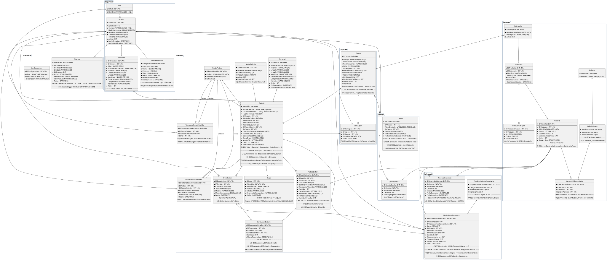

# ShopCart

Plataforma web de ventas con catálogo, carrito de compras, cupones, checkout, gestión de pedidos, inventario con kardex, reportes y bitácora. Proyecto del **Tech Challenge 360** (Grupo Pentandra).

## Ambiente en línea

El proyecto está desplegado y en funcionamiento, publicado con un túnel de Cloudflare (ver [Integración y despliegue continuos](#integración-y-despliegue-continuos)):

| Qué | URL |
| :--- | :--- |
| Aplicación web (Fase 2, en desarrollo) | <https://shopcart.dou2020.com/> |
| Documentación interactiva de la API (Swagger, permite probar los endpoints) | <https://api-shopcart.dou2020.com/api/docs/> |
| Estado del servicio y de sus conexiones a SQL Server y Redis | <https://shopcart.dou2020.com/api/health> |

Para iniciar sesión usa los usuarios de [Credenciales de prueba](#credenciales-de-prueba). En Swagger, `POST /auth/login` devuelve el access token; con el botón **Authorize** se envía en las demás peticiones.

## Contenido

1. [Stack](#stack)
2. [Estructura del repositorio](#estructura-del-repositorio)
3. [Librerías](#librerías)
4. [Inicializar y ejecutar el proyecto](#inicializar-y-ejecutar-el-proyecto)
5. [Backend](#backend) (detalle en [Backend/README.md](Backend/README.md))
6. [Frontend](#frontend) (detalle en [Frontend/README.md](Frontend/README.md))
7. [Base de datos](#base-de-datos) (detalle en [Database/README.md](Database/README.md))
8. [Documentación de la API](#documentación-de-la-api)

---

## Stack

| Capa | Tecnología |
| :--- | :--- |
| Base de datos | Microsoft SQL Server 2019 o superior |
| Backend | Node.js 24 LTS, TypeScript (modo `strict`), Express |
| Acceso a datos | Solo stored procedures, invocados con `mssql` y parámetros tipados |
| Validación | `zod` (body, query, params y variables de entorno) |
| Autenticación | Access token JWT de corta duración y refresh token con rotación en cookie `httpOnly` |
| Redis | Redis 7.4: sesiones, revocación de tokens, bloqueo de login, rate limiting y caché. No guarda datos de negocio |
| Frontend | React 18 o superior con TypeScript |

---

## Estructura del repositorio

```
ShopCart/
├── Backend/        # API REST en Node.js + TypeScript (Fase 1)
│   ├── README.md   # Librerías, ejecución local, arquitectura, Redis y pruebas
│   └── API.md      # Referencia de todos los endpoints
├── Database/       # Scripts SQL numerados, pruebas de integridad y docker-init.sh que los ejecuta
│   └── README.md   # Diseño de la base, cómo crearla y diagrama entidad-relación
├── Frontend/       # Aplicación React (Fase 2)
│   └── README.md   # Librerías, cómo ejecutarlo y estructura de carpetas
├── docker-compose.yml
├── .env.example    # Variables de docker compose
└── README.md
```

---

## Librerías

Cada parte documenta sus librerías con la versión elegida y el motivo de cada una:

- [Backend](Backend/README.md#librerías): producción, desarrollo y pruebas
- [Frontend](Frontend/README.md#librerías): aplicación, build y pruebas

---

## Inicializar y ejecutar el proyecto

Hay dos formas de levantar el proyecto en una máquina limpia: con **Docker Compose** (solo requiere Docker) o **manual** (Node y sqlcmd instalados en la máquina).

### Opción rápida: Docker Compose

Requisito: Docker con Docker Compose v2 (`docker compose version`).

```bash
cp .env.example .env          # ajusta contraseñas y JWT_ACCESS_SECRET
docker compose up -d          # SQL Server + creación de la base
docker compose --profile app up -d --build  # backend + frontend
docker compose logs -f db-init # ver que la base se creó correctamente
```

`db-init` espera a que SQL Server esté listo, ejecuta `Database/scripts` en orden y termina. Cuando muestra *Base de datos ShopCart creada correctamente.*, la base está lista en `localhost:1433`.

Con el backend y el frontend implementados, se levantan junto con la base usando el perfil `app`:

```bash
docker compose --profile app up -d --build
```

| Servicio | Perfil | Puerto | Descripción |
| :--- | :--- | :--- | :--- |
| `sqlserver` | — | `SQL_PORT` (1433) | SQL Server 2022 Developer, datos en el volumen `sqlserver-data` |
| `db-init` | — | — | Crea la base si no existe y termina |
| `redis` | — | `REDIS_PORT` (6379) | Redis 7.4 con persistencia AOF, datos en el volumen `redis-data` |
| `mailpit` | — | `MAILPIT_UI_PORT` (8025) | SMTP de desarrollo (puerto 1025 dentro de la red de compose): recibe los correos sin enviarlos. Bandeja web en `http://localhost:8025`, API en `/api/v1/messages` |
| `backend` | `app` | `BACKEND_PORT` (4000) | API; arranca cuando `db-init` terminó bien. Las imágenes de producto subidas viven en el volumen `imagenes` |
| `frontend` | `app` | `FRONTEND_PORT` (8080) | Sitio servido por nginx; reenvía `/api` (también `/api/imagenes`) al backend |

Todos los puertos se publican en `PUERTOS_HOST` (por defecto `127.0.0.1`), así que solo se alcanzan desde la misma máquina: SQL Server, Redis y la bandeja de Mailpit, que muestra los enlaces de contraseña, no quedan expuestos en la red. Con `PUERTOS_HOST=0.0.0.0` se publican en todas las interfaces. No lo uses en un servidor: Docker se salta las reglas de `ufw`.

El registro y la recuperación de contraseña mandan un correo con un enlace. En desarrollo ábrelo en la bandeja de Mailpit; con el túnel o en producción configura `SMTP_*` con un proveedor real. Las imágenes subidas se guardan en el disco del servidor (volumen `imagenes`), no en un almacenamiento externo; el límite de tamaño de nginx para esas subidas se explica en [Frontend/README.md](Frontend/README.md#con-docker-compose).

Comandos útiles:

| Comando | Para |
| :--- | :--- |
| `docker compose ps` | Ver el estado de los servicios |
| `DB_RESET=true docker compose run --rm db-init` | Borrar y volver a crear la base con los datos iniciales |
| `DB_PRUEBAS=true docker compose run --rm db-init` | Ejecutar las pruebas de integridad de la base (`Database/pruebas`); no deja datos |
| `docker compose down` | Detener todo y conservar los datos |
| `docker compose down -v` | Detener todo y borrar el volumen de la base |

`docker compose up` no borra la base en cada arranque: `db-init` la crea solo si no existe. En equipos con Apple Silicon, la imagen de SQL Server corre emulada (`platform: linux/amd64`).

#### Integración y despliegue continuos

El workflow `.github/workflows/ci-despliegue.yml` se ejecuta en cada pull request y en cada push a `main`:
- **Backend:** typecheck, lint, formato, pruebas unitarias y pruebas de integración (testcontainers levanta SQL Server y Redis, y además corre `Database/pruebas`).
- **Frontend:** typecheck, lint, formato, pruebas y build.
- **Despliegue:** si todo pasa en `main`, el job `despliegue` corre en un runner self-hosted del servidor (etiqueta `shopcart`). Ejecuta `docker compose --profile app up -d --build` con el `.env` del servidor (`/opt/shopcart/.env`, fuera del repo) y espera a que `/api/health` responda a través de nginx.

El sitio se publica con un túnel de Cloudflare gestionado en el host (`cloudflared` como servicio de systemd), fuera de docker compose. Las copias de referencia de su configuración están en `.cloudflared/` y las credenciales del túnel nunca se versionan. En el `.env` del servidor, `APP_URL_PUBLICA` y `CORS_ORIGIN` llevan la URL pública del túnel, y `FRONTEND_PORT` y `BACKEND_PORT` deben coincidir con los puertos de `.cloudflared/shopcart.yml`. El despliegue no migra una base existente: un cambio de tablas requiere `DB_RESET=true … run --rm db-init` manual, que borra los datos.

### Opción manual

Sin Docker Compose, cada parte se levanta por separado, con Node y `sqlcmd` instalados en la máquina:

1. **SQL Server, la base y el backend:** [Ejecutar en local](Backend/README.md#ejecutar-en-local) en `Backend/README.md` (requisitos, SQL Server, creación de la base, `.env`, scripts de npm y verificación). Las demás formas de crear la base están en [Database/README.md](Database/README.md#crear-la-base-de-datos).
2. **Frontend:** [En desarrollo](Frontend/README.md#en-desarrollo) en `Frontend/README.md`.

Si algo falla al arrancar (conexión a SQL Server, Redis o variables del `.env`), revisa [Problemas comunes](Backend/README.md#problemas-comunes).

### Credenciales de prueba

Creadas por `090_datos_semilla.sql`:

| Rol | Correo | Contraseña | Uso |
| :--- | :--- | :--- | :--- |
| Administrador | `admin@shopcart.gt` | `Admin#2026` | |
| Operador | `operador@shopcart.gt` | `Operador#2026` | |
| Cliente | `cliente@shopcart.gt` | `Cliente#2026` | Dos direcciones (Casa y Oficina) y dos tarjetas guardadas: VISA crédito `4242` (predeterminada) y MASTERCARD débito `5454` |
| Cliente | `cliente2@shopcart.gt` | `Cliente#2026` | Segundo cliente: sus recursos son ajenos para `cliente@` (404) |
| Cliente (inactivo) | `inactivo@shopcart.gt` | `Cliente#2026` | Login responde `403 USUARIO_INACTIVO` |
| Cliente | `cliente3@shopcart.gt` | `Cliente#2026` | Dueño de los 7 pedidos de ejemplo (usuario 6, dirección 5) |

Cupones de prueba (las vigencias se calculan desde la fecha en que se crea la base):

| Código | Regla | Para probar |
| :--- | :--- | :--- |
| `BIENVENIDA10` | 10 % sobre todo el carrito, vigente | Cupón válido |
| `VERANO25` | Q25.00 en la categoría Camisetas, compra mínima de Q300.00 | `CUPON_NO_APLICA`, `CUPON_MINIMO_NO_ALCANZADO` |
| `VENCIDO5` | 5 %, su vigencia terminó ayer | `CUPON_VENCIDO` |
| `AGOTADO5` | 5 %, límite total de 1 uso ya alcanzado | `CUPON_AGOTADO` |
| `PROXIMO15` | 15 %, empieza en 30 días | `CUPON_NO_VIGENTE` |
| `INACTIVO5` | 5 %, desactivado | `CUPON_INACTIVO` |

Pedidos de ejemplo del cliente 6 (`cliente3@`), creados con los SPs reales y con las fechas repartidas (relativas al día en que se crea la base; las horas son UTC):

| IDPedido | Creado | Estado | Contenido |
| :---: | :--- | :--- | :--- |
| 1 | hace 12 días, 15:30 | `ENTREGADO` | 2 × `CAM-BAS-NEG-M` + 1 × `PAN-JOG-GRI-M`, envío Estándar |
| 2 | hace 9 días, **02:00** | `ENTREGADO` | `PAN-JEA-AZU-30` + `ACC-GOR-NEG-U`, Express. Son las 20:00 del día anterior en Guatemala: prueba la agrupación por fecha local |
| 3 | hace 8 días, 14:00 | `CANCELADO` | 4 × `CAM-BAS-BLA-M` con `VERANO25` (la cancelación reintegró la existencia y liberó el cupón) |
| 4 | hace 6 días, 16:00 | `ENTREGADO` | 4 × `CAM-BAS-BLA-M` + `ACC-GOR-ROJ-U` con `VERANO25` (deja `UsosActuales = 1`) |
| 5 | hace 4 días, 18:00 | `DEVUELTO_PARCIAL` | 3 × `CAM-BAS-AZU-L` + 2 × `ACC-GOR-ROJ-U`; se devolvió 1 × `CAM-BAS-AZU-L` (Q95.00) |
| 6 | hace 2 días, 09:00 | `EN_PREPARACION` | `PAN-JOG-NEG-L` + `PAN-JEA-NEG-34`, Express |
| 7 | hace 1 día, 10:00 | `PAGADO` | `CAM-BAS-NEG-M` + `PAN-JEA-AZU-32`, recoger en tienda |

Cómo la semilla reescribe las fechas y comprueba existencias y cupones: [Datos semilla](Database/README.md#datos-semilla).

Catálogo de ejemplo: 4 categorías, atributos Talla y Color, 7 productos (uno inactivo, `Bufanda de lana`) y 16 variantes con su existencia inicial en el kardex. Variantes útiles para pruebas: `CAM-LIM-NEG-M` tiene una sola unidad (compra concurrente de la última unidad), `CAL-TEN-NEG-41` está inactiva con 5 unidades y `CAL-TEN-BLA-42` está agotada.

---

## Backend

La documentación del backend está en [Backend/README.md](Backend/README.md):

- [Librerías](Backend/README.md#librerías) de producción, desarrollo y pruebas
- [Ejecutar en local](Backend/README.md#ejecutar-en-local): requisitos, variables del `.env` y scripts de npm
- [Estructura del proyecto](Backend/README.md#estructura-del-proyecto), [responsabilidad de cada capa](Backend/README.md#responsabilidad-de-cada-capa) y [flujo de una petición](Backend/README.md#flujo-de-una-petición)
- [Redis](Backend/README.md#redis): claves, TTL, sesiones, caché y qué pasa si falla
- [Pruebas](Backend/README.md#pruebas): unitarias, de integración y su relación con los criterios RF-01 a RF-09

El backend no contiene SQL: todo el acceso a datos pasa por `executeSp`, que solo ejecuta stored procedures, y el login `shopcart_app` solo tiene permiso `EXECUTE`.

---

## Frontend

La documentación del frontend (Fase 2) está en [Frontend/README.md](Frontend/README.md):

- [Librerías](Frontend/README.md#librerías) de la aplicación, del build y de pruebas
- [Ejecutar](Frontend/README.md#ejecutar) con Docker Compose (nginx) o en desarrollo (Vite)
- [Estructura](Frontend/README.md#estructura) de carpetas y convenciones

---

## Base de datos

La documentación de la base de datos está en [Database/README.md](Database/README.md):

- [Cómo crearla](Database/README.md#crear-la-base-de-datos): Docker Compose, `docker-init.sh` o `script.sql` (SSMS / sqlcmd)
- [Catálogos y datos semilla](Database/README.md#datos-iniciales)
- [Tablas por módulo](Database/README.md#tablas-por-módulo) y [diagrama entidad-relación](Database/README.md#diagrama-entidad-relación)
- [Ciclo de vida del pedido](Database/README.md#ciclo-de-vida-del-pedido), [reglas de integridad](Database/README.md#reglas-de-integridad-en-la-base) y [normalización](Database/README.md#normalización)
- [Patrón de los stored procedures que escriben](Database/README.md#patrón-de-los-stored-procedures-que-escriben), [vistas y funciones](Database/README.md#vistas-y-funciones) e [índices](Database/README.md#índices-principales)
- [Pruebas de integridad](Database/README.md#pruebas-de-integridad)

[](Database/README.md#diagrama-entidad-relación)

---

## Documentación de la API

La referencia completa de endpoints, con accesos por rol, stored procedure de cada uno, ejemplos y códigos de error, está en [Backend/API.md](Backend/API.md). Con el backend corriendo, la especificación interactiva está en `http://localhost:4000/api/docs`.
