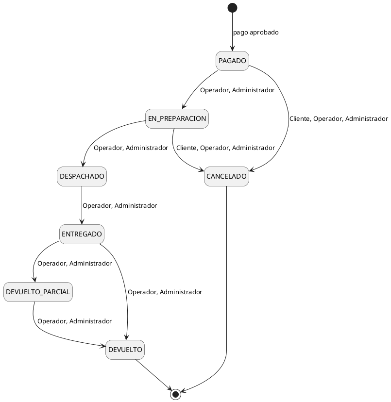

# ShopCart

Plataforma web de ventas con catálogo, carrito de compras, cupones, checkout, gestión de pedidos, inventario con kardex, reportes y bitácora. Proyecto del **Tech Challenge 360** (Grupo Pentandra).

## Contenido

1. [Stack](#stack)
2. [Estructura del repositorio](#estructura-del-repositorio)
3. [Librerías](#librerías)
4. [Inicializar y ejecutar el proyecto](#inicializar-y-ejecutar-el-proyecto)
5. [Estructura del backend](#estructura-del-backend) (incluye [Pruebas](#pruebas))
6. [Estructura de la base de datos](#estructura-de-la-base-de-datos)
7. [Documentación de la API](#documentación-de-la-api)

---

## Stack

| Capa | Tecnología |
| :--- | :--- |
| Base de datos | Microsoft SQL Server 2019 o superior |
| Backend | Node.js 24 LTS, TypeScript (modo `strict`), Express |
| Acceso a datos | Solo stored procedures, invocados con `mssql` y parámetros tipados |
| Validación | `zod` (body, query, params y variables de entorno) |
| Autenticación | Access token JWT de corta duración y refresh token con rotación en cookie `httpOnly` |
| Redis | Redis 7.4: sesiones, revocación de tokens, bloqueo de login, rate limiting y caché. No guarda datos de negocio |
| Frontend | React 18 o superior con TypeScript |

---

## Estructura del repositorio

```
ShopCart/
├── Backend/        # API REST en Node.js + TypeScript (Fase 1)
│   └── API.md      # Referencia de todos los endpoints
├── Database/       # Scripts SQL numerados, pruebas de integridad y docker-init.sh que los ejecuta
├── Frontend/       # Aplicación React (Fase 2)
├── docker-compose.yml
├── .env.example    # Variables de docker compose
└── README.md
```

---

## Librerías

La columna **Línea** indica la versión mayor.menor elegida. Las versiones exactas se fijan al instalar (`npm install --save-exact`) y quedan en `package-lock.json`, así que `npm ci` instala siempre lo mismo.

### Backend — producción

| Librería | Línea | Uso y motivo |
| :--- | :--- | :--- |
| `express` | 5.3 | Servidor HTTP. Express 5 envía al `errorHandler` los errores de handlers `async` sin envolverlos |
| `mssql` | 12.7 | Conexión a SQL Server; `executeSp` la usa para ejecutar SPs con parámetros tipados |
| `zod` | 4.6 | Validación de body, query, params y de las variables de entorno |
| `jsonwebtoken` | 9.0 | Firma y verificación del access token |
| `argon2` | 0.45 | Hash de contraseñas con Argon2id |
| `helmet` | 8.3 | Cabeceras de seguridad básicas |
| `cors` | 2.8 | CORS con origen explícito y `credentials: true` para la cookie de refresh |
| `cookie-parser` | 1.4 | Lectura de la cookie del refresh token |
| `express-rate-limit` | 8.7 | Límite de intentos en login y registro (extra opcional) |
| `redis` | 6.3 | Cliente oficial de Redis (node-redis): sesiones, revocación, bloqueo de login y caché |
| `rate-limit-redis` | 6.0 | Guarda los contadores de `express-rate-limit` en Redis: sobreviven reinicios y se comparten entre instancias |
| `pino`, `pino-http` | 10.4 / 11.0 | Logs en JSON con un `requestId` por petición |
| `swagger-ui-express`, `yaml` | 5.0 / 2.9 | Sirven `openapi.yaml` en `/api/docs` |

No se necesitan:
- **`dotenv`**: Node 24 carga el `.env` con `--env-file`.
- **Librería de UUID**: se usa `crypto.randomUUID()`.
- **Librería de cron**: el job de reservas usa `setInterval`.

### Backend — desarrollo

| Librería | Línea | Uso y motivo |
| :--- | :--- | :--- |
| `typescript` | 6.0 | Compilador en modo `strict`. Se usa 6.0 y no 7.0 porque `typescript-eslint` 8.72 solo soporta TypeScript `< 6.1` |
| `tsx` | 4.23 | Ejecuta TypeScript con recarga automática en `npm run dev` |
| `@types/node` | 24 | Tipos de Node, en la misma línea que el runtime (Node 24 LTS) |
| `@types/express`, `@types/mssql`, `@types/jsonwebtoken`, `@types/cookie-parser`, `@types/cors`, `@types/swagger-ui-express` | — | Tipos de las librerías de producción |
| `eslint`, `@eslint/js`, `typescript-eslint` | 10.13 / 10.0 / 8.72 | Análisis estático con reglas para TypeScript |
| `prettier` | 3.9 | Formato del código |

### Backend — pruebas

| Librería | Línea | Uso y motivo |
| :--- | :--- | :--- |
| `vitest` | 5.0 | Runner de pruebas unitarias y de integración; ejecuta TypeScript sin compilar y simula módulos con `vi.mock` |
| `@vitest/coverage-v8` | 5.0 | Reporte de cobertura |
| `supertest`, `@types/supertest` | 7.3 / 7.2 | Peticiones HTTP contra la app Express sin abrir un puerto |
| `testcontainers`, `@testcontainers/mssqlserver`, `@testcontainers/redis` | 12.2 | Levantan un SQL Server y un Redis desechables en Docker para las pruebas de integración; en SQL Server se ejecutan los scripts de `Database/` |

### Frontend (Fase 2)

| Librería | Línea | Uso y motivo |
| :--- | :--- | :--- |
| `react`, `react-dom` | 19.3 | Interfaz |
| `react-router` | 8.5 | Rutas y rutas protegidas por rol |
| `@tanstack/react-query` | 5.105 | Datos del servidor: caché, estados de carga y error, invalidación |
| `react-hook-form`, `@hookform/resolvers`, `zod` | 7.91 / 6.0 / 4.6 | Formularios con validación y mensajes por campo |
| `recharts` | 3.10 | Gráficas del dashboard |
| `tailwindcss`, `@tailwindcss/vite` | 4.3 | Estilos |
| `lucide-react` | 1.62 | Íconos |
| `vite`, `@vitejs/plugin-react` | 8.3 / 6.1 | Servidor de desarrollo y build (desarrollo) |
| `typescript`, `eslint` | 6.0 / 10.13 | Tipado y análisis estático (desarrollo) |
| `jspdf`, `jspdf-autotable`, `exceljs` | 4.2 / 5.0 / 4.4 | Exportación de reportes a PDF y Excel (extra opcional); se cargan solo al exportar |

---

## Inicializar y ejecutar el proyecto

Hay dos formas de levantar el proyecto en una máquina limpia: con **Docker Compose** (solo requiere Docker) o **manual** (Node y sqlcmd instalados en la máquina).

### Opción rápida: Docker Compose

Requisito: Docker con Docker Compose v2 (`docker compose version`).

```bash
cp .env.example .env          # ajusta contraseñas y JWT_ACCESS_SECRET
docker compose up -d          # SQL Server + creación de la base
docker compose logs -f db-init
```

`db-init` espera a que SQL Server esté listo, ejecuta `Database/scripts` en orden y termina. Cuando muestra *Base de datos ShopCart creada correctamente.*, la base está lista en `localhost:1433`.

Con el backend y el frontend implementados, se levantan junto con la base usando el perfil `app`:

```bash
docker compose --profile app up -d --build
```

| Servicio | Perfil | Puerto | Descripción |
| :--- | :--- | :--- | :--- |
| `sqlserver` | — | `SQL_PORT` (1433) | SQL Server 2022 Developer, datos en el volumen `sqlserver-data` |
| `db-init` | — | — | Crea la base si no existe y termina |
| `redis` | — | `REDIS_PORT` (6379) | Redis 7.4 con persistencia AOF, datos en el volumen `redis-data` |
| `backend` | `app` | `BACKEND_PORT` (4000) | API; arranca cuando `db-init` terminó bien |
| `frontend` | `app` | `FRONTEND_PORT` (8080) | Sitio servido por nginx; reenvía `/api` al backend |

Comandos útiles:

| Comando | Para |
| :--- | :--- |
| `docker compose ps` | Ver el estado de los servicios |
| `DB_RESET=true docker compose run --rm db-init` | Borrar y volver a crear la base con los datos iniciales |
| `DB_PRUEBAS=true docker compose run --rm db-init` | Ejecutar las pruebas de integridad de la base (`Database/pruebas`); no deja datos |
| `docker compose down` | Detener todo y conservar los datos |
| `docker compose down -v` | Detener todo y borrar el volumen de la base |

`docker compose up` no borra la base en cada arranque: `db-init` la crea solo si no existe. En equipos con Apple Silicon, la imagen de SQL Server corre emulada (`platform: linux/amd64`).

### Opción manual

### 1. Requisitos previos

| Herramienta | Versión | Verificar con |
| :--- | :--- | :--- |
| Node.js | 24 LTS (definida en `Backend/.nvmrc`) | `node -v` |
| npm | La que trae Node 24 | `npm -v` |
| SQL Server | 2019 o superior (local o en Docker) | — |
| Redis | 7.4 o superior; lo más simple es `docker compose up -d redis` | `redis-cli ping` |
| sqlcmd | `mssql-tools18` o el `sqlcmd` (go) | `sqlcmd -?` |
| Docker | Para levantar SQL Server sin instalarlo y para las pruebas de integración | `docker -v` |

Si usas `nvm`, instala y activa la versión del proyecto:

```bash
cd Backend
nvm install   # lee .nvmrc
nvm use
```

### 2. Levantar SQL Server

Si ya tienes una instancia de SQL Server 2019 o superior, salta al paso 3. Si no, con Docker:

```bash
docker run -d --name shopcart-sql \
  -e "ACCEPT_EULA=Y" \
  -e "MSSQL_SA_PASSWORD=ShopCart#Local2026" \
  -p 1433:1433 \
  mcr.microsoft.com/mssql/server:2022-latest
```

Espera unos segundos a que el servidor arranque (`docker logs -f shopcart-sql` muestra *SQL Server is now ready for client connections*).

### 3. Crear la base de datos

El script `Database/docker-init.sh` (el mismo que usa docker compose) ejecuta en orden todos los archivos de `Database/scripts/`: crea la base `ShopCart`, sus tablas, índices, triggers, funciones, vistas, stored procedures, el usuario de la aplicación y los datos semilla.

```bash
cd Database
DB_SERVER=localhost,1433 \
DB_USER=sa \
DB_PASSWORD='ShopCart#Local2026' \
APP_DB_PASSWORD='ShopCartApp#2026' \
./docker-init.sh
```

| Variable | Uso |
| :--- | :--- |
| `DB_SERVER` | Servidor y puerto (`host,puerto`) |
| `DB_USER`, `DB_PASSWORD` | Usuario administrador con el que se crean los objetos |
| `APP_DB_PASSWORD` | Contraseña del login `shopcart_app` que usará el backend |
| `DB_NAME` | Opcional; nombre de la base (por defecto `ShopCart`) |
| `DB_RESET` | Opcional; `true` para borrar y volver a crear la base aunque ya exista |
| `DB_PRUEBAS` | Opcional; `true` para ejecutar `Database/pruebas` al terminar. Comprueba que la base rechace los datos que rompen las reglas y no deja filas |

> Si la base ya existe, el script la conserva (con `DB_PRUEBAS=true` solo ejecuta las pruebas). Con `DB_RESET=true`, `001_crear_base_datos.sql` **la elimina y la vuelve a crear** en su estado inicial con los datos semilla.

Si no tienes `sqlcmd` instalado, puedes ejecutarlo dentro del contenedor:

```bash
docker cp Database shopcart-sql:/tmp/Database
docker exec -it \
  -e DB_SERVER=localhost -e DB_USER=sa \
  -e DB_PASSWORD='ShopCart#Local2026' -e APP_DB_PASSWORD='ShopCartApp#2026' \
  shopcart-sql bash /tmp/Database/docker-init.sh
```

### 4. Configurar el backend

```bash
cd Backend
cp .env.example .env
npm ci
```

Edita `.env` con los datos de tu entorno:

| Variable | Ejemplo | Descripción |
| :--- | :--- | :--- |
| `NODE_ENV` | `development` | `development`, `test` o `production` |
| `PORT` | `4000` | Puerto del API |
| `DB_SERVER` | `localhost` | Host de SQL Server |
| `DB_PORT` | `1433` | Puerto de SQL Server |
| `DB_NAME` | `ShopCart` | Nombre de la base |
| `DB_USER` | `shopcart_app` | Login de la aplicación (solo tiene permiso `EXECUTE`) |
| `DB_PASSWORD` | `'ShopCartApp#2026'` | Debe coincidir con `APP_DB_PASSWORD` del paso 3. **Entre comillas**: sin ellas, Node toma lo que sigue a `#` como comentario |
| `DB_ENCRYPT` | `true` | Cifrado de la conexión |
| `DB_TRUST_SERVER_CERTIFICATE` | `true` | `true` solo en local (certificado autofirmado) |
| `JWT_ACCESS_SECRET` | *(cadena aleatoria de 64+ caracteres)* | Firma de los access tokens |
| `JWT_ACCESS_EXPIRES_IN` | `15m` | Vigencia del access token |
| `REFRESH_TOKEN_DAYS` | `7` | Vigencia del refresh token |
| `CORS_ORIGIN` | `http://localhost:5173` | Origen permitido del frontend |
| `RESERVAS_JOB_INTERVAL_MS` | `60000` | Cada cuánto se liberan las reservas vencidas |
| `REDIS_URL` | `redis://localhost:6379` | Conexión a Redis |
| `CACHE_ENABLED` | `true` | `false` desactiva la caché (las sesiones siguen en Redis) |
| `CACHE_TTL_REPORTES_SEG` | `300` | Vigencia de la caché de reportes |
| `CACHE_TTL_CATALOGO_SEG` | `600` | Vigencia de la caché del catálogo público |
| `LOGIN_MAX_INTENTOS` | `5` | Intentos fallidos antes de bloquear la cuenta |
| `LOGIN_BLOQUEO_MIN` | `15` | Minutos de bloqueo tras superar los intentos |
| `RATE_LIMIT_AUTH_MAX` | `10` | Solicitudes por IP a login y a registro en cada ventana; `0` desactiva el límite |
| `RATE_LIMIT_AUTH_VENTANA_MIN` | `15` | Duración de la ventana del rate limit |

Para generar un secreto:

```bash
node -e "console.log(require('crypto').randomBytes(48).toString('base64'))"
```

`config/env.ts` valida estas variables al arrancar: si falta alguna o tiene un formato inválido, el servidor no inicia y muestra cuál es.

### 5. Ejecutar el backend

```bash
npm run dev
```

| Script | Descripción |
| :--- | :--- |
| `npm run dev` | Servidor en modo desarrollo con recarga automática (`tsx watch --env-file=.env src/server.ts`) |
| `npm run build` | Compila TypeScript a `dist/` (`tsconfig.build.json`) |
| `npm start` | Ejecuta la versión compilada (`node --env-file-if-exists=.env dist/server.js`; en Docker las variables vienen de compose) |
| `npm run typecheck` | Verifica tipos sin compilar |
| `npm run lint` | Revisa el código con ESLint |
| `npm run format` | Formatea el código con Prettier |
| `npm test` | Ejecuta las pruebas unitarias y de integración |
| `npm run test:unit` | Solo pruebas unitarias (no necesitan base de datos) |
| `npm run test:integration` | Solo pruebas de integración (necesitan Docker o `TEST_DB_SERVER`) |
| `npm run test:coverage` | Todas las pruebas con reporte de cobertura en `coverage/` |

### 6. Verificar

```bash
curl http://localhost:4000/api/health
```

Debe responder con el estado del servicio y de la conexión a la base. La documentación interactiva queda en `http://localhost:4000/api/docs`.

### Credenciales de prueba

Creadas por `090_datos_semilla.sql`:

| Rol | Correo | Contraseña | Uso |
| :--- | :--- | :--- | :--- |
| Administrador | `admin@shopcart.gt` | `Admin#2026` | |
| Operador | `operador@shopcart.gt` | `Operador#2026` | |
| Cliente | `cliente@shopcart.gt` | `Cliente#2026` | Dos direcciones (Casa y Oficina) |
| Cliente | `cliente2@shopcart.gt` | `Cliente#2026` | Segundo cliente: sus recursos son ajenos para `cliente@` (404) |
| Cliente (inactivo) | `inactivo@shopcart.gt` | `Cliente#2026` | Login responde `403 USUARIO_INACTIVO` |
| Cliente | `cliente3@shopcart.gt` | `Cliente#2026` | Dueño de los 7 pedidos de ejemplo (usuario 6, dirección 5) |

Cupones de prueba (las vigencias se calculan desde la fecha en que se crea la base):

| Código | Regla | Para probar |
| :--- | :--- | :--- |
| `BIENVENIDA10` | 10 % sobre todo el carrito, vigente | Cupón válido |
| `VERANO25` | Q25.00 en la categoría Camisetas, compra mínima de Q300.00 | `CUPON_NO_APLICA`, `CUPON_MINIMO_NO_ALCANZADO` |
| `VENCIDO5` | 5 %, su vigencia terminó ayer | `CUPON_VENCIDO` |
| `AGOTADO5` | 5 %, límite total de 1 uso ya alcanzado | `CUPON_AGOTADO` |
| `PROXIMO15` | 15 %, empieza en 30 días | `CUPON_NO_VIGENTE` |
| `INACTIVO5` | 5 %, desactivado | `CUPON_INACTIVO` |

Pedidos de ejemplo del cliente 6 (`cliente3@`), creados con los SPs reales y con las fechas repartidas (relativas al día en que se crea la base; las horas son UTC):

| IDPedido | Creado | Estado | Contenido |
| :---: | :--- | :--- | :--- |
| 1 | hace 12 días, 15:30 | `ENTREGADO` | 2 × `CAM-BAS-NEG-M` + 1 × `PAN-JOG-GRI-M`, envío Estándar |
| 2 | hace 9 días, **02:00** | `ENTREGADO` | `PAN-JEA-AZU-30` + `ACC-GOR-NEG-U`, Express. Son las 20:00 del día anterior en Guatemala: prueba la agrupación por fecha local |
| 3 | hace 8 días, 14:00 | `CANCELADO` | 4 × `CAM-BAS-BLA-M` con `VERANO25` (la cancelación reintegró la existencia y liberó el cupón) |
| 4 | hace 6 días, 16:00 | `ENTREGADO` | 4 × `CAM-BAS-BLA-M` + `ACC-GOR-ROJ-U` con `VERANO25` (deja `UsosActuales = 1`) |
| 5 | hace 4 días, 18:00 | `DEVUELTO_PARCIAL` | 3 × `CAM-BAS-AZU-L` + 2 × `ACC-GOR-ROJ-U`; se devolvió 1 × `CAM-BAS-AZU-L` (Q95.00) |
| 6 | hace 2 días, 09:00 | `EN_PREPARACION` | `PAN-JOG-NEG-L` + `PAN-JEA-NEG-34`, Express |
| 7 | hace 1 día, 10:00 | `PAGADO` | `CAM-BAS-NEG-M` + `PAN-JEA-AZU-32`, recoger en tienda |

Los SPs graban la fecha actual; la semilla reescribe las fechas como `sa`, con los triggers de inmutabilidad deshabilitados dentro de su transacción y habilitados otra vez antes del `COMMIT`, y mueve a 30 días atrás el `INVENTARIO_INICIAL` de las variantes vendidas para que el kardex quede en orden cronológico. Al final comprueba que cada existencia coincide con su kardex y sus reservas, y cada `UsosActuales` con `UsoCupon`. Las variantes y los clientes de las pruebas (`CAM-LIM-NEG-M`, `BIENVENIDA10`, `AGOTADO5`, clientes 3 y 4) no se tocan.

Catálogo de ejemplo: 4 categorías, atributos Talla y Color, 7 productos (uno inactivo, `Bufanda de lana`) y 16 variantes con su existencia inicial en el kardex. Variantes útiles para pruebas: `CAM-LIM-NEG-M` tiene una sola unidad (compra concurrente de la última unidad), `CAL-TEN-NEG-41` está inactiva con 5 unidades y `CAL-TEN-BLA-42` está agotada.

### Problemas comunes

| Síntoma | Solución |
| :--- | :--- |
| `self-signed certificate` al conectar | En local, `DB_TRUST_SERVER_CERTIFICATE=true` |
| `Login failed for user 'shopcart_app'` | `DB_PASSWORD` del `.env` no coincide con `APP_DB_PASSWORD` usado en el paso 3 |
| `ECONNREFUSED 127.0.0.1:1433` | SQL Server no está corriendo o aún está arrancando |
| Login y rutas autenticadas responden `503 SERVICIO_NO_DISPONIBLE` | Redis no responde; revisa `docker compose ps redis`. El catálogo público sigue funcionando sin caché |
| `Bind for 127.0.0.1:6379 failed: port is already allocated` | Otro Redis usa ese puerto; cambia `REDIS_PORT` en `.env` (y `REDIS_URL` si corres el backend fuera de Docker) |
| El servidor no inicia y lista variables | Falta o es inválida una variable del `.env` |

---

## Estructura del backend

El backend está organizado **por módulo de negocio** y, dentro de cada módulo, **por capas**.

```
Backend/
├── src/
│   ├── app.ts                    # Configura Express: helmet, cors, cookies, json, rutas y errorHandler
│   ├── server.ts                 # Arranque del servidor, del job de reservas y cierre ordenado del pool
│   ├── config/
│   │   ├── env.ts                # Variables de entorno validadas con zod
│   │   ├── logger.ts             # Logger pino (JSON); oculta Authorization y cookies
│   │   ├── database.ts           # Pool de conexiones mssql
│   │   └── redis.ts              # Cliente de Redis con reconexión automática
│   ├── db/
│   │   ├── executeSp.ts          # Único punto de ejecución de stored procedures
│   │   └── sqlErrorMapper.ts     # Traduce THROW 50xxx de SQL Server a errores HTTP
│   ├── middlewares/
│   │   ├── authenticate.ts       # Verifica el access token y que no esté revocado en Redis (401)
│   │   ├── authorize.ts          # Control por rol (403 si no tiene permiso)
│   │   ├── validate.ts           # Valida body/query/params con un esquema zod
│   │   ├── idempotencyKey.ts     # Exige el header Idempotency-Key en el pago
│   │   ├── guestCart.ts          # Lee el header X-Cart-Token del carrito de invitado
│   │   ├── rateLimit.ts          # Límite por IP en login y registro, con store en Redis (extra)
│   │   ├── errorHandler.ts       # Manejo centralizado de errores
│   │   └── notFound.ts
│   ├── modules/
│   │   ├── auth/                 # Registro, login, refresh con rotación, logout
│   │   │   ├── sesiones.store.ts   # Sesiones en Redis y script Lua de rotación atómica
│   │   │   ├── revocacion.store.ts # Lista de access tokens revocados
│   │   │   └── intentos.store.ts   # Contador de intentos fallidos y bloqueo temporal
│   │   ├── perfil/               # Datos y contraseña del propio usuario
│   │   ├── usuarios/             # Gestión y desactivación de usuarios (Administrador)
│   │   ├── direcciones/          # Direcciones de entrega del cliente
│   │   ├── catalogo/             # Catálogo público, categorías, productos, variantes, atributos
│   │   ├── inventario/           # Existencias, kardex, entradas y ajustes
│   │   ├── carrito/              # Carrito de cliente e invitado, cupón aplicado
│   │   ├── cupones/              # CRUD de cupones (Administrador)
│   │   ├── checkout/             # Reserva de existencia y pago idempotente
│   │   ├── pedidos/              # Ciclo de vida, cancelación y devoluciones
│   │   ├── reportes/             # Dashboard y reportes de ventas
│   │   ├── bitacora/             # Consulta de la bitácora (Administrador)
│   │   ├── configuracion/        # Parámetros del sistema
│   │   └── sistema/              # Health check
│   ├── jobs/
│   │   └── liberarReservas.job.ts  # Ejecuta SP_Inventario_LiberarReservasVencidas periódicamente
│   ├── shared/
│   │   ├── cache/                # cache.ts (getOrSet, invalidar) y claves.ts (claves y namespaces)
│   │   ├── errors/               # AppError y catálogo de códigos de error
│   │   ├── utils/                # Paginación, montos, fechas (filtros desde/hasta), esquemas zod comunes
│   │   └── types/                # Extensiones de tipos de Express (usuario autenticado, token de carrito)
│   └── docs/
│       └── openapi.yaml          # Especificación OpenAPI servida en /api/docs
├── tests/                        # Ver "Pruebas"
│   ├── unit/
│   ├── integration/
│   ├── helpers/
│   └── setup/
├── API.md                        # Referencia de endpoints
├── Dockerfile                    # Imagen multi-stage (node:24-bookworm-slim) para docker compose
├── .env.example
├── .nvmrc                        # 24
├── .prettierrc
├── package.json
├── eslint.config.js
├── vitest.config.ts              # Proyectos de prueba: unit e integration
├── tsconfig.json                 # "strict": true, ESM (NodeNext); incluye src y tests
└── tsconfig.build.json           # Compilación a dist/ (solo src)
```

Cada módulo sigue la misma estructura:

```
modules/pedidos/
├── pedidos.routes.ts       # Endpoints, middlewares de auth, rol y validación
├── pedidos.controller.ts   # Lee la request, llama al servicio y responde
├── pedidos.service.ts      # Lógica de negocio
├── pedidos.repository.ts   # Llama a los stored procedures del módulo
├── pedidos.schemas.ts      # Esquemas zod de entrada
└── pedidos.types.ts        # Tipos y DTOs del módulo
```

### Responsabilidad de cada capa

| Capa | Responsabilidad | No debe |
| :--- | :--- | :--- |
| Rutas | Declarar endpoints, aplicar `authenticate`, `authorize` y `validate` | Contener lógica |
| Controlador | Traducir HTTP ↔ servicio (params, usuario autenticado, código de respuesta) | Contener reglas de negocio |
| Servicio | Reglas de negocio y orquestación entre repositorios | Conocer Express ni SQL |
| Repositorio | Invocar SPs con `executeSp('SP_Modulo_Proceso', params)` y mapear el resultado | Construir SQL |
| Stored procedure | Transacciones, bloqueos y reglas críticas de integridad | Concatenar SQL dinámico (solo `sp_executesql` con parámetros) |

### Flujo de una petición

```
Request → helmet/cors → authenticate → authorize(roles) → validate(schema)
        → controller → service → repository → executeSp → SQL Server (SP)
        ← respuesta JSON  ←  errorHandler (si algo falla: sqlErrorMapper → código HTTP)
```

**Regla:** el backend no contiene consultas SQL. Todo el acceso a datos pasa por `executeSp`, que solo acepta el nombre del SP y parámetros tipados. Además, el login `shopcart_app` solo tiene permiso `EXECUTE`: aunque alguien intentara ejecutar SQL directo, la base lo rechazaría.

### Redis

Redis guarda las sesiones, la revocación de tokens, el bloqueo de login, los contadores de rate limiting y la caché. **SQL Server sigue siendo la única fuente de verdad del negocio**: existencias, reservas, idempotencia del pago, cupones, pedidos y bitácora nunca pasan por Redis.

Todas las claves llevan el prefijo `shopcart:`.

| Uso | Claves | TTL |
| :--- | :--- | :--- |
| Sesión (refresh token) | `sesion:token:{sha256 del token}` → `{idUsuario, familia}` (se conserva tras rotar, para detectar la reutilización); `sesion:familia:{familia}` → `{idUsuario, tokenActual}`; `sesion:usuario:{idUsuario}` → familias activas del usuario | 7 días, renovados en cada rotación |
| Revocar un access token | `auth:revocado:jti:{jti}` (logout) | Vida restante del token (≤ 15 min) |
| Revocar todos los tokens de un usuario | `auth:revocado-desde:{idUsuario}` = segundo Unix; se rechazan los tokens emitidos en segundos anteriores (desactivación, cambio de contraseña o de rol) | 15 min |
| Bloqueo por intentos | `auth:intentos:{correo}`; con `LOGIN_MAX_INTENTOS` fallos → `429 CUENTA_BLOQUEADA` con `Retry-After`; se borra al iniciar sesión bien | `LOGIN_BLOQUEO_MIN` |
| Rate limit por IP | `ratelimit:login:{ip}` y `ratelimit:registro:{ip}` (store de `rate-limit-redis`, 10 por IP cada 15 min) | 15 min |
| Caché del usuario | `usuario:{id}` → rol, estado, nombre y correo; la usan `refresh` y `/me` | 15 min |
| Caché de reportes | `reportes:v{n}:{endpoint}:{hash de filtros}` | `CACHE_TTL_REPORTES_SEG` |
| Caché del catálogo público | `catalogo:v{n}:categorias`, `catalogo:v{n}:metodos-envio` | `CACHE_TTL_CATALOGO_SEG` |
| Caché de la configuración | `configuracion` | 1 h |

**Sesiones y tokens:**
- El access token JWT lleva `jti` (identificador único) y `sid` (familia de la sesión). `authenticate` verifica la firma y luego consulta en Redis, en una sola ida (`MULTI`), si el `jti` fue revocado, si la familia `sid` sigue existiendo y si el token es anterior a `revocado-desde` del usuario. Así, al terminar una sesión dejan de valer todos sus access tokens.
- El refresh token tiene la forma `<sid>.<secreto>`: la familia viaja en el token para que el script de rotación reciba todas sus claves.
- La rotación del refresh token es un **script Lua atómico**: si el token presentado es el `tokenActual` de su familia, emite uno nuevo y lo reemplaza; si no lo es (alguien reutilizó un token ya rotado), borra la familia completa y responde `401 REFRESH_INVALIDO`. Dos peticiones simultáneas con el mismo token no pueden rotarlo dos veces.
- Logout revoca el `jti` actual y borra la familia. Desactivar un usuario, cambiar su contraseña o su rol borra todas sus familias y fija `revocado-desde`.

**Caché:**
- Patrón *cache-aside*: el servicio llama `cache.getOrSet(clave, ttl, () => repositorio.consultar())`.
- **Invalidación por versión**: cada namespace (`reportes`, `catalogo`) tiene un contador. Invalidar es `INCR shopcart:reportes:version`; las claves anteriores dejan de leerse y expiran solas. Es atómico y no necesita recorrer claves.
- Se invalida en el servicio **después** de que el SP confirmó la transacción, nunca antes:

| Namespace | Se invalida al |
| :--- | :--- |
| `reportes` | Crear, cancelar o cambiar de estado un pedido, y registrar una devolución |
| `catalogo` | Crear, modificar, activar/desactivar o eliminar categorías y productos; crear o activar/desactivar variantes (lo que cambia qué categorías y cuántos productos se ven). Precios, SKU, valores de atributo e imágenes no están en lo cacheado |
| `usuario:{id}` | Actualizar perfil, rol o estado del usuario |
| `configuracion` | `PUT /api/configuracion/:clave` |

- La existencia disponible **nunca** se cachea: la búsqueda y el detalle de productos del catálogo público traen `disponible` y `existenciaDisponible`, así que se leen de la base en cada petición.
- Las respuestas cacheadas llevan el header `X-Cache: HIT` o `X-Cache: MISS`.

**Si Redis falla:**

| Función | Comportamiento |
| :--- | :--- |
| Sesiones, revocación y bloqueo de login | *Fail-closed*: login, registro, refresh, logout y rutas autenticadas responden `503 SERVICIO_NO_DISPONIBLE` (no se puede verificar si un token fue revocado). El registro lo comprueba antes de crear el usuario. El cliente de Redis no encola comandos mientras reconecta (`disableOfflineQueue`), así que la respuesta es inmediata |
| Rate limit por IP | Deja pasar la solicitud; login y registro igual responden `503` por la fila anterior |
| Caché | *Fail-open*: se registra el error y se lee de la base |
| `GET /api/health` | Reporta `redis: "down"` |

**Configuración del servidor** (en `docker-compose.yml`): persistencia AOF (`appendonly yes`, `appendfsync everysec`) para no perder sesiones al reiniciar, y `maxmemory 256mb` con `maxmemory-policy noeviction` para que Redis nunca expulse sesiones. Si la memoria se llena, fallan las escrituras de caché (que es fail-open) y no las sesiones existentes.

### Pruebas

Se usan **Vitest** como runner, **Supertest** para las peticiones HTTP y **Testcontainers** para levantar un SQL Server real durante las pruebas de integración.

```
Backend/tests/
├── unit/                         # Servicios y middlewares con repositorios simulados (vi.mock)
│   ├── carrito.service.test.ts   # Armado de la respuesta del carrito y elección usuario/token
│   ├── carrito.schemas.test.ts   # Esquemas del carrito y del cupón
│   ├── pedidos.service.test.ts
│   ├── inventario.service.test.ts
│   ├── liberarReservas.job.test.ts  # Sin solapamiento; un error no tumba el proceso
│   ├── sqlErrorMapper.test.ts
│   └── middlewares/              # authorize, validate, idempotencyKey
├── integration/                  # Endpoints de punta a punta con supertest
│   ├── auth.test.ts
│   ├── catalogo.test.ts
│   ├── direcciones.test.ts
│   ├── carrito.test.ts
│   ├── cupones.test.ts
│   ├── checkout.concurrencia.test.ts
│   ├── pedidos.test.ts
│   ├── inventario.test.ts
│   ├── reportes.test.ts
│   └── bitacora.test.ts
├── helpers/                      # Datos de prueba, login por rol y cliente HTTP autenticado
└── setup/
    └── globalSetup.ts            # Levanta el contenedor, crea la base con Database/, corre Database/pruebas y expone la conexión
```

| Tipo | Qué prueba | Base de datos |
| :--- | :--- | :--- |
| Unitarias | Reglas de los servicios (validación y cálculo de cupones, transiciones de estado, armado de respuestas), `sqlErrorMapper` y los middlewares `authorize`, `validate` e `idempotencyKey` | No; los repositorios se simulan |
| Integración | Los criterios de aceptación de punta a punta: petición HTTP → servicio → SP → SQL Server | Sí; SQL Server en Docker con los scripts y datos semilla |
| Base de datos | Que cada restricción rechace los datos que rompen su regla, aunque no se pase por un SP: FK compuestas, `CHECK`, índices únicos y triggers (38 casos) | Sí; `Database/pruebas/integridad.sql`, que `globalSetup` ejecuta antes de la suite de integración |

Casos de integración ligados a los criterios de aceptación:

| Requisito | Caso |
| :--- | :--- |
| RF-01 | Token expirado → 401; rol sin permiso → 403; un cliente pide el pedido, carrito o dirección de otro → 404; un cliente inicia el checkout con la dirección de otro → 404 |
| RF-02 | Cambiar el precio de una variante no altera el total de un pedido ya creado; una variante con dos valores del mismo atributo → 400 |
| RF-03 | La existencia coincide con la suma del kardex; un ajuste sin motivo o que deja negativo se rechaza |
| RF-04 | No se puede agregar más cantidad que la disponible |
| RF-05 | Cupón vencido, agotado o sin el mínimo se rechaza con su código; con usos en paralelo nunca se supera el límite total |
| RF-06 | Dos clientes pagan la última unidad al mismo tiempo → un `201` y un `409 STOCK_INSUFICIENTE`; dos pagos con la misma `Idempotency-Key` → un solo pedido y un solo cobro |
| RF-07 | Transición no permitida → 409; cancelar antes del despacho reintegra la existencia con un movimiento `CANCELACION` y libera el uso del cupón; devolver más de lo vendido → 422; devolver una línea de otro pedido → 400; una reserva vencida se libera al correr el job |
| RF-08 | Los reportes excluyen pedidos cancelados y descuentan devoluciones; una venta de las 20:00 hora de Guatemala (02:00 UTC del día siguiente) cuenta en el día local |
| RF-09 | Un `UPDATE` o `DELETE` sobre la bitácora falla (lo prueba `Database/pruebas/integridad.sql`, porque ninguna ruta escribe en la bitácora) |

Casos de integración de Redis:

| Caso | Resultado esperado |
| :--- | :--- |
| 5 logins fallidos seguidos con el mismo correo | El sexto responde `429 CUENTA_BLOQUEADA`, aun con la contraseña correcta |
| Logout y luego una petición con el mismo access token | `401` de inmediato, sin esperar a que el token expire |
| Reutilizar un refresh token ya rotado | `401 REFRESH_INVALIDO` y la sesión completa queda revocada |
| Dos refresh simultáneos con el mismo token | Solo uno obtiene un token nuevo |
| Desactivar un usuario con sesión abierta | Su access token y su refresh token dejan de funcionar |
| Consultar un reporte dos veces, cancelar un pedido y consultarlo otra vez | `MISS`, `HIT` y luego `MISS` con el dato actualizado |
| Redis detenido | Las rutas autenticadas responden `503`; el catálogo público responde sin caché |

Las pruebas de integración necesitan Docker. Si defines `TEST_DB_SERVER` (con `TEST_DB_USER` y `TEST_DB_PASSWORD`), se usa ese SQL Server en lugar del contenedor; los scripts recrean la base `ShopCart_Test` antes de correr. En los dos casos `globalSetup` ejecuta `docker-init.sh` con `DB_PRUEBAS=true`: si una restricción de integridad deja de funcionar, la suite falla antes de empezar.

---

## Estructura de la base de datos

### Scripts

```
Database/
├── scripts/
│   ├── 001_crear_base_datos.sql     # Elimina y crea la base (collation Modern_Spanish_100_CI_AI, READ_COMMITTED_SNAPSHOT)
│   ├── 002_tablas.sql               # 28 tablas con PK, FK (algunas compuestas), UNIQUE, NOT NULL, CHECK y DEFAULT
│   ├── 003_indices.sql              # Índices de búsqueda, filtros, reportes y FKs; únicos filtrados
│   ├── 004_triggers.sql             # Bitácora y kardex inmutables; el pedido nace en PAGADO y cambia solo por transiciones válidas
│   ├── 005_funciones.sql            # Funciones tipo tabla (FU_)                                   (en curso: existencia disponible, búsqueda, catálogo, cupones, carrito, reserva del checkout y JSON de pedidos)
│   ├── 006_vistas.sql               # Vistas (VW_)                                                (en curso: VW_Inventario_Existencias, VW_Pedidos_Historial)
│   ├── 007_sp_auth.sql              # SPs de autenticación, perfil, usuarios y direcciones        (completo)
│   ├── 008_sp_catalogo.sql          # SPs de catálogo, categorías, productos, variantes y atributos
│   ├── 009_sp_inventario.sql        # SPs de existencias, kardex, ajustes y reservas
│   ├── 010_sp_carrito.sql           # SPs de carrito y cupón aplicado
│   ├── 011_sp_cupones.sql           # SPs de gestión de cupones
│   ├── 012_sp_pedidos.sql           # SPs de checkout, pedidos, estados y devoluciones
│   ├── 013_sp_reportes.sql          # SPs de reportes y dashboard                                 (pendiente)
│   ├── 014_sp_bitacora.sql          # SPs de bitácora, configuración y sistema                    (completo)
│   ├── 080_permisos.sql             # Login shopcart_app con permiso EXECUTE únicamente
│   ├── 085_datos_catalogos.sql      # Roles, estados y transiciones, tipos de movimiento, métodos de envío, configuración
│   └── 090_datos_semilla.sql        # Usuarios de prueba, productos, cupones y 7 pedidos de ejemplo
├── pruebas/
│   └── integridad.sql               # Intenta romper cada regla de integridad y verifica qué restricción lo impide; no deja datos
└── docker-init.sh                   # Ejecuta los scripts en orden con sqlcmd; lo usan db-init (compose), la opción manual y las pruebas del backend
```

`docker-init.sh` crea la base solo si no existe; con `DB_RESET=true` siempre produce la misma base desde cero. Con `DB_PRUEBAS=true` ejecuta además `pruebas/*.sql`: cada prueba trabaja dentro de una transacción que deshace al final y termina con error si un caso no da lo esperado. Cada script recibe el nombre de la base por la variable de sqlcmd `$(DbName)`, así las pruebas pueden crear `ShopCart_Test` con los mismos scripts (`DB_NAME=ShopCart_Test`).

Datos que crea `085_datos_catalogos.sql`:

| Catálogo | Valores |
| :--- | :--- |
| Roles | Cliente, Operador, Administrador |
| Estados del pedido | `PAGADO`, `EN_PREPARACION`, `DESPACHADO`, `ENTREGADO`, `DEVUELTO_PARCIAL`, `CANCELADO` (final), `DEVUELTO` (final) |
| Transiciones | `PAGADO → EN_PREPARACION → DESPACHADO → ENTREGADO → DEVUELTO_PARCIAL → DEVUELTO` (Operador, Administrador); `ENTREGADO → DEVUELTO`; `PAGADO` o `EN_PREPARACION` → `CANCELADO` (también el Cliente) |
| Tipos de movimiento | `INVENTARIO_INICIAL`, `ENTRADA_COMPRA`, `AJUSTE_ENTRADA`, `DEVOLUCION`, `CANCELACION` (+1); `SALIDA_VENTA`, `AJUSTE_SALIDA` (−1) |
| Métodos de envío | Estándar Q25.00 (3 días), Express Q45.00 (1 día), Recoger en tienda Q0.00 |
| Configuración | `MinutosReserva` 15, `HorasCarritoAbandonado` 24, `PorcentajeIVA` 12.00, `UmbralBajoStock` 5 |

### Estándar de nomenclatura

| Objeto | Formato | Ejemplo |
| :--- | :--- | :--- |
| Tabla | PascalCase en singular | `Pedido`, `MovimientoInventario` |
| Stored procedure | `SP_Modulo_Proceso` | `SP_Pedidos_CrearPedido` |
| Vista | `VW_Modulo_Proceso` | `VW_Dashboard_VentasPorCategoria` |
| Función tipo tabla | `FU_Modulo_Proceso` | `FU_Cupones_CalculoDescuento` |
| Trigger | `TR_Modulo_Proceso` | `TR_Bitacora_ImpedirCambios` |
| Llave primaria autoincrementable | `ID` + nombre de la tabla | `IDProducto`, `IDPedido` |
| Llave foránea | Mismo nombre que la PK referenciada | `Pedido.IDUsuario` |
| Constraints | `PK_`, `FK_<Tabla>_<Referencia>`, `UQ_`, `CK_`, `DF_` + tabla y columnas | `CK_Variante_ExistenciaReservada` |
| Índices | `IX_<Tabla>_<Columnas>`; únicos filtrados `UX_` | `UX_Carrito_IDUsuario_Activo` |

- Montos en `DECIMAL(12,2)`, cantidades en `INT`. No se usa `FLOAT` ni `REAL`.
- Fechas en `DATETIME2` (UTC).
- Todos los objetos se crean con scripts escritos a mano; no se usa ORM.
- Excepción a la regla de las FK: cuando una tabla tiene dos FK a la misma tabla, cada una lleva el nombre de su rol. Ejemplos: `TransicionEstadoPedido.IDEstadoOrigen`/`IDEstadoDestino` y `HistorialEstadoPedido.IDEstadoAnterior`/`IDEstadoNuevo`, que referencian `EstadoPedido.IDEstadoPedido`.

### Tablas por módulo

| Módulo | Tablas | Propósito |
| :--- | :--- | :--- |
| Seguridad | `Rol`, `Usuario`, `Direccion` | Usuarios, roles y direcciones de entrega (las sesiones viven en Redis) |
| Catálogo | `Categoria`, `Producto`, `ProductoImagen`, `Atributo`, `ValorAtributo`, `Variante`, `VarianteValorAtributo` | Productos con variantes vendibles (SKU, precio y existencia propios) |
| Inventario | `TipoMovimientoInventario`, `MovimientoInventario`, `ReservaExistencia` | Kardex de entradas, salidas y ajustes; reservas temporales del checkout |
| Carrito | `Carrito`, `CarritoDetalle` | Carrito de cliente o de invitado (por token) |
| Cupones | `Cupon`, `UsoCupon` | Reglas de descuento y registro de cada uso |
| Pedidos | `MetodoEnvio`, `EstadoPedido`, `TransicionEstadoPedido`, `Pedido`, `PedidoDetalle`, `Pago`, `HistorialEstadoPedido`, `Devolucion`, `DevolucionDetalle` | Pedidos con precios congelados, ciclo de vida, pagos y devoluciones |
| Auditoría | `Bitacora`, `Configuracion` | Bitácora inmutable y parámetros del sistema |

### Ciclo de vida del pedido

Los estados y las transiciones permitidas están en `EstadoPedido` y `TransicionEstadoPedido` (`085_datos_catalogos.sql`); cada flecha indica qué roles pueden ejecutarla. El SP valida la transición y el rol, y el trigger `TR_Pedidos_ValidarTransicion` rechaza en la base cualquier otra transición y cualquier pedido que no nazca en `PAGADO`.



- El pedido nace en `PAGADO` cuando se aprueba el pago simulado; antes de eso solo existen el carrito y su reserva.
- Cancelar, solo antes del despacho, reintegra la existencia con movimientos `CANCELACION` en el kardex y libera el uso del cupón.
- Las devoluciones se registran por línea sobre pedidos entregados (`ENTREGADO` o `DEVUELTO_PARCIAL`). El pedido pasa a `DEVUELTO` cuando ya no queda nada por devolver; otra devolución parcial sobre un pedido en `DEVUELTO_PARCIAL` no cambia el estado ni escribe historial.
- Cada cambio de estado inserta una fila en `HistorialEstadoPedido` con el usuario, la fecha y hora, el estado anterior y el nuevo.

### Reglas de integridad en la base

| Regla | Cómo se garantiza |
| :--- | :--- |
| Sin existencia negativa ni sobreventa | `CHECK (ExistenciaReservada BETWEEN 0 AND ExistenciaFisica)` en `Variante`; la reserva y el pedido bloquean la fila con `UPDLOCK, ROWLOCK` dentro de la transacción |
| Una reserva activa por línea | Índice único filtrado `UX_ReservaExistencia_IDCarrito_IDVariante` (`WHERE Estado = 'ACTIVA'`): repetir el checkout no aparta dos veces |
| Kardex consistente | Todo cambio de existencia inserta un `MovimientoInventario` con existencia anterior y nueva; un `CHECK` exige que no sean negativas y que `ExistenciaNueva = ExistenciaAnterior + Signo * Cantidad`, con el `Signo` del tipo copiado por una FK compuesta, así que una salida nunca suma existencia; el trigger `TR_Inventario_ImpedirCambiosKardex` impide editar o borrar movimientos |
| Pedido sin duplicados | `UNIQUE (ClaveIdempotencia)` en `Pedido`; `HuellaSolicitud` (SHA-256 del carrito) detecta la misma clave con otro contenido |
| Precio congelado | `PedidoDetalle` guarda SKU, nombre, precio y descuento del momento de la compra |
| Dirección del propio cliente | FK compuesta `(IDDireccion, IDUsuario)` de `Pedido` a `Direccion` |
| Un valor por atributo | `VarianteValorAtributo` repite `IDAtributo`, con FK compuesta a `ValorAtributo` y `UNIQUE (IDVariante, IDAtributo)`: una variante no puede ser talla S y talla M a la vez |
| Un cupón por pedido | `UNIQUE (IDPedido)` en `UsoCupon` |
| Uso de cupón coherente | FK compuesta `(IDPedido, IDUsuario, IDCupon)` de `UsoCupon` a `Pedido`: el uso es del cliente y del cupón del pedido |
| Cupón solo con sesión | `CHECK (IDCupon IS NULL OR IDUsuario IS NOT NULL)` en `Carrito`: un invitado no aplica cupones |
| Límite de usos del cupón | `UPDATE … SET UsosActuales += 1 WHERE UsosActuales < LimiteUsosTotal` atómico, más `CHECK (UsosActuales <= LimiteUsosTotal)` |
| Límite de usos por cliente | El `UPDATE` condicional sobre `Cupon` bloquea la fila del cupón y el SP cuenta los usos del cliente después, en la misma transacción: dos pagos simultáneos del mismo cliente se serializan |
| Montos coherentes | `CHECK (Total >= 0 AND Total = Subtotal - Descuento + CostoEnvio)` y `CHECK (IDCupon IS NOT NULL OR Descuento = 0)` en `Pedido`; `CHECK (Subtotal = PrecioUnitario * Cantidad - DescuentoLinea)` en `PedidoDetalle` |
| Pago simulado con tarjeta | `CHECK (MetodoPago IN ('TARJETA'))` en `Pago` |
| Transiciones de estado válidas | Los SPs validan la transición y el rol en `TransicionEstadoPedido`; además, el trigger `TR_Pedidos_ValidarTransicion` rechaza un pedido que no nazca en `PAGADO` y cualquier cambio de estado no registrado, aunque no pase por un SP. Un `CHECK` impide transiciones e historial de un estado a sí mismo |
| Un carrito activo por cliente | Índice único filtrado `UX_Carrito_IDUsuario_Activo` |
| Devoluciones acotadas | `CHECK (CantidadDevuelta BETWEEN 0 AND Cantidad)` en `PedidoDetalle` |
| Devolución de su propio pedido | `DevolucionDetalle` repite `IDPedido`, con FK compuestas a `Devolucion` y a `PedidoDetalle`: una devolución solo incluye líneas de su pedido. En el kardex, `(IDDevolucion, IDPedido)` apunta a esa misma devolución |
| Carrito con dueño | `CHECK (IDUsuario IS NOT NULL OR TokenInvitado IS NOT NULL)` en `Carrito` |
| Bitácora inmutable | Trigger `TR_Bitacora_ImpedirCambios` (`INSTEAD OF UPDATE, DELETE`) y `DENY UPDATE, DELETE` al login de la aplicación |

`Database/pruebas/integridad.sql` intenta romper cada una de estas reglas sin pasar por los SPs y comprueba qué restricción lo impide.

### Normalización

De las 28 tablas, 22 están en BCNF: en cada una, todo determinante es una clave, ya sea la PK o una clave natural declarada con `UNIQUE` (`Usuario.Correo`, `Variante.SKU`, `CarritoDetalle (IDCarrito, IDVariante)`…). Las otras seis tienen dependencias aceptadas a propósito, que se explican abajo:

| Tabla | Forma normal | Dependencia que la rompe | Se explica en |
| :--- | :--- | :--- | :--- |
| `Pedido` | 2FN | `IDDireccion → IDUsuario`; `Subtotal, Descuento, CostoEnvio → Total` | Columnas repetidas; Totales derivados |
| `PedidoDetalle` | 2FN | `PrecioUnitario, Cantidad, DescuentoLinea → Subtotal` | Totales derivados |
| `VarianteValorAtributo` | 3FN | `IDValorAtributo → IDAtributo` | Columnas repetidas |
| `DevolucionDetalle` | 1FN | `IDDevolucion → IDPedido`, que depende de una parte de la clave `(IDDevolucion, IDPedidoDetalle)` | Columnas repetidas |
| `MovimientoInventario` | 2FN | `IDTipoMovimientoInventario → Signo`; `ExistenciaAnterior, Signo, Cantidad → ExistenciaNueva`; `IDDevolucion → IDPedido` | Columnas repetidas; Saldos y contadores |
| `Direccion` | 2FN | `CodigoPostal → Municipio, Departamento` | Otras dependencias aceptadas |

Las formas normales se evalúan con todas las claves candidatas, no solo con la PK: como cada tabla tiene una PK sustituta (`ID` + tabla), mirar solo la PK haría pasar la 2FN a cualquier tabla.

Los saldos, contadores y totales que se calculan con filas de otras tablas (`Variante.ExistenciaFisica`, `Cupon.UsosActuales`, `Pedido.Subtotal`…) no rompen ninguna forma normal, porque las formas normales solo miran dependencias dentro de una tabla. Son redundancia controlada.

Un dominio va en una tabla de catálogo cuando tiene atributos propios o reglas que la base consulta. Por ejemplo, `EstadoPedido` tiene `EsFinal` y sus transiciones, y `TipoMovimientoInventario` tiene `Signo`. Los dominios cortos y fijos sin atributos se validan con `CHECK`: `Carrito.Estado`, `Pago.Estado`, `Pago.MetodoPago`, `ReservaExistencia.Estado`, `Cupon.TipoDescuento`, `Devolucion.Tipo` y `Bitacora.Accion`.

Algunas columnas repiten o derivan datos a propósito. Las tablas siguientes dicen para qué sirve cada una y cómo se mantiene consistente.

#### Copias históricas

No son redundancia: guardan el dato tal como estaba al momento de la compra, que es un hecho distinto del dato vigente. El SKU y los valores de atributo se editan con `PUT /api/variantes/:id` y el precio con `PATCH /api/variantes/:id/precio`, así que dos pedidos de la misma variante pueden guardar datos distintos: dentro de `PedidoDetalle` no existe `IDVariante → SKU`, y la clave `(IDPedido, IDVariante)` no tiene dependencias parciales.

| Columna | Copia de | Motivo |
| :--- | :--- | :--- |
| `PedidoDetalle.SKU`, `NombreProducto`, `DescripcionVariante`, `PrecioUnitario` | `Variante`, `Producto`, `ValorAtributo` | Precio congelado: un cambio posterior en el catálogo no altera el pedido |
| `Pedido.DireccionEntrega` | `Direccion` | La dirección puede editarse o darse de baja y el pedido conserva a dónde se envió. Se guarda como texto formateado porque solo se muestra; ningún reporte filtra por ella |
| `Pedido.CostoEnvio` | `MetodoEnvio.Costo` | El costo del método de envío puede cambiar |
| `Pedido.MontoIVA` | `Configuracion.PorcentajeIVA` | Desglose calculado con la tasa vigente al pagar |

#### Saldos y contadores

Evitan sumar el historial en cada lectura y, sobre todo, dan una sola fila que se puede bloquear y proteger con `CHECK` bajo concurrencia. Un `COUNT` o `SUM` seguido de un `INSERT` no impide que dos transacciones simultáneas pasen la misma validación.

| Columna | Equivale a | Para qué | Quién la mantiene |
| :--- | :--- | :--- | :--- |
| `Variante.ExistenciaFisica` | Suma de `MovimientoInventario.Cantidad` × `Signo` | Leer la existencia sin recorrer el kardex; `CHECK (ExistenciaFisica >= 0)` | Todo SP que inserta un movimiento actualiza la existencia en la misma transacción, con la variante bloqueada (`UPDLOCK, ROWLOCK`). La variante nace con 0 y `SP_Productos_Crear` / `SP_Variantes_Crear` registran la existencia inicial como `INVENTARIO_INICIAL`; después la mueven `SP_Inventario_RegistrarEntrada` (`ENTRADA_COMPRA`), `SP_Inventario_RegistrarAjuste` (`AJUSTE_ENTRADA` / `AJUSTE_SALIDA`) y los SPs de pedidos |
| `Variante.ExistenciaReservada` | Suma de `ReservaExistencia.Cantidad` con `Estado = 'ACTIVA'` | `CHECK (ExistenciaReservada BETWEEN 0 AND ExistenciaFisica)` impide la sobreventa | `SP_Inventario_ReservarExistencia`, `SP_Inventario_LiberarReserva`, `SP_Inventario_LiberarReservasVencidas`, `SP_Pedidos_CrearPedido`. El saldo incluye las reservas vencidas hasta que el job las libera, así que `SP_Inventario_RegistrarAjuste` libera las vencidas de su variante antes de una salida: si no, el `CHECK` rechazaría un ajuste que solo choca con reservas ya vencidas |
| `Cupon.UsosActuales` | Filas de `UsoCupon` del cupón | `UPDATE … WHERE UsosActuales < LimiteUsosTotal` respeta el límite total aunque dos clientes paguen a la vez | `SP_Pedidos_CrearPedido` suma; `SP_Pedidos_Cancelar` resta |
| `PedidoDetalle.CantidadDevuelta` | Suma de `DevolucionDetalle.Cantidad` de la línea | `CHECK (CantidadDevuelta BETWEEN 0 AND Cantidad)` impide devolver más de lo vendido, también con dos devoluciones simultáneas | `SP_Pedidos_RegistrarDevolucion` |
| `MovimientoInventario.ExistenciaAnterior`, `ExistenciaNueva` | Saldo acumulado del kardex | Leer el kardex sin recalcular el saldo línea por línea | Se escriben una sola vez; `CHECK (ExistenciaNueva = ExistenciaAnterior + Signo * Cantidad)` exige que cambien en la cantidad y en la dirección del tipo, y el trigger impide modificarlas |
| `Pedido.IDEstadoPedido` | `IDEstadoNuevo` del último `HistorialEstadoPedido` | Filtrar pedidos por estado con un índice; el trigger `TR_Pedidos_ValidarTransicion` valida las transiciones sobre esta columna | `SP_Pedidos_CrearPedido`, `SP_Pedidos_CambiarEstado`, `SP_Pedidos_Cancelar` y `SP_Pedidos_RegistrarDevolucion` escriben el estado y el historial juntos |
| `HistorialEstadoPedido.IDEstadoAnterior` | `IDEstadoNuevo` de la fila anterior del mismo pedido | Que `CK_HistorialEstadoPedido_Estados` impida registrar un cambio al mismo estado, y leer cada cambio sin buscar la fila anterior. Es redundancia entre filas, no una dependencia funcional | Los SPs que cambian el estado, al insertar la fila del historial |
| `Pago.Estado` | `REEMBOLSADO_PARCIAL` tras una devolución parcial; `REEMBOLSADO` si el pedido se cancela o ya no queda nada por devolver | Saber si el cobro se reembolsó sin recorrer cancelaciones y devoluciones | `SP_Pedidos_Cancelar` y `SP_Pedidos_RegistrarDevolucion`, en la misma transacción que el cambio de estado del pedido |
| `EstadoPedido.EsFinal` | El estado no tiene transiciones de salida en `TransicionEstadoPedido` | Saber si un pedido terminó sin consultar las transiciones | `085_datos_catalogos.sql`: es un catálogo fijo y ningún endpoint lo modifica |

#### Totales derivados

| Columna | Equivale a | Cómo se garantiza |
| :--- | :--- | :--- |
| `Pedido.Total` | `Subtotal - Descuento + CostoEnvio` | `CHECK` en `Pedido` |
| `PedidoDetalle.Subtotal` | `PrecioUnitario * Cantidad - DescuentoLinea` | `CHECK` en `PedidoDetalle` |
| `Pedido.Subtotal` | Suma de `PrecioUnitario * Cantidad` de las líneas, antes del descuento | `SP_Pedidos_CrearPedido` escribe el pedido y sus líneas en la misma transacción; después no se modifican |
| `Pedido.Descuento` | Suma de `PedidoDetalle.DescuentoLinea` | `SP_Pedidos_CrearPedido`, en la misma transacción |
| `Pago.Monto` | `Pedido.Total` | `SP_Pedidos_CrearPedido` |
| `DevolucionDetalle.MontoReembolso` | `Cantidad * PedidoDetalle.Subtotal / PedidoDetalle.Cantidad`, redondeado a 2 decimales. La devolución que completa la línea recibe lo que falta para llegar a `PedidoDetalle.Subtotal` | `SP_Pedidos_RegistrarDevolucion` |
| `Devolucion.MontoReembolso`, `Devolucion.Tipo` | Suma de `DevolucionDetalle.MontoReembolso`; `TOTAL` cuando ya no queda nada por devolver | `SP_Pedidos_RegistrarDevolucion` |

`Pedido.Subtotal` no es la suma de `PedidoDetalle.Subtotal`: esa columna ya resta `DescuentoLinea`, y sumarla aplicaría el descuento dos veces. En el ejemplo "Iniciar checkout" de `Backend/API.md`, el subtotal es Q298.00, las líneas suman Q268.20 y el total es Q293.20; con la suma de las líneas el total saldría Q263.40. La relación que se cumple es: suma de `PedidoDetalle.Subtotal` = `Pedido.Subtotal - Pedido.Descuento`.

El reembolso se redondea en cada devolución, y la que completa la línea toma el resto para no perder centavos. Por ejemplo, una línea de 3 unidades con subtotal Q100.00 devuelta en tres veces reembolsa Q33.33, Q33.33 y Q33.34.

Un `CHECK` no puede comparar contra otra tabla. Por eso los totales que suman filas de detalle los escribe un solo SP, en la misma transacción que el detalle.

#### Cupón aplicado

El cupón de un pedido aparece en `Pedido` (`IDCupon`, `Descuento`) y en `UsoCupon` (`IDCupon`, `IDUsuario`, `IDPedido`). Son dos hechos distintos:

- `Pedido.IDCupon` y `Pedido.Descuento` dicen qué cupón se aplicó y cuánto descontó. Forman parte del pedido congelado y no cambian. El monto total se guarda aquí y su reparto por línea en `PedidoDetalle.DescuentoLinea`; `UsoCupon` no guarda montos.
- `UsoCupon` es el registro de usos que cuentan contra los límites. Al cancelar, `SP_Pedidos_Cancelar` borra la fila y resta `UsosActuales`, y el cliente puede volver a usar el cupón; el pedido cancelado sigue mostrando el cupón que tenía.
- `UsoCupon.IDCupon` e `IDUsuario` repiten datos del pedido, pero la FK compuesta `(IDPedido, IDUsuario, IDCupon)` hacia `Pedido` impide que se contradigan. `IDUsuario` se guarda para contar los usos por cliente con el índice `IX_UsoCupon_IDCupon_IDUsuario`, sin unir con `Pedido`.

#### Columnas repetidas para proteger reglas entre tablas

Cinco columnas repiten un dato que ya se deduce de otra columna de la misma fila. Se aceptan porque permiten declarar en la base una regla que cruza tablas: la FK compuesta garantiza que la copia sea siempre igual al dato original. No hay anomalías de actualización: el dato original no cambia y, como la FK no tiene `ON UPDATE CASCADE`, la base impide cambiarlo mientras esté referenciado.

| Columna | Dependencia que introduce | Forma normal que rompe | Regla que permite declarar |
| :--- | :--- | :--- | :--- |
| `Pedido.IDUsuario` | `IDDireccion → IDUsuario` (cada dirección es de un solo cliente) | 3FN | La dirección de entrega es del cliente del pedido. Además, el dueño del pedido se lee sin unir con `Direccion` y lo usa el índice de "Mis pedidos" |
| `VarianteValorAtributo.IDAtributo` | `IDValorAtributo → IDAtributo` | Solo BCNF: `IDAtributo` es parte de la clave `(IDVariante, IDAtributo)`, así que la tabla sigue en 3FN | Un valor por atributo en cada variante, con `UNIQUE (IDVariante, IDAtributo)`. Una descomposición en BCNF no puede expresar esta regla con una restricción de una sola tabla |
| `DevolucionDetalle.IDPedido` | `IDDevolucion → IDPedido` e `IDPedidoDetalle → IDPedido` | 2FN: depende de una parte de la clave `(IDDevolucion, IDPedidoDetalle)` | La línea devuelta es del pedido de la devolución |
| `MovimientoInventario.IDPedido`, en los movimientos de una devolución | `IDDevolucion → IDPedido` | 3FN | El movimiento de una devolución apunta al pedido de esa devolución |
| `MovimientoInventario.Signo` | `IDTipoMovimientoInventario → Signo` | 3FN | `CHECK (ExistenciaNueva = ExistenciaAnterior + Signo * Cantidad)`: la existencia cambia en la dirección del tipo, así que una salida nunca suma existencia. Sin la copia, el `CHECK` no podría leer el signo, que está en otra tabla |

#### Otras dependencias aceptadas

- `Direccion`: un código postal corresponde a un solo municipio y departamento, así que `CodigoPostal → Municipio, Departamento` rompe la 3FN. Se acepta porque la dirección es texto que escribe el cliente, el código es opcional, la base no valida códigos postales y el pedido guarda su propia copia en `DireccionEntrega`. Normalizarlo exigiría un catálogo geográfico que el reto no pide.
- `Bitacora.Modulo` no depende de `Entidad`: el módulo dice dónde ocurrió el cambio, no qué tabla cambió. Por ejemplo, `Variante` se registra en el módulo de catálogo al cambiar el precio y en el de inventario al ajustar la existencia.
- `Bitacora.ValorAnterior` y `ValorNuevo` guardan JSON y cumplen la 1FN porque la base los trata como un valor único: solo se muestran, ninguna consulta filtra ni une por su contenido, y un `CHECK` exige `ISJSON`. Una tabla de detalle con campo, valor anterior y valor nuevo no aportaría nada en una bitácora que no se modifica.

#### Validación en el SP y en la base

Las reglas que cruzan tablas se protegen con FK compuestas: la tabla referenciada tiene un `UNIQUE (PK, columna)` y la tabla hija repite esa columna (por ejemplo `VarianteValorAtributo.IDAtributo` o `DevolucionDetalle.IDPedido`). La restricción es la última barrera. El SP valida antes de escribir y responde con su código de negocio, así el cliente nunca recibe un error de la base; si una violación de FK o `CHECK` (547) llegara al backend, responde 500 porque significa que el SP omitió una validación (`Backend/API.md` §4).

| Regla | Restricción | Respuesta | Dónde se valida antes |
| :--- | :--- | :--- | :--- |
| La dirección es del cliente del pedido | `FK_Pedido_Direccion` | 404 `NO_ENCONTRADO` | `SP_Inventario_ReservarExistencia`, `SP_Pedidos_CrearPedido` |
| Un valor por atributo en cada variante | `UQ_VarianteValorAtributo_IDVariante_IDAtributo` | 400 `VALIDACION` | `SP_Productos_Crear`, `SP_Variantes_Crear`, `SP_Variantes_Actualizar` |
| La línea devuelta es del pedido de la devolución | `FK_DevolucionDetalle_PedidoDetalle` | 400 `VALIDACION` | `SP_Pedidos_RegistrarDevolucion` |
| El estado nuevo es distinto del actual | `CK_HistorialEstadoPedido_Estados` | 409 `TRANSICION_NO_PERMITIDA` | Servicio de pedidos y `SP_Pedidos_CambiarEstado` |
| El método de pago es `TARJETA` | `CK_Pago_MetodoPago` | 400 `VALIDACION` | Esquema zod del checkout |

`FK_UsoCupon_Pedido`, `FK_MovimientoInventario_Devolucion`, `FK_MovimientoInventario_TipoMovimientoInventario` y `CK_Pedido_DescuentoSinCupon` no tienen un código propio: esos datos los arma el SP, el cliente no los envía.

### Patrón de los stored procedures que escriben

```sql
CREATE OR ALTER PROCEDURE SP_Modulo_Proceso
    @IDUsuarioSolicitante INT,
    @Parametro            INT
AS
BEGIN
    SET NOCOUNT ON;
    SET XACT_ABORT ON;            -- cualquier error revierte toda la transacción

    BEGIN TRY
        BEGIN TRANSACTION;

        -- 1. Validar reglas de negocio; si fallan: THROW 50xxx, 'mensaje', 1;
        -- 2. Bloquear las filas que se van a modificar (UPDLOCK, ROWLOCK)
        -- 3. Escribir los cambios
        -- 4. Registrar en Bitacora / MovimientoInventario / HistorialEstadoPedido

        COMMIT TRANSACTION;
    END TRY
    BEGIN CATCH
        IF @@TRANCOUNT > 0 ROLLBACK TRANSACTION;
        THROW;                    -- el backend lo traduce con sqlErrorMapper
    END CATCH
END;
```

Convenciones de los SPs:

- Los que escriben llaman primero a `SP_Usuarios_ValidarSolicitante @IDUsuarioSolicitante` (sin endpoint): un solicitante inexistente responde 50004 y uno desactivado 50012, en lugar de un 547 de `FK_Bitacora_Usuario`.
- La bitácora usa `Modulo` = módulo funcional (`Catalogo`, `Inventario`, `Pedidos`…) y `Entidad` = tabla (`Producto`, `Variante`, `Categoria`, `ProductoImagen`, `Atributo`, `ValorAtributo`). `ValorAnterior` y `ValorNuevo` se arman con `FOR JSON PATH, WITHOUT_ARRAY_WRAPPER, INCLUDE_NULL_VALUES`. Activar o desactivar algo que ya está en ese estado, o un cambio de precio al mismo precio, no escribe ni registra nada.
- Los listados validan `@Pagina >= 1`, `@TamanoPagina` entre 1 y 100 y `@Orden` contra su lista blanca; si no, 50001. Ordenan con un `CASE` por cada `campo:dirección` y desempatan por la PK. Filtran en una variable de tabla (toma la collation de la base; una `#temporal` tomaría la de `tempdb`) y devuelven las filas de la página y luego `Total`.
- Los SPs que crean o modifican devuelven el mismo resultado que su `ObtenerPorId` (lo ejecutan después del `COMMIT`), así el backend mapea una sola forma por recurso.
- Orden de bloqueo en el catálogo: `Categoria` → `Producto` → `Variante`. Crear o mover un producto bloquea su categoría con `UPDLOCK`, igual que `SP_Categorias_Eliminar`, que además comprueba los productos con `READCOMMITTEDLOCK` (con `READ_COMMITTED_SNAPSHOT` una lectura normal no ve un `INSERT` sin confirmar).
- `SP_Productos_Eliminar` borra físicamente solo un producto sin ventas (si no, 50050) y sin movimientos de kardex ni reservas (si no, 50051): el kardex es inmutable y no puede quedar sin su variante. Un producto así se desactiva.
- Orden de bloqueo en carrito y cupones: `Carrito` → `Cupon` → `Variante` → `ReservaExistencia`, con `Categoria` antes de `Cupon` al crear o actualizar un cupón. Todo SP que escribe en un carrito lo bloquea primero con `UPDLOCK, HOLDLOCK` (también si aún no existe, para no crear dos carritos del mismo cliente). El carrito se identifica por el usuario del token o por `X-Cart-Token`, nunca por un ID enviado; manda el usuario si vienen ambos. Los SPs del carrito no reservan ni bloquean variantes: la sobreventa la impiden la reserva del checkout y el pedido.
- Orden de bloqueo en inventario: `Variante` → `ReservaExistencia`, y varias variantes en orden de `IDVariante`. Quien crea, confirma o libera una reserva bloquea antes su variante con `UPDLOCK, ROWLOCK`; así un ajuste que tiene la variante bloqueada ve un conjunto de reservas estable.
- Entradas y ajustes escriben en la bitácora `MODIFICAR` de la `Variante` con `Modulo = 'Inventario'`: `ValorAnterior` lleva `ExistenciaFisica` y `ExistenciaReservada`, y `ValorNuevo` además el movimiento (`IDMovimientoInventario`, tipo, cantidad, motivo). Un ajuste de salida que dejaría la existencia por debajo de 0 o de la reservada vigente responde 50032. `SP_Inventario_LiberarReservasVencidas` no escribe bitácora: no cambia la existencia física.
- Usuarios: un Administrador no puede desactivarse a sí mismo ni quitarse el rol de Administrador, y el sistema nunca se queda sin un Administrador activo (50051 `EN_USO` en los tres casos). Los SPs bloquean con `UPDLOCK` a todos los administradores activos antes de contar. La bitácora (`Modulo = 'Usuarios'`, `Entidad = 'Usuario'`) usa `FU_Usuarios_UsuarioJson`, que nunca incluye el hash; el cambio de contraseña registra solo `{"ContrasenaCambiada":true}`. `SP_Usuarios_Actualizar` y `SP_Usuarios_CambiarEstado` devuelven `RolCambio` y `ActivoCambio` para que el backend revoque sesiones. El perfil (`ActualizarPerfil`) no va a la bitácora.
- `SP_Configuracion_Actualizar` valida el valor según la clave (enteros solo con dígitos, IVA decimal 0–100 con hasta 2 decimales), lo guarda normalizado y registra `Modulo = 'Configuracion'`; un valor igual al actual no escribe nada.
- Orden de bloqueo en checkout y pedidos: `Carrito` → `Cupon` → `Variante` → `ReservaExistencia`; con un pedido existente, `Pedido` → `PedidoDetalle` → `Cupon` → `Variante`. Las variantes se bloquean una por una en orden de `IDVariante`. `SP_Pedidos_CrearPedido` toma antes un bloqueo de aplicación (`sp_getapplock`) por `Idempotency-Key`: las peticiones simultáneas con la misma clave se serializan y las posteriores devuelven el pedido ya creado (`Repetido = 1`), sin depender de capturar el 2627.
- Reservar (`SP_Inventario_ReservarExistencia`) reemplaza la reserva `ACTIVA` anterior del carrito y libera las vencidas de las variantes involucradas antes de comprobar la existencia, para que `CK_Variante_ExistenciaReservada` no rechace una reserva válida. Si falta existencia lanza 50030 con el detalle en el mensaje (`\nDETALLE=` y un arreglo JSON); todo se revierte. `SP_Checkout_ObtenerResumen` sin reserva vigente responde 50031; el método de envío no se guarda con la reserva, por eso recibe `@IDMetodoEnvio` opcional.
- `SP_Pedidos_CrearPedido` calcula `HuellaSolicitud` (SHA-256 en hexadecimal) sobre dirección, método de envío, método de pago, últimos 4 dígitos, cupón y líneas `IDVariantexCantidad` ordenadas. `NumeroPedido` es `SC-<año>-<IDPedido a 6 dígitos>`. El pago simulado con tarjeta terminada en `0000` lanza 50020 antes de escribir, así que la reserva sigue vigente. El precio congelado es el vigente al pagar.
- `SP_Pedidos_CambiarEstado` no sirve para cancelar ni devolver (50040): `SP_Pedidos_Cancelar` reintegra existencia (`CANCELACION`), borra el `UsoCupon`, resta `UsosActuales` y deja el pago `REEMBOLSADO`; `SP_Pedidos_RegistrarDevolucion` reintegra por línea (`DEVOLUCION`), actualiza `CantidadDevuelta`, el estado y el pago. El rol del solicitante se busca en la base. Todos escriben bitácora `MODIFICAR` del pedido (`CREAR` al crearlo).
- Las direcciones se filtran siempre por `@IDUsuarioSolicitante` y `Activo = 1`: la de otro cliente, la inexistente y la dada de baja responden igual, 50004. La baja es lógica porque `Pedido` la referencia; no van a la bitácora.

### Vistas y funciones

| Objeto | Uso |
| :--- | :--- |
| `VW_Dashboard_VentasPorCategoria` | Ventas netas y unidades por categoría (pedidos completados menos devoluciones) |
| `VW_Pedidos_Historial` | Historial de estados con nombres de estado y usuario; la usa `SP_Pedidos_ObtenerHistorialEstados` |
| `VW_Inventario_Existencias` | Existencia física, reservada vigente y disponible por variante, con su producto y categoría e incluidas las inactivas. La usa `SP_Inventario_ListarExistencias`, que marca `BajoStock` cuando la disponible es menor o igual a `Configuracion.UmbralBajoStock` (5 si falta o no es un entero válido) |
| `VW_Reportes_VentasNetas` | Base de los reportes: pedidos completados con devoluciones descontadas |
| `FU_Cupones_CalculoDescuento` | Una fila por línea del carrito con importe, si el cupón le aplica y su descuento. Porcentaje: `ROUND(subtotal elegible * valor / 100, 2)`; monto fijo: el menor entre el valor y el subtotal elegible. Elegible: todo el carrito, o las líneas de la categoría del cupón. El descuento se reparte proporcional al importe, en centavos exactos (la suma de las líneas es el descuento). Es el único lugar donde se calcula: lo reusan el carrito, el checkout y `SP_Pedidos_CrearPedido` |
| `FU_Cupones_Validar` | Primer motivo por el que un cupón no aplica a un carrito (50060 a 50067, en ese orden) y su mensaje; sin error, el cupón aplica. El monto mínimo se compara con el subtotal de todo el carrito antes del descuento |
| `FU_Carrito_CalcularTotales` | Subtotal, descuento, envío, total (nunca negativo) y desglose del IVA incluido (`Total - Total / (1 + IVA)`, con `Configuracion.PorcentajeIVA`; no es un recargo). Un cupón que dejó de valer no descuenta y se informa su motivo |
| `FU_Cupones_CuponJson` | Foto JSON del cupón para `Bitacora.ValorAnterior` / `ValorNuevo` |
| `FU_Usuarios_UsuarioJson` | Foto JSON del usuario (sin el hash de la contraseña) para `Bitacora.ValorAnterior` / `ValorNuevo` |
| `FU_Inventario_ExistenciaDisponible` | Existencia física, reservada vigente y disponible de una variante (varias con `CROSS APPLY`). Solo resta reservas `ACTIVA` no vencidas, aunque el job de liberación no haya corrido; el segundo parámetro excluye las reservas de un carrito |
| `FU_Checkout_EstadoReserva` | Si la reserva del carrito está vigente: cada línea con una reserva `ACTIVA` no vencida de su misma cantidad y ninguna reserva de variantes que ya no están en el carrito. Devuelve `Vigente`, `ReservaExpiraEn` y los conteos que fallan. La usan `SP_Checkout_ObtenerResumen` y `SP_Pedidos_CrearPedido` (esta, con las variantes ya bloqueadas) |
| `FU_Pedidos_PedidoJson` | Foto JSON del pedido (estado, montos, estado del pago, monto reembolsado y, opcional, líneas con su cantidad devuelta) para `Bitacora.ValorAnterior` / `ValorNuevo` |
| `FU_Catalogo_DescripcionVariante` | Texto de los valores de una variante (`Talla M / Color Negro`), para el catálogo, el carrito y `PedidoDetalle.DescripcionVariante` |
| `FU_Catalogo_LeerValoresAtributo` | Lee el arreglo JSON de `IDValorAtributo` de una variante; el SP rechaza con 50001 los inválidos, inexistentes y atributos repetidos |
| `FU_Catalogo_ProductoJson`, `FU_Catalogo_VarianteJson` | Foto JSON del producto (con o sin variantes) y de la variante para `Bitacora.ValorAnterior` / `ValorNuevo` |
| `FU_Sistema_PatronBusqueda` | Patrón `LIKE` del parámetro `q` de los listados, con `[`, `%` y `_` escapados para que se busquen literales |

Decisiones de los reportes:

- Las ventas por categoría usan la categoría vigente del producto. Si un producto cambia de categoría, sus ventas anteriores se cuentan en la nueva.
- Las fechas se guardan en UTC. Los reportes por día, semana y mes agrupan por la fecha de Guatemala (`FechaCreacion AT TIME ZONE 'UTC' AT TIME ZONE 'Central America Standard Time'`), para que una venta de las 20:00 del lunes no cuente como del martes.

### Índices principales

| Tabla | Índice | Para |
| :--- | :--- | :--- |
| `Variante` | `UNIQUE (SKU)` | Búsqueda por SKU y unicidad |
| `Producto` | `(IDCategoria, Activo)` | Filtro por categoría en el catálogo |
| `Pedido` | `(IDUsuario, FechaCreacion DESC)` | Mis pedidos |
| `Pedido` | `(IDEstadoPedido, FechaCreacion)` | Listado de pedidos y reportes |
| `MovimientoInventario` | `(IDVariante, Fecha)` | Kardex |
| `ReservaExistencia` | `(FechaExpiracion) WHERE Estado = 'ACTIVA'` | Liberación de reservas vencidas |
| `ReservaExistencia` | `UNIQUE (IDCarrito, IDVariante) WHERE Estado = 'ACTIVA'` | Una sola reserva activa por línea del carrito |
| `Carrito` | `UNIQUE (TokenInvitado) WHERE TokenInvitado IS NOT NULL` | Carrito de invitado |
| `Carrito` | `(Estado, FechaUltimaActividad)` | Carritos abandonados |
| `Carrito` | `(IDCupon) WHERE IDCupon IS NOT NULL` | Cupones aplicados en carritos (`SP_Cupones_Eliminar`) |
| `Bitacora` | `(Modulo, Fecha DESC)` | Consulta con filtro por módulo |

### Diagrama entidad-relación

```plantuml
@startuml ShopCart_ER
!pragma layout smetana
hide circle
skinparam linetype ortho
skinparam shadowing false
skinparam entity {
  BackgroundColor #FDFDFD
  BorderColor #2B4A6F
}
skinparam package {
  BorderColor #8AA1B9
}

' ============ Seguridad ============
package "Seguridad" {
  entity Rol {
    * IDRol : INT <<PK>>
    --
    * Nombre : NVARCHAR(30) <<UQ>>
  }

  entity Usuario {
    * IDUsuario : INT <<PK>>
    --
    * IDRol : INT <<FK>>
    * Correo : NVARCHAR(150) <<UQ>>
    * HashContrasena : NVARCHAR(255)
    * Nombre : NVARCHAR(100)
    * Apellido : NVARCHAR(100)
    Telefono : NVARCHAR(20)
    * Activo : BIT
    * FechaCreacion : DATETIME2
    FechaModificacion : DATETIME2
  }

  entity Direccion {
    * IDDireccion : INT <<PK>>
    --
    * IDUsuario : INT <<FK>>
    * Alias : NVARCHAR(50)
    * NombreDestinatario : NVARCHAR(150)
    * Telefono : NVARCHAR(20)
    * Linea1 : NVARCHAR(200)
    Linea2 : NVARCHAR(200)
    * Municipio : NVARCHAR(100)
    * Departamento : NVARCHAR(100)
    CodigoPostal : NVARCHAR(10)
    Referencias : NVARCHAR(300)
    * Activo : BIT
    .. UQ (IDDireccion, IDUsuario) ..
  }
}

' ============ Catálogo ============
package "Catalogo" {
  entity Categoria {
    * IDCategoria : INT <<PK>>
    --
    * Nombre : NVARCHAR(100) <<UQ>>
    Descripcion : NVARCHAR(500)
    * Activo : BIT
  }

  entity Producto {
    * IDProducto : INT <<PK>>
    --
    * IDCategoria : INT <<FK>>
    * Nombre : NVARCHAR(150)
    Descripcion : NVARCHAR(MAX)
    * Activo : BIT
    * FechaCreacion : DATETIME2
    FechaModificacion : DATETIME2
  }

  entity ProductoImagen {
    * IDProductoImagen : INT <<PK>>
    --
    * IDProducto : INT <<FK>>
    * Url : NVARCHAR(500)
    * Orden : TINYINT
    * EsPrincipal : BIT
  }

  entity Atributo {
    * IDAtributo : INT <<PK>>
    --
    * Nombre : NVARCHAR(50) <<UQ>>
  }

  entity ValorAtributo {
    * IDValorAtributo : INT <<PK>>
    --
    * IDAtributo : INT <<FK>>
    * Valor : NVARCHAR(50)
    .. UQ (IDAtributo, Valor) ..
    .. UQ (IDAtributo, IDValorAtributo) ..
  }

  entity Variante {
    * IDVariante : INT <<PK>>
    --
    * IDProducto : INT <<FK>>
    * SKU : NVARCHAR(50) <<UQ>>
    * Precio : DECIMAL(12,2)
    * ExistenciaFisica : INT
    * ExistenciaReservada : INT
    * Activo : BIT
    * RowVersion : ROWVERSION
    .. CHECK Precio > 0 ..
    .. CHECK 0 <= ExistenciaReservada <= ExistenciaFisica ..
  }

  entity VarianteValorAtributo {
    * IDVarianteValorAtributo : INT <<PK>>
    --
    * IDVariante : INT <<FK>>
    * IDAtributo : INT <<FK>>
    * IDValorAtributo : INT <<FK>>
    .. FK (IDAtributo, IDValorAtributo) → ValorAtributo ..
    .. UQ (IDVariante, IDAtributo): un valor por atributo ..
  }
}

' ============ Inventario ============
package "Inventario" {
  entity TipoMovimientoInventario {
    * IDTipoMovimientoInventario : INT <<PK>>
    --
    * Codigo : NVARCHAR(30) <<UQ>>
    * Nombre : NVARCHAR(100)
    * Signo : SMALLINT
    .. CHECK Signo IN (-1, 1) ..
    .. UQ (IDTipoMovimientoInventario, Signo) ..
  }

  entity MovimientoInventario {
    * IDMovimientoInventario : BIGINT <<PK>>
    --
    * IDVariante : INT <<FK>>
    * IDTipoMovimientoInventario : INT <<FK>>
    * Signo : SMALLINT
    * IDUsuario : INT <<FK>>
    IDPedido : INT <<FK>>
    IDDevolucion : INT <<FK>>
    * Cantidad : INT
    * ExistenciaAnterior : INT
    * ExistenciaNueva : INT
    * Motivo : NVARCHAR(300)
    * Fecha : DATETIME2
    .. CHECK Cantidad > 0 AND ExistenciaNueva >= 0 ..
    .. CHECK ExistenciaNueva = ExistenciaAnterior + Signo * Cantidad ..
    .. FK (IDTipoMovimientoInventario, Signo) → TipoMovimientoInventario ..
    .. FK (IDDevolucion, IDPedido) → Devolucion ..
  }

  entity ReservaExistencia {
    * IDReservaExistencia : INT <<PK>>
    --
    * IDCarrito : INT <<FK>>
    * IDVariante : INT <<FK>>
    * Cantidad : INT
    * Estado : NVARCHAR(20)
    * FechaExpiracion : DATETIME2
    * FechaCreacion : DATETIME2
    .. Estado: ACTIVA / CONFIRMADA / LIBERADA ..
    .. UQ (IDCarrito, IDVariante) WHERE Estado = 'ACTIVA' ..
  }
}

' ============ Carrito ============
package "Carrito" {
  entity Carrito {
    * IDCarrito : INT <<PK>>
    --
    IDUsuario : INT <<FK>>
    TokenInvitado : UNIQUEIDENTIFIER <<UQ>>
    IDCupon : INT <<FK>>
    * Estado : NVARCHAR(20)
    * FechaCreacion : DATETIME2
    * FechaUltimaActividad : DATETIME2
    .. CHECK IDUsuario o TokenInvitado no nulo ..
    .. CHECK IDCupon solo con IDUsuario ..
  }

  entity CarritoDetalle {
    * IDCarritoDetalle : INT <<PK>>
    --
    * IDCarrito : INT <<FK>>
    * IDVariante : INT <<FK>>
    * Cantidad : INT
    * FechaAgregado : DATETIME2
    .. UQ (IDCarrito, IDVariante) ..
  }
}

' ============ Cupones ============
package "Cupones" {
  entity Cupon {
    * IDCupon : INT <<PK>>
    --
    * Codigo : NVARCHAR(30) <<UQ>>
    Descripcion : NVARCHAR(300)
    * TipoDescuento : NVARCHAR(20)
    * Valor : DECIMAL(12,2)
    IDCategoria : INT <<FK>>
    * MontoMinimo : DECIMAL(12,2)
    * FechaInicio : DATETIME2
    * FechaFin : DATETIME2
    * LimiteUsosTotal : INT
    * LimiteUsosPorCliente : INT
    * UsosActuales : INT
    * Activo : BIT
    .. TipoDescuento: PORCENTAJE / MONTO_FIJO ..
    .. CHECK UsosActuales <= LimiteUsosTotal ..
    .. IDCategoria NULL = aplica a todo el carrito ..
  }

  entity UsoCupon {
    * IDUsoCupon : INT <<PK>>
    --
    * IDCupon : INT <<FK>>
    * IDUsuario : INT <<FK>>
    * IDPedido : INT <<FK, UQ>>
    * Fecha : DATETIME2
    .. FK (IDPedido, IDUsuario, IDCupon) → Pedido ..
  }
}

' ============ Pedidos ============
package "Pedidos" {
  entity MetodoEnvio {
    * IDMetodoEnvio : INT <<PK>>
    --
    * Nombre : NVARCHAR(100) <<UQ>>
    * Costo : DECIMAL(12,2)
    * DiasEstimados : TINYINT
    * Activo : BIT
  }

  entity EstadoPedido {
    * IDEstadoPedido : INT <<PK>>
    --
    * Codigo : NVARCHAR(30) <<UQ>>
    * Nombre : NVARCHAR(100)
    * EsFinal : BIT
  }

  entity TransicionEstadoPedido {
    * IDTransicionEstadoPedido : INT <<PK>>
    --
    * IDEstadoOrigen : INT <<FK>>
    * IDEstadoDestino : INT <<FK>>
    * IDRol : INT <<FK>>
    .. UQ (IDEstadoOrigen, IDEstadoDestino, IDRol) ..
    .. CHECK IDEstadoOrigen ≠ IDEstadoDestino ..
  }

  entity Pedido {
    * IDPedido : INT <<PK>>
    --
    * NumeroPedido : NVARCHAR(20) <<UQ>>
    * ClaveIdempotencia : UNIQUEIDENTIFIER <<UQ>>
    * HuellaSolicitud : CHAR(64)
    * IDUsuario : INT <<FK>>
    * IDEstadoPedido : INT <<FK>>
    * IDDireccion : INT <<FK>>
    * IDMetodoEnvio : INT <<FK>>
    IDCupon : INT <<FK>>
    * DireccionEntrega : NVARCHAR(800)
    * Subtotal : DECIMAL(12,2)
    * Descuento : DECIMAL(12,2)
    * CostoEnvio : DECIMAL(12,2)
    * MontoIVA : DECIMAL(12,2)
    * Total : DECIMAL(12,2)
    * FechaCreacion : DATETIME2
    .. CHECK Total = Subtotal - Descuento + CostoEnvio >= 0 ..
    .. CHECK sin cupón, Descuento = 0 ..
    .. FK (IDDireccion, IDUsuario) → Direccion ..
    .. UQ (IDPedido, IDUsuario, IDCupon) ..
  }

  entity PedidoDetalle {
    * IDPedidoDetalle : INT <<PK>>
    --
    * IDPedido : INT <<FK>>
    * IDVariante : INT <<FK>>
    * SKU : NVARCHAR(50)
    * NombreProducto : NVARCHAR(150)
    * DescripcionVariante : NVARCHAR(200)
    * Cantidad : INT
    * PrecioUnitario : DECIMAL(12,2)
    * DescuentoLinea : DECIMAL(12,2)
    * Subtotal : DECIMAL(12,2)
    * CantidadDevuelta : INT
    .. CHECK 0 <= CantidadDevuelta <= Cantidad ..
    .. UQ (IDPedidoDetalle, IDPedido) ..
  }

  entity Pago {
    * IDPago : INT <<PK>>
    --
    * IDPedido : INT <<FK, UQ>>
    * MetodoPago : NVARCHAR(20)
    * Monto : DECIMAL(12,2)
    * Estado : NVARCHAR(20)
    * ReferenciaTransaccion : NVARCHAR(100)
    * Fecha : DATETIME2
    .. CHECK MetodoPago = 'TARJETA' ..
  }

  entity HistorialEstadoPedido {
    * IDHistorialEstadoPedido : INT <<PK>>
    --
    * IDPedido : INT <<FK>>
    IDEstadoAnterior : INT <<FK>>
    * IDEstadoNuevo : INT <<FK>>
    * IDUsuario : INT <<FK>>
    Comentario : NVARCHAR(300)
    * Fecha : DATETIME2
    .. CHECK IDEstadoAnterior ≠ IDEstadoNuevo ..
  }

  entity Devolucion {
    * IDDevolucion : INT <<PK>>
    --
    * IDPedido : INT <<FK>>
    * IDUsuario : INT <<FK>>
    * Tipo : NVARCHAR(10)
    * Motivo : NVARCHAR(300)
    * MontoReembolso : DECIMAL(12,2)
    * Fecha : DATETIME2
    .. Tipo: TOTAL / PARCIAL ..
    .. UQ (IDDevolucion, IDPedido) ..
  }

  entity DevolucionDetalle {
    * IDDevolucionDetalle : INT <<PK>>
    --
    * IDDevolucion : INT <<FK>>
    * IDPedido : INT <<FK>>
    * IDPedidoDetalle : INT <<FK>>
    * Cantidad : INT
    * MontoReembolso : DECIMAL(12,2)
    .. CHECK Cantidad > 0 ..
    .. FK (IDDevolucion, IDPedido) → Devolucion ..
    .. FK (IDPedidoDetalle, IDPedido) → PedidoDetalle ..
  }
}

' ============ Auditoría y configuración ============
package "Auditoria" {
  entity Bitacora {
    * IDBitacora : BIGINT <<PK>>
    --
    * IDUsuario : INT <<FK>>
    * Modulo : NVARCHAR(50)
    * Entidad : NVARCHAR(50)
    * IDRegistro : INT
    * Accion : NVARCHAR(20)
    ValorAnterior : NVARCHAR(MAX)
    ValorNuevo : NVARCHAR(MAX)
    * Fecha : DATETIME2
    .. Accion: CREAR / MODIFICAR / ACTIVAR / DESACTIVAR / ELIMINAR ..
    .. Inmutable: trigger INSTEAD OF UPDATE, DELETE ..
  }

  entity Configuracion {
    * IDConfiguracion : INT <<PK>>
    --
    * Clave : NVARCHAR(50) <<UQ>>
    * Valor : NVARCHAR(200)
    Descripcion : NVARCHAR(300)
  }
}

' ============ Relaciones ============
Rol ||--o{ Usuario
Rol ||--o{ TransicionEstadoPedido
Usuario ||--o{ Direccion

Categoria ||--o{ Producto
Producto ||--o{ ProductoImagen
Producto ||--|{ Variante
Atributo ||--o{ ValorAtributo
Variante ||--o{ VarianteValorAtributo
ValorAtributo ||--o{ VarianteValorAtributo

Variante ||--o{ MovimientoInventario
TipoMovimientoInventario ||--o{ MovimientoInventario
Usuario ||--o{ MovimientoInventario
Pedido |o--o{ MovimientoInventario
Devolucion |o--o{ MovimientoInventario
Carrito ||--o{ ReservaExistencia
Variante ||--o{ ReservaExistencia

Usuario |o--o{ Carrito
Carrito ||--o{ CarritoDetalle
Variante ||--o{ CarritoDetalle
Cupon |o--o{ Carrito

Categoria |o--o{ Cupon
Cupon ||--o{ UsoCupon
Usuario ||--o{ UsoCupon
Pedido ||--o| UsoCupon

Usuario ||--o{ Pedido
EstadoPedido ||--o{ Pedido
Direccion ||--o{ Pedido
MetodoEnvio ||--o{ Pedido
Cupon |o--o{ Pedido
Pedido ||--|{ PedidoDetalle
Variante ||--o{ PedidoDetalle
Pedido ||--o| Pago
EstadoPedido ||--o{ TransicionEstadoPedido : origen
EstadoPedido ||--o{ TransicionEstadoPedido : destino
Pedido ||--|{ HistorialEstadoPedido
EstadoPedido ||--o{ HistorialEstadoPedido
Usuario ||--o{ HistorialEstadoPedido
Pedido ||--o{ Devolucion
Usuario ||--o{ Devolucion
Devolucion ||--|{ DevolucionDetalle
PedidoDetalle ||--o{ DevolucionDetalle

Usuario ||--o{ Bitacora
@enduml
```



> Para visualizarlo: en VS Code con la extensión **PlantUML** (`jebbs.plantuml`), coloca el cursor dentro del bloque y presiona `Alt+D`. Se usa `!pragma layout smetana` para que se genere sin instalar Graphviz.

---

## Documentación de la API

La referencia completa de endpoints, con accesos por rol, stored procedure de cada uno, ejemplos y códigos de error, está en [Backend/API.md](Backend/API.md). Con el backend corriendo, la especificación interactiva está en `http://localhost:4000/api/docs`.
