# ShopCart

Plataforma web de ventas con catálogo, carrito de compras, cupones, checkout, gestión de pedidos, inventario con kardex, reportes y bitácora. Proyecto del **Tech Challenge 360** (Grupo Pentandra).

| Fase | Alcance | Fecha límite |
| :--- | :--- | :--- |
| Fase 1 | Base de datos y backend | Lunes 2 de noviembre de 2026, 23:59 |
| Fase 2 | Frontend y proyecto completo | Lunes 9 de noviembre de 2026, 23:59 |

## Contenido

1. [Stack](#stack)
2. [Estructura del repositorio](#estructura-del-repositorio)
3. [Librerías](#librerías)
4. [Inicializar y ejecutar el proyecto](#inicializar-y-ejecutar-el-proyecto)
5. [Estructura del backend](#estructura-del-backend) (incluye [Pruebas](#pruebas))
6. [Estructura de la base de datos](#estructura-de-la-base-de-datos)
7. [Documentación de la API](#documentación-de-la-api)

---

## Stack

| Capa | Tecnología |
| :--- | :--- |
| Base de datos | Microsoft SQL Server 2019 o superior |
| Backend | Node.js 24 LTS, TypeScript (modo `strict`), Express |
| Acceso a datos | Solo stored procedures, invocados con `mssql` y parámetros tipados |
| Validación | `zod` (body, query, params y variables de entorno) |
| Autenticación | Access token JWT de corta duración y refresh token con rotación en cookie `httpOnly` |
| Redis | Redis 7.4: sesiones, revocación de tokens, bloqueo de login, rate limiting y caché. No guarda datos de negocio |
| Frontend (Fase 2) | React 18 o superior con TypeScript |

---

## Estructura del repositorio

```
ShopCart/
├── Backend/        # API REST en Node.js + TypeScript (Fase 1)
│   └── API.md      # Referencia de todos los endpoints
├── Database/       # Scripts SQL versionados y numerados, y docker-init.sh que los ejecuta
├── Frontend/       # Aplicación React (Fase 2)
├── docker-compose.yml
├── .env.example    # Variables de docker compose
└── README.md
```

---

## Librerías

La columna **Línea** indica la versión mayor.menor elegida. Las versiones exactas se fijan al instalar (`npm install --save-exact`) y quedan en `package-lock.json`, así que `npm ci` instala siempre lo mismo.

### Backend — producción

| Librería | Línea | Uso y motivo |
| :--- | :--- | :--- |
| `express` | 5.3 | Servidor HTTP. Express 5 envía al `errorHandler` los errores de handlers `async` sin envolverlos |
| `mssql` | 12.7 | Conexión a SQL Server; `executeSp` la usa para ejecutar SPs con parámetros tipados |
| `zod` | 4.6 | Validación de body, query, params y de las variables de entorno |
| `jsonwebtoken` | 9.0 | Firma y verificación del access token |
| `argon2` | 0.45 | Hash de contraseñas con Argon2id |
| `helmet` | 8.3 | Cabeceras de seguridad básicas |
| `cors` | 2.8 | CORS con origen explícito y `credentials: true` para la cookie de refresh |
| `cookie-parser` | 1.4 | Lectura de la cookie del refresh token |
| `express-rate-limit` | 8.7 | Límite de intentos en login y registro (extra opcional) |
| `redis` | 5 | Cliente oficial de Redis (node-redis): sesiones, revocación, bloqueo de login y caché |
| `rate-limit-redis` | 4 | Guarda los contadores de `express-rate-limit` en Redis: sobreviven reinicios y se comparten entre instancias |
| `pino`, `pino-http` | 10.4 / 11.0 | Logs en JSON con un `requestId` por petición |
| `swagger-ui-express`, `yaml` | 5.0 / 2.9 | Sirven `openapi.yaml` en `/api/docs` |

No se necesitan:
- **`dotenv`**: Node 24 carga el `.env` con `--env-file`.
- **Librería de UUID**: se usa `crypto.randomUUID()`.
- **Librería de cron**: el job de reservas usa `setInterval`.

### Backend — desarrollo

| Librería | Línea | Uso y motivo |
| :--- | :--- | :--- |
| `typescript` | 6.0 | Compilador en modo `strict`. Se usa 6.0 y no 7.0 porque `typescript-eslint` 8.72 solo soporta TypeScript `< 6.1` |
| `tsx` | 4.23 | Ejecuta TypeScript con recarga automática en `npm run dev` |
| `@types/node` | 24 | Tipos de Node, en la misma línea que el runtime (Node 24 LTS) |
| `@types/express`, `@types/mssql`, `@types/jsonwebtoken`, `@types/cookie-parser`, `@types/cors`, `@types/swagger-ui-express` | — | Tipos de las librerías de producción |
| `eslint`, `@eslint/js`, `typescript-eslint` | 10.13 / 10.0 / 8.72 | Análisis estático con reglas para TypeScript |
| `prettier` | 3.9 | Formato del código |

### Backend — pruebas

| Librería | Línea | Uso y motivo |
| :--- | :--- | :--- |
| `vitest` | 5.0 | Runner de pruebas unitarias y de integración; ejecuta TypeScript sin compilar y simula módulos con `vi.mock` |
| `@vitest/coverage-v8` | 5.0 | Reporte de cobertura |
| `supertest`, `@types/supertest` | 7.3 / 7.2 | Peticiones HTTP contra la app Express sin abrir un puerto |
| `testcontainers`, `@testcontainers/mssqlserver`, `@testcontainers/redis` | 12.2 | Levantan un SQL Server y un Redis desechables en Docker para las pruebas de integración; en SQL Server se ejecutan los scripts de `Database/` |

### Frontend (Fase 2)

| Librería | Línea | Uso y motivo |
| :--- | :--- | :--- |
| `react`, `react-dom` | 19.3 | Interfaz |
| `react-router` | 8.5 | Rutas y rutas protegidas por rol |
| `@tanstack/react-query` | 5.105 | Datos del servidor: caché, estados de carga y error, invalidación |
| `react-hook-form`, `@hookform/resolvers`, `zod` | 7.91 / 6.0 / 4.6 | Formularios con validación y mensajes por campo |
| `recharts` | 3.10 | Gráficas del dashboard |
| `tailwindcss`, `@tailwindcss/vite` | 4.3 | Estilos |
| `lucide-react` | 1.62 | Íconos |
| `vite`, `@vitejs/plugin-react` | 8.3 / 6.1 | Servidor de desarrollo y build (desarrollo) |
| `typescript`, `eslint` | 6.0 / 10.13 | Tipado y análisis estático (desarrollo) |
| `jspdf`, `jspdf-autotable`, `exceljs` | 4.2 / 5.0 / 4.4 | Exportación de reportes a PDF y Excel (extra opcional); se cargan solo al exportar |

---

## Inicializar y ejecutar el proyecto

Hay dos formas de levantar el proyecto en una máquina limpia: con **Docker Compose** (solo requiere Docker) o **manual** (Node y sqlcmd instalados en la máquina).

### Opción rápida: Docker Compose

Requisito: Docker con Docker Compose v2 (`docker compose version`).

```bash
cp .env.example .env          # ajusta contraseñas y JWT_ACCESS_SECRET
docker compose up -d          # SQL Server + creación de la base
docker compose logs -f db-init
```

`db-init` espera a que SQL Server esté listo, ejecuta `Database/scripts` en orden y termina. Cuando muestra *Base de datos ShopCart creada correctamente.*, la base está lista en `localhost:1433`.

Con el backend y el frontend implementados, se levantan junto con la base usando el perfil `app`:

```bash
docker compose --profile app up -d --build
```

| Servicio | Perfil | Puerto | Descripción |
| :--- | :--- | :--- | :--- |
| `sqlserver` | — | `SQL_PORT` (1433) | SQL Server 2022 Developer, datos en el volumen `sqlserver-data` |
| `db-init` | — | — | Crea la base si no existe y termina |
| `redis` | — | `REDIS_PORT` (6379) | Redis 7.4 con persistencia AOF, datos en el volumen `redis-data` |
| `backend` | `app` | `BACKEND_PORT` (4000) | API; arranca cuando `db-init` terminó bien |
| `frontend` | `app` | `FRONTEND_PORT` (8080) | Sitio servido por nginx; reenvía `/api` al backend |

Comandos útiles:

| Comando | Para |
| :--- | :--- |
| `docker compose ps` | Ver el estado de los servicios |
| `DB_RESET=true docker compose run --rm db-init` | Borrar y volver a crear la base con los datos iniciales |
| `docker compose down` | Detener todo y conservar los datos |
| `docker compose down -v` | Detener todo y borrar el volumen de la base |

`docker compose up` no borra la base en cada arranque: `db-init` la crea solo si no existe. En equipos con Apple Silicon, la imagen de SQL Server corre emulada (`platform: linux/amd64`).

### Opción manual

### 1. Requisitos previos

| Herramienta | Versión | Verificar con |
| :--- | :--- | :--- |
| Node.js | 24 LTS (definida en `Backend/.nvmrc`) | `node -v` |
| npm | La que trae Node 24 | `npm -v` |
| SQL Server | 2019 o superior (local o en Docker) | — |
| Redis | 7.4 o superior; lo más simple es `docker compose up -d redis` | `redis-cli ping` |
| sqlcmd | `mssql-tools18` o el `sqlcmd` (go) | `sqlcmd -?` |
| Docker | Para levantar SQL Server sin instalarlo y para las pruebas de integración | `docker -v` |

Si usas `nvm`, instala y activa la versión del proyecto:

```bash
cd Backend
nvm install   # lee .nvmrc
nvm use
```

### 2. Levantar SQL Server

Si ya tienes una instancia de SQL Server 2019 o superior, salta al paso 3. Si no, con Docker:

```bash
docker run -d --name shopcart-sql \
  -e "ACCEPT_EULA=Y" \
  -e "MSSQL_SA_PASSWORD=ShopCart#Local2026" \
  -p 1433:1433 \
  mcr.microsoft.com/mssql/server:2022-latest
```

Espera unos segundos a que el servidor arranque (`docker logs -f shopcart-sql` muestra *SQL Server is now ready for client connections*).

### 3. Crear la base de datos

El script `Database/docker-init.sh` (el mismo que usa docker compose) ejecuta en orden todos los archivos de `Database/scripts/`: crea la base `ShopCart`, sus tablas, índices, triggers, funciones, vistas, stored procedures, el usuario de la aplicación y los datos semilla.

```bash
cd Database
DB_SERVER=localhost,1433 \
DB_USER=sa \
DB_PASSWORD='ShopCart#Local2026' \
APP_DB_PASSWORD='ShopCartApp#2026' \
./docker-init.sh
```

| Variable | Uso |
| :--- | :--- |
| `DB_SERVER` | Servidor y puerto (`host,puerto`) |
| `DB_USER`, `DB_PASSWORD` | Usuario administrador con el que se crean los objetos |
| `APP_DB_PASSWORD` | Contraseña del login `shopcart_app` que usará el backend |
| `DB_NAME` | Opcional; nombre de la base (por defecto `ShopCart`) |
| `DB_RESET` | Opcional; `true` para borrar y volver a crear la base aunque ya exista |

> Si la base ya existe, el script la conserva y no hace nada. Con `DB_RESET=true`, `001_crear_base_datos.sql` **la elimina y la vuelve a crear** en su estado inicial con los datos semilla.

Si no tienes `sqlcmd` instalado, puedes ejecutarlo dentro del contenedor:

```bash
docker cp Database shopcart-sql:/tmp/Database
docker exec -it \
  -e DB_SERVER=localhost -e DB_USER=sa \
  -e DB_PASSWORD='ShopCart#Local2026' -e APP_DB_PASSWORD='ShopCartApp#2026' \
  shopcart-sql bash /tmp/Database/docker-init.sh
```

### 4. Configurar el backend

```bash
cd Backend
cp .env.example .env
npm ci
```

Edita `.env` con los datos de tu entorno:

| Variable | Ejemplo | Descripción |
| :--- | :--- | :--- |
| `NODE_ENV` | `development` | `development`, `test` o `production` |
| `PORT` | `4000` | Puerto del API |
| `DB_SERVER` | `localhost` | Host de SQL Server |
| `DB_PORT` | `1433` | Puerto de SQL Server |
| `DB_NAME` | `ShopCart` | Nombre de la base |
| `DB_USER` | `shopcart_app` | Login de la aplicación (solo tiene permiso `EXECUTE`) |
| `DB_PASSWORD` | `ShopCartApp#2026` | Debe coincidir con `APP_DB_PASSWORD` del paso 3 |
| `DB_ENCRYPT` | `true` | Cifrado de la conexión |
| `DB_TRUST_SERVER_CERTIFICATE` | `true` | `true` solo en local (certificado autofirmado) |
| `JWT_ACCESS_SECRET` | *(cadena aleatoria de 64+ caracteres)* | Firma de los access tokens |
| `JWT_ACCESS_EXPIRES_IN` | `15m` | Vigencia del access token |
| `REFRESH_TOKEN_DAYS` | `7` | Vigencia del refresh token |
| `CORS_ORIGIN` | `http://localhost:5173` | Origen permitido del frontend |
| `RESERVAS_JOB_INTERVAL_MS` | `60000` | Cada cuánto se liberan las reservas vencidas |
| `REDIS_URL` | `redis://localhost:6379` | Conexión a Redis |
| `CACHE_ENABLED` | `true` | `false` desactiva la caché (las sesiones siguen en Redis) |
| `CACHE_TTL_REPORTES_SEG` | `300` | Vigencia de la caché de reportes |
| `CACHE_TTL_CATALOGO_SEG` | `600` | Vigencia de la caché del catálogo público |
| `LOGIN_MAX_INTENTOS` | `5` | Intentos fallidos antes de bloquear la cuenta |
| `LOGIN_BLOQUEO_MIN` | `15` | Minutos de bloqueo tras superar los intentos |

Para generar un secreto:

```bash
node -e "console.log(require('crypto').randomBytes(48).toString('base64'))"
```

`config/env.ts` valida estas variables al arrancar: si falta alguna o tiene un formato inválido, el servidor no inicia y muestra cuál es.

### 5. Ejecutar el backend

```bash
npm run dev
```

| Script | Descripción |
| :--- | :--- |
| `npm run dev` | Servidor en modo desarrollo con recarga automática (`tsx watch --env-file=.env src/server.ts`) |
| `npm run build` | Compila TypeScript a `dist/` |
| `npm start` | Ejecuta la versión compilada (`node --env-file=.env dist/server.js`) |
| `npm run typecheck` | Verifica tipos sin compilar |
| `npm run lint` | Revisa el código con ESLint |
| `npm run format` | Formatea el código con Prettier |
| `npm test` | Ejecuta las pruebas unitarias y de integración |
| `npm run test:unit` | Solo pruebas unitarias (no necesitan base de datos) |
| `npm run test:integration` | Solo pruebas de integración (necesitan Docker o `TEST_DB_SERVER`) |
| `npm run test:coverage` | Todas las pruebas con reporte de cobertura en `coverage/` |

### 6. Verificar

```bash
curl http://localhost:4000/api/health
```

Debe responder con el estado del servicio y de la conexión a la base. La documentación interactiva queda en `http://localhost:4000/api/docs`.

### Credenciales de prueba

Creadas por `090_datos_semilla.sql`:

| Rol | Correo | Contraseña |
| :--- | :--- | :--- |
| Administrador | `admin@shopcart.gt` | `Admin#2026` |
| Operador | `operador@shopcart.gt` | `Operador#2026` |
| Cliente | `cliente@shopcart.gt` | `Cliente#2026` |

Cupones de prueba: `BIENVENIDA10` (10 % sobre todo el carrito) y `VERANO25` (Q25.00 con compra mínima de Q300.00).

### Problemas comunes

| Síntoma | Solución |
| :--- | :--- |
| `self-signed certificate` al conectar | En local, `DB_TRUST_SERVER_CERTIFICATE=true` |
| `Login failed for user 'shopcart_app'` | `DB_PASSWORD` del `.env` no coincide con `APP_DB_PASSWORD` usado en el paso 3 |
| `ECONNREFUSED 127.0.0.1:1433` | SQL Server no está corriendo o aún está arrancando |
| Login y rutas autenticadas responden `503 SERVICIO_NO_DISPONIBLE` | Redis no responde; revisa `docker compose ps redis`. El catálogo público sigue funcionando sin caché |
| `Bind for 127.0.0.1:6379 failed: port is already allocated` | Otro Redis usa ese puerto; cambia `REDIS_PORT` en `.env` (y `REDIS_URL` si corres el backend fuera de Docker) |
| El servidor no inicia y lista variables | Falta o es inválida una variable del `.env` |

---

## Estructura del backend

El backend está organizado **por módulo de negocio** y, dentro de cada módulo, **por capas**.

```
Backend/
├── src/
│   ├── app.ts                    # Configura Express: helmet, cors, cookies, json, rutas y errorHandler
│   ├── server.ts                 # Arranque del servidor, del job de reservas y cierre ordenado del pool
│   ├── config/
│   │   ├── env.ts                # Variables de entorno validadas con zod
│   │   ├── database.ts           # Pool de conexiones mssql
│   │   └── redis.ts              # Cliente de Redis con reconexión automática
│   ├── db/
│   │   ├── executeSp.ts          # Único punto de ejecución de stored procedures
│   │   └── sqlErrorMapper.ts     # Traduce THROW 50xxx de SQL Server a errores HTTP
│   ├── middlewares/
│   │   ├── authenticate.ts       # Verifica el access token y que no esté revocado en Redis (401)
│   │   ├── authorize.ts          # Control por rol (403 si no tiene permiso)
│   │   ├── validate.ts           # Valida body/query/params con un esquema zod
│   │   ├── idempotencyKey.ts     # Exige el header Idempotency-Key en el pago
│   │   ├── guestCart.ts          # Lee el header X-Cart-Token del carrito de invitado
│   │   ├── rateLimit.ts          # Límite por IP en login y registro, con store en Redis (extra)
│   │   ├── errorHandler.ts       # Manejo centralizado de errores
│   │   └── notFound.ts
│   ├── modules/
│   │   ├── auth/                 # Registro, login, refresh con rotación, logout
│   │   │   ├── sesiones.store.ts   # Sesiones en Redis y script Lua de rotación atómica
│   │   │   ├── revocacion.store.ts # Lista de access tokens revocados
│   │   │   └── intentos.store.ts   # Contador de intentos fallidos y bloqueo temporal
│   │   ├── perfil/               # Datos y contraseña del propio usuario
│   │   ├── usuarios/             # Gestión y desactivación de usuarios (Administrador)
│   │   ├── direcciones/          # Direcciones de entrega del cliente
│   │   ├── catalogo/             # Catálogo público, categorías, productos, variantes, atributos
│   │   ├── inventario/           # Existencias, kardex, entradas y ajustes
│   │   ├── carrito/              # Carrito de cliente e invitado, cupón aplicado
│   │   ├── cupones/              # CRUD de cupones (Administrador)
│   │   ├── checkout/             # Reserva de existencia y pago idempotente
│   │   ├── pedidos/              # Ciclo de vida, cancelación y devoluciones
│   │   ├── reportes/             # Dashboard y reportes de ventas
│   │   ├── bitacora/             # Consulta de la bitácora (Administrador)
│   │   ├── configuracion/        # Parámetros del sistema
│   │   └── sistema/              # Health check
│   ├── jobs/
│   │   └── liberarReservas.job.ts  # Ejecuta SP_Inventario_LiberarReservasVencidas periódicamente
│   ├── shared/
│   │   ├── cache/                # cache.ts (getOrSet, invalidar) y claves.ts (claves y namespaces)
│   │   ├── errors/               # AppError y catálogo de códigos de error
│   │   ├── utils/                # Paginación, respuestas, montos
│   │   └── types/express.d.ts    # Extensión de Request (usuario autenticado, token de carrito)
│   └── docs/
│       └── openapi.yaml          # Especificación OpenAPI servida en /api/docs
├── tests/                        # Ver "Pruebas"
│   ├── unit/
│   ├── integration/
│   ├── helpers/
│   └── setup/
├── API.md                        # Referencia de endpoints
├── Dockerfile                    # Imagen multi-stage (node:24-bookworm-slim) para docker compose
├── .env.example
├── .nvmrc                        # 24
├── .prettierrc
├── package.json
├── eslint.config.js
├── vitest.config.ts              # Proyectos de prueba: unit e integration
└── tsconfig.json                 # "strict": true
```

Cada módulo sigue la misma estructura:

```
modules/pedidos/
├── pedidos.routes.ts       # Endpoints, middlewares de auth, rol y validación
├── pedidos.controller.ts   # Lee la request, llama al servicio y responde
├── pedidos.service.ts      # Lógica de negocio
├── pedidos.repository.ts   # Llama a los stored procedures del módulo
├── pedidos.schemas.ts      # Esquemas zod de entrada
└── pedidos.types.ts        # Tipos y DTOs del módulo
```

### Responsabilidad de cada capa

| Capa | Responsabilidad | No debe |
| :--- | :--- | :--- |
| Rutas | Declarar endpoints, aplicar `authenticate`, `authorize` y `validate` | Contener lógica |
| Controlador | Traducir HTTP ↔ servicio (params, usuario autenticado, código de respuesta) | Contener reglas de negocio |
| Servicio | Reglas de negocio y orquestación entre repositorios | Conocer Express ni SQL |
| Repositorio | Invocar SPs con `executeSp('SP_Modulo_Proceso', params)` y mapear el resultado | Construir SQL |
| Stored procedure | Transacciones, bloqueos y reglas críticas de integridad | Concatenar SQL dinámico (solo `sp_executesql` con parámetros) |

### Flujo de una petición

```
Request → helmet/cors → authenticate → authorize(roles) → validate(schema)
        → controller → service → repository → executeSp → SQL Server (SP)
        ← respuesta JSON  ←  errorHandler (si algo falla: sqlErrorMapper → código HTTP)
```

**Regla:** el backend no contiene consultas SQL. Todo el acceso a datos pasa por `executeSp`, que solo acepta el nombre del SP y parámetros tipados. Además, el login `shopcart_app` solo tiene permiso `EXECUTE`: aunque alguien intentara ejecutar SQL directo, la base lo rechazaría.

### Redis

Redis guarda las sesiones, la revocación de tokens, el bloqueo de login, los contadores de rate limiting y la caché. **SQL Server sigue siendo la única fuente de verdad del negocio**: existencias, reservas, idempotencia del pago, cupones, pedidos y bitácora nunca pasan por Redis.

Todas las claves llevan el prefijo `shopcart:`.

| Uso | Claves | TTL |
| :--- | :--- | :--- |
| Sesión (refresh token) | `sesion:token:{sha256 del token}` → `{idUsuario, familia}`; `sesion:familia:{familia}` → `{idUsuario, tokenActual}`; `sesion:usuario:{idUsuario}` → familias activas del usuario | 7 días |
| Revocar un access token | `auth:revocado:jti:{jti}` (logout) | Vida restante del token (≤ 15 min) |
| Revocar todos los tokens de un usuario | `auth:revocado-desde:{idUsuario}` = fecha; se rechazan los tokens emitidos antes (desactivación, cambio de contraseña o de rol) | 15 min |
| Bloqueo por intentos | `auth:intentos:{correo}`; con `LOGIN_MAX_INTENTOS` fallos → `429 CUENTA_BLOQUEADA` con `Retry-After`; se borra al iniciar sesión bien | `LOGIN_BLOQUEO_MIN` |
| Rate limit por IP | Store de `rate-limit-redis` en login y registro (10 por IP cada 15 min) | 15 min |
| Caché del usuario | `usuario:{id}` → rol, estado, nombre y correo; la usan `refresh` y `/me` | 15 min |
| Caché de reportes | `reportes:v{n}:{endpoint}:{hash de filtros}` | `CACHE_TTL_REPORTES_SEG` |
| Caché del catálogo público | `catalogo:v{n}:categorias`, `catalogo:v{n}:producto:{id}` (sin existencia) | `CACHE_TTL_CATALOGO_SEG` |
| Métodos de envío y configuración | `checkout:metodos-envio`, `configuracion` | 1 h |

**Sesiones y tokens:**
- El access token JWT lleva `jti` (identificador único) y `sid` (familia de la sesión). `authenticate` verifica la firma y luego consulta en Redis si el `jti` fue revocado o si el token es anterior a `revocado-desde` del usuario.
- La rotación del refresh token es un **script Lua atómico**: si el token presentado es el `tokenActual` de su familia, emite uno nuevo y lo reemplaza; si no lo es (alguien reutilizó un token ya rotado), borra la familia completa y responde `401 REFRESH_INVALIDO`. Dos peticiones simultáneas con el mismo token no pueden rotarlo dos veces.
- Logout revoca el `jti` actual y borra la familia. Desactivar un usuario, cambiar su contraseña o su rol borra todas sus familias y fija `revocado-desde`.

**Caché:**
- Patrón *cache-aside*: el servicio llama `cache.getOrSet(clave, ttl, () => repositorio.consultar())`.
- **Invalidación por versión**: cada namespace (`reportes`, `catalogo`) tiene un contador. Invalidar es `INCR shopcart:reportes:version`; las claves anteriores dejan de leerse y expiran solas. Es atómico y no necesita recorrer claves.
- Se invalida en el servicio **después** de que el SP confirmó la transacción, nunca antes:

| Namespace | Se invalida al |
| :--- | :--- |
| `reportes` | Crear, cancelar o cambiar de estado un pedido, y registrar una devolución |
| `catalogo` | Crear, modificar o desactivar categorías, productos, variantes, precios o imágenes |
| `usuario:{id}` | Actualizar perfil, rol o estado del usuario |
| `configuracion` | `PUT /api/configuracion/:clave` |

- La existencia disponible **nunca** se cachea: el detalle de producto combina los datos cacheados con la existencia leída de la base en cada petición.
- Las respuestas cacheadas llevan el header `X-Cache: HIT` o `X-Cache: MISS`.

**Si Redis falla:**

| Función | Comportamiento |
| :--- | :--- |
| Sesiones, revocación y bloqueo de login | *Fail-closed*: login, refresh y rutas autenticadas responden `503 SERVICIO_NO_DISPONIBLE` (no se puede verificar si un token fue revocado) |
| Caché | *Fail-open*: se registra el error y se lee de la base |
| `GET /api/health` | Reporta `redis: "down"` |

**Configuración del servidor** (en `docker-compose.yml`): persistencia AOF (`appendonly yes`, `appendfsync everysec`) para no perder sesiones al reiniciar, y `maxmemory 256mb` con `maxmemory-policy noeviction` para que Redis nunca expulse sesiones. Si la memoria se llena, fallan las escrituras de caché (que es fail-open) y no las sesiones existentes.

### Pruebas

Se usan **Vitest** como runner, **Supertest** para las peticiones HTTP y **Testcontainers** para levantar un SQL Server real durante las pruebas de integración.

```
Backend/tests/
├── unit/                         # Servicios y middlewares con repositorios simulados (vi.mock)
│   ├── cupones.service.test.ts
│   ├── pedidos.service.test.ts
│   ├── sqlErrorMapper.test.ts
│   └── middlewares/              # authorize, validate, idempotencyKey
├── integration/                  # Endpoints de punta a punta con supertest
│   ├── auth.test.ts
│   ├── carrito.test.ts
│   ├── checkout.concurrencia.test.ts
│   ├── pedidos.test.ts
│   ├── inventario.test.ts
│   ├── reportes.test.ts
│   └── bitacora.test.ts
├── helpers/                      # Datos de prueba, login por rol y cliente HTTP autenticado
└── setup/
    └── globalSetup.ts            # Levanta el contenedor, ejecuta los scripts de Database/ y expone la conexión
```

| Tipo | Qué prueba | Base de datos |
| :--- | :--- | :--- |
| Unitarias | Reglas de los servicios (validación y cálculo de cupones, transiciones de estado, armado de respuestas), `sqlErrorMapper` y los middlewares `authorize`, `validate` e `idempotencyKey` | No; los repositorios se simulan |
| Integración | Los criterios de aceptación de punta a punta: petición HTTP → servicio → SP → SQL Server | Sí; SQL Server en Docker con los scripts y datos semilla |

Casos de integración ligados a los criterios de aceptación:

| Requisito | Caso |
| :--- | :--- |
| RF-01 | Token expirado → 401; rol sin permiso → 403; un cliente pide el pedido, carrito o dirección de otro → 404 |
| RF-02 | Cambiar el precio de una variante no altera el total de un pedido ya creado |
| RF-03 | La existencia coincide con la suma del kardex; un ajuste sin motivo o que deja negativo se rechaza |
| RF-04 | No se puede agregar más cantidad que la disponible |
| RF-05 | Cupón vencido, agotado o sin el mínimo se rechaza con su código; con usos en paralelo nunca se supera el límite total |
| RF-06 | Dos clientes pagan la última unidad al mismo tiempo → un `201` y un `409 STOCK_INSUFICIENTE`; dos pagos con la misma `Idempotency-Key` → un solo pedido y un solo cobro |
| RF-07 | Transición no permitida → 409; devolver más de lo vendido → 422; una reserva vencida se libera al correr el job |
| RF-08 | Los reportes excluyen pedidos cancelados y descuentan devoluciones |
| RF-09 | Un `UPDATE` o `DELETE` sobre la bitácora falla |

Casos de integración de Redis:

| Caso | Resultado esperado |
| :--- | :--- |
| 5 logins fallidos seguidos con el mismo correo | El sexto responde `429 CUENTA_BLOQUEADA`, aun con la contraseña correcta |
| Logout y luego una petición con el mismo access token | `401` de inmediato, sin esperar a que el token expire |
| Reutilizar un refresh token ya rotado | `401 REFRESH_INVALIDO` y la sesión completa queda revocada |
| Dos refresh simultáneos con el mismo token | Solo uno obtiene un token nuevo |
| Desactivar un usuario con sesión abierta | Su access token y su refresh token dejan de funcionar |
| Consultar un reporte dos veces, cancelar un pedido y consultarlo otra vez | `MISS`, `HIT` y luego `MISS` con el dato actualizado |
| Redis detenido | Las rutas autenticadas responden `503`; el catálogo público responde sin caché |

Las pruebas de integración necesitan Docker. Si defines `TEST_DB_SERVER` (con `TEST_DB_USER` y `TEST_DB_PASSWORD`), se usa ese SQL Server en lugar del contenedor; los scripts recrean la base `ShopCart_Test` antes de correr.

---

## Estructura de la base de datos

### Scripts

```
Database/
├── scripts/
│   ├── 001_crear_base_datos.sql     # Elimina y crea la base (collation Modern_Spanish_100_CI_AI, READ_COMMITTED_SNAPSHOT)
│   ├── 002_tablas.sql               # 28 tablas con PK, FK, UNIQUE, NOT NULL, CHECK y DEFAULT
│   ├── 003_indices.sql              # Índices de búsqueda, filtros, reportes y FKs; únicos filtrados
│   ├── 004_triggers.sql             # Bitácora y kardex inmutables; transiciones de estado válidas
│   ├── 005_funciones.sql            # Funciones tipo tabla (FU_)                                   (pendiente)
│   ├── 006_vistas.sql               # Vistas (VW_)                                                (pendiente)
│   ├── 007_sp_auth.sql              # SPs de autenticación, perfil y usuarios                     (pendiente)
│   ├── 008_sp_catalogo.sql          # SPs de catálogo, categorías, productos, variantes y atributos (pendiente)
│   ├── 009_sp_inventario.sql        # SPs de existencias, kardex, ajustes y reservas              (pendiente)
│   ├── 010_sp_carrito.sql           # SPs de carrito y cupón aplicado                             (pendiente)
│   ├── 011_sp_cupones.sql           # SPs de gestión de cupones                                   (pendiente)
│   ├── 012_sp_pedidos.sql           # SPs de checkout, pedidos, estados y devoluciones            (pendiente)
│   ├── 013_sp_reportes.sql          # SPs de reportes y dashboard                                 (pendiente)
│   ├── 014_sp_bitacora.sql          # SPs de bitácora, configuración y sistema                    (pendiente)
│   ├── 080_permisos.sql             # Login shopcart_app con permiso EXECUTE únicamente
│   ├── 085_datos_catalogos.sql      # Roles, estados y transiciones, tipos de movimiento, métodos de envío, configuración
│   └── 090_datos_semilla.sql        # Usuarios de prueba, productos, cupones y pedidos de ejemplo  (pendiente)
└── docker-init.sh                   # Ejecuta los scripts en orden con sqlcmd; lo usan db-init (compose) y la opción manual
```

`docker-init.sh` crea la base solo si no existe; con `DB_RESET=true` siempre produce la misma base desde cero. Cada script recibe el nombre de la base por la variable de sqlcmd `$(DbName)`, así las pruebas pueden crear `ShopCart_Test` con los mismos scripts (`DB_NAME=ShopCart_Test`).

Datos que crea `085_datos_catalogos.sql`:

| Catálogo | Valores |
| :--- | :--- |
| Roles | Cliente, Operador, Administrador |
| Estados del pedido | `PAGADO`, `EN_PREPARACION`, `DESPACHADO`, `ENTREGADO`, `DEVUELTO_PARCIAL`, `CANCELADO` (final), `DEVUELTO` (final) |
| Transiciones | `PAGADO → EN_PREPARACION → DESPACHADO → ENTREGADO → DEVUELTO_PARCIAL → DEVUELTO` (Operador, Administrador); `ENTREGADO → DEVUELTO`; `PAGADO` o `EN_PREPARACION` → `CANCELADO` (también el Cliente) |
| Tipos de movimiento | `INVENTARIO_INICIAL`, `ENTRADA_COMPRA`, `AJUSTE_ENTRADA`, `DEVOLUCION`, `CANCELACION` (+1); `SALIDA_VENTA`, `AJUSTE_SALIDA` (−1) |
| Métodos de envío | Estándar Q25.00 (3 días), Express Q45.00 (1 día), Recoger en tienda Q0.00 |
| Configuración | `MinutosReserva` 15, `HorasCarritoAbandonado` 24, `PorcentajeIVA` 12.00, `UmbralBajoStock` 5 |

### Estándar de nomenclatura

| Objeto | Formato | Ejemplo |
| :--- | :--- | :--- |
| Tabla | PascalCase en singular | `Pedido`, `MovimientoInventario` |
| Stored procedure | `SP_Modulo_Proceso` | `SP_Pedidos_CrearPedido` |
| Vista | `VW_Modulo_Proceso` | `VW_Dashboard_VentasPorCategoria` |
| Función tipo tabla | `FU_Modulo_Proceso` | `FU_Cupones_CalculoDescuento` |
| Trigger | `TR_Modulo_Proceso` | `TR_Bitacora_ImpedirCambios` |
| Llave primaria autoincrementable | `ID` + nombre de la tabla | `IDProducto`, `IDPedido` |
| Llave foránea | Mismo nombre que la PK referenciada | `Pedido.IDUsuario` |
| Constraints | `PK_`, `FK_<Tabla>_<Referencia>`, `UQ_`, `CK_`, `DF_` + tabla y columnas | `CK_Variante_ExistenciaReservada` |
| Índices | `IX_<Tabla>_<Columnas>`; únicos filtrados `UX_` | `UX_Carrito_IDUsuario_Activo` |

- Montos en `DECIMAL(12,2)`, cantidades en `INT`. No se usa `FLOAT` ni `REAL`.
- Fechas en `DATETIME2` (UTC).
- Todos los objetos se crean con scripts escritos a mano; no se usa ORM.

### Tablas por módulo

| Módulo | Tablas | Propósito |
| :--- | :--- | :--- |
| Seguridad | `Rol`, `Usuario`, `Direccion` | Usuarios, roles y direcciones de entrega (las sesiones viven en Redis) |
| Catálogo | `Categoria`, `Producto`, `ProductoImagen`, `Atributo`, `ValorAtributo`, `Variante`, `VarianteValorAtributo` | Productos con variantes vendibles (SKU, precio y existencia propios) |
| Inventario | `TipoMovimientoInventario`, `MovimientoInventario`, `ReservaExistencia` | Kardex de entradas, salidas y ajustes; reservas temporales del checkout |
| Carrito | `Carrito`, `CarritoDetalle` | Carrito de cliente o de invitado (por token) |
| Cupones | `Cupon`, `UsoCupon` | Reglas de descuento y registro de cada uso |
| Pedidos | `MetodoEnvio`, `EstadoPedido`, `TransicionEstadoPedido`, `Pedido`, `PedidoDetalle`, `Pago`, `HistorialEstadoPedido`, `Devolucion`, `DevolucionDetalle` | Pedidos con precios congelados, ciclo de vida, pagos y devoluciones |
| Auditoría | `Bitacora`, `Configuracion` | Bitácora inmutable y parámetros del sistema |

### Reglas de integridad en la base

| Regla | Cómo se garantiza |
| :--- | :--- |
| Sin existencia negativa ni sobreventa | `CHECK (ExistenciaReservada BETWEEN 0 AND ExistenciaFisica)` en `Variante`; la reserva y el pedido bloquean la fila con `UPDLOCK, ROWLOCK` dentro de la transacción |
| Kardex consistente | Todo cambio de existencia inserta un `MovimientoInventario` con existencia anterior y nueva; `CHECK (ExistenciaNueva >= 0)`; el trigger `TR_Inventario_ImpedirCambiosKardex` impide editar o borrar movimientos |
| Pedido sin duplicados | `UNIQUE (ClaveIdempotencia)` en `Pedido`; `HuellaSolicitud` (SHA-256 del carrito) detecta la misma clave con otro contenido |
| Precio congelado | `PedidoDetalle` guarda SKU, nombre, precio y descuento del momento de la compra |
| Un cupón por pedido | `UNIQUE (IDPedido)` en `UsoCupon` |
| Límite de usos del cupón | `UPDATE … SET UsosActuales += 1 WHERE UsosActuales < LimiteUsosTotal` atómico, más `CHECK (UsosActuales <= LimiteUsosTotal)` |
| Montos coherentes | `CHECK (Total >= 0 AND Total = Subtotal - Descuento + CostoEnvio)` en `Pedido`; `CHECK (Subtotal = PrecioUnitario * Cantidad - DescuentoLinea)` en `PedidoDetalle` |
| Transiciones de estado válidas | Los SPs validan la transición y el rol en `TransicionEstadoPedido`; además, el trigger `TR_Pedidos_ValidarTransicion` rechaza cualquier cambio de estado no registrado aunque no pase por un SP |
| Un carrito activo por cliente | Índice único filtrado `UX_Carrito_IDUsuario_Activo` |
| Devoluciones acotadas | `CHECK (CantidadDevuelta BETWEEN 0 AND Cantidad)` en `PedidoDetalle` |
| Carrito con dueño | `CHECK (IDUsuario IS NOT NULL OR TokenInvitado IS NOT NULL)` en `Carrito` |
| Bitácora inmutable | Trigger `TR_Bitacora_ImpedirCambios` (`INSTEAD OF UPDATE, DELETE`) y `DENY UPDATE, DELETE` al login de la aplicación |

### Patrón de los stored procedures que escriben

```sql
CREATE OR ALTER PROCEDURE SP_Modulo_Proceso
    @IDUsuarioSolicitante INT,
    @Parametro            INT
AS
BEGIN
    SET NOCOUNT ON;
    SET XACT_ABORT ON;            -- cualquier error revierte toda la transacción

    BEGIN TRY
        BEGIN TRANSACTION;

        -- 1. Validar reglas de negocio; si fallan: THROW 50xxx, 'mensaje', 1;
        -- 2. Bloquear las filas que se van a modificar (UPDLOCK, ROWLOCK)
        -- 3. Escribir los cambios
        -- 4. Registrar en Bitacora / MovimientoInventario / HistorialEstadoPedido

        COMMIT TRANSACTION;
    END TRY
    BEGIN CATCH
        IF @@TRANCOUNT > 0 ROLLBACK TRANSACTION;
        THROW;                    -- el backend lo traduce con sqlErrorMapper
    END CATCH
END;
```

### Vistas y funciones

| Objeto | Uso |
| :--- | :--- |
| `VW_Dashboard_VentasPorCategoria` | Ventas netas y unidades por categoría (pedidos completados menos devoluciones) |
| `VW_Pedidos_Historial` | Historial de estados con nombres de estado y usuario |
| `VW_Inventario_Existencias` | Existencia física, reservada y disponible por variante |
| `VW_Reportes_VentasNetas` | Base de los reportes: pedidos completados con devoluciones descontadas |
| `FU_Cupones_CalculoDescuento` | Descuento de un cupón sobre un carrito (por línea, nunca mayor al subtotal) |
| `FU_Carrito_CalcularTotales` | Subtotal, descuento y total de un carrito |
| `FU_Inventario_ExistenciaDisponible` | Existencia disponible de una o varias variantes |

### Índices principales

| Tabla | Índice | Para |
| :--- | :--- | :--- |
| `Variante` | `UNIQUE (SKU)` | Búsqueda por SKU y unicidad |
| `Producto` | `(IDCategoria, Activo)` | Filtro por categoría en el catálogo |
| `Pedido` | `(IDUsuario, FechaCreacion DESC)` | Mis pedidos |
| `Pedido` | `(IDEstadoPedido, FechaCreacion)` | Listado de pedidos y reportes |
| `MovimientoInventario` | `(IDVariante, Fecha)` | Kardex |
| `ReservaExistencia` | `(FechaExpiracion) WHERE Estado = 'ACTIVA'` | Liberación de reservas vencidas |
| `Carrito` | `UNIQUE (TokenInvitado) WHERE TokenInvitado IS NOT NULL` | Carrito de invitado |
| `Carrito` | `(Estado, FechaUltimaActividad)` | Carritos abandonados |
| `Bitacora` | `(Modulo, Fecha DESC)` | Consulta con filtro por módulo |

### Diagrama entidad-relación

```plantuml
@startuml ShopCart_ER
!pragma layout smetana
hide circle
skinparam linetype ortho
skinparam shadowing false
skinparam entity {
  BackgroundColor #FDFDFD
  BorderColor #2B4A6F
}
skinparam package {
  BorderColor #8AA1B9
}

' ============ Seguridad ============
package "Seguridad" {
  entity Rol {
    * IDRol : INT <<PK>>
    --
    * Nombre : NVARCHAR(30) <<UQ>>
  }

  entity Usuario {
    * IDUsuario : INT <<PK>>
    --
    * IDRol : INT <<FK>>
    * Correo : NVARCHAR(150) <<UQ>>
    * HashContrasena : NVARCHAR(255)
    * Nombre : NVARCHAR(100)
    * Apellido : NVARCHAR(100)
    Telefono : NVARCHAR(20)
    * Activo : BIT
    * FechaCreacion : DATETIME2
    FechaModificacion : DATETIME2
  }

  entity Direccion {
    * IDDireccion : INT <<PK>>
    --
    * IDUsuario : INT <<FK>>
    * Alias : NVARCHAR(50)
    * NombreDestinatario : NVARCHAR(150)
    * Telefono : NVARCHAR(20)
    * Linea1 : NVARCHAR(200)
    Linea2 : NVARCHAR(200)
    * Municipio : NVARCHAR(100)
    * Departamento : NVARCHAR(100)
    CodigoPostal : NVARCHAR(10)
    Referencias : NVARCHAR(300)
    * Activo : BIT
  }
}

' ============ Catálogo ============
package "Catalogo" {
  entity Categoria {
    * IDCategoria : INT <<PK>>
    --
    * Nombre : NVARCHAR(100) <<UQ>>
    Descripcion : NVARCHAR(500)
    * Activo : BIT
  }

  entity Producto {
    * IDProducto : INT <<PK>>
    --
    * IDCategoria : INT <<FK>>
    * Nombre : NVARCHAR(150)
    Descripcion : NVARCHAR(MAX)
    * Activo : BIT
    * FechaCreacion : DATETIME2
    FechaModificacion : DATETIME2
  }

  entity ProductoImagen {
    * IDProductoImagen : INT <<PK>>
    --
    * IDProducto : INT <<FK>>
    * Url : NVARCHAR(500)
    * Orden : TINYINT
    * EsPrincipal : BIT
  }

  entity Atributo {
    * IDAtributo : INT <<PK>>
    --
    * Nombre : NVARCHAR(50) <<UQ>>
  }

  entity ValorAtributo {
    * IDValorAtributo : INT <<PK>>
    --
    * IDAtributo : INT <<FK>>
    * Valor : NVARCHAR(50)
    .. UQ (IDAtributo, Valor) ..
  }

  entity Variante {
    * IDVariante : INT <<PK>>
    --
    * IDProducto : INT <<FK>>
    * SKU : NVARCHAR(50) <<UQ>>
    * Precio : DECIMAL(12,2)
    * ExistenciaFisica : INT
    * ExistenciaReservada : INT
    * Activo : BIT
    * RowVersion : ROWVERSION
    .. CHECK Precio > 0 ..
    .. CHECK 0 <= ExistenciaReservada <= ExistenciaFisica ..
  }

  entity VarianteValorAtributo {
    * IDVarianteValorAtributo : INT <<PK>>
    --
    * IDVariante : INT <<FK>>
    * IDValorAtributo : INT <<FK>>
    .. UQ (IDVariante, IDValorAtributo) ..
  }
}

' ============ Inventario ============
package "Inventario" {
  entity TipoMovimientoInventario {
    * IDTipoMovimientoInventario : INT <<PK>>
    --
    * Codigo : NVARCHAR(30) <<UQ>>
    * Nombre : NVARCHAR(100)
    * Signo : SMALLINT
    .. CHECK Signo IN (-1, 1) ..
  }

  entity MovimientoInventario {
    * IDMovimientoInventario : BIGINT <<PK>>
    --
    * IDVariante : INT <<FK>>
    * IDTipoMovimientoInventario : INT <<FK>>
    * IDUsuario : INT <<FK>>
    IDPedido : INT <<FK>>
    IDDevolucion : INT <<FK>>
    * Cantidad : INT
    * ExistenciaAnterior : INT
    * ExistenciaNueva : INT
    * Motivo : NVARCHAR(300)
    * Fecha : DATETIME2
    .. CHECK Cantidad > 0 AND ExistenciaNueva >= 0 ..
  }

  entity ReservaExistencia {
    * IDReservaExistencia : INT <<PK>>
    --
    * IDCarrito : INT <<FK>>
    * IDVariante : INT <<FK>>
    * Cantidad : INT
    * Estado : NVARCHAR(20)
    * FechaExpiracion : DATETIME2
    * FechaCreacion : DATETIME2
    .. Estado: ACTIVA / CONFIRMADA / LIBERADA ..
  }
}

' ============ Carrito ============
package "Carrito" {
  entity Carrito {
    * IDCarrito : INT <<PK>>
    --
    IDUsuario : INT <<FK>>
    TokenInvitado : UNIQUEIDENTIFIER <<UQ>>
    IDCupon : INT <<FK>>
    * Estado : NVARCHAR(20)
    * FechaCreacion : DATETIME2
    * FechaUltimaActividad : DATETIME2
    .. CHECK IDUsuario o TokenInvitado no nulo ..
  }

  entity CarritoDetalle {
    * IDCarritoDetalle : INT <<PK>>
    --
    * IDCarrito : INT <<FK>>
    * IDVariante : INT <<FK>>
    * Cantidad : INT
    * FechaAgregado : DATETIME2
    .. UQ (IDCarrito, IDVariante) ..
  }
}

' ============ Cupones ============
package "Cupones" {
  entity Cupon {
    * IDCupon : INT <<PK>>
    --
    * Codigo : NVARCHAR(30) <<UQ>>
    Descripcion : NVARCHAR(300)
    * TipoDescuento : NVARCHAR(20)
    * Valor : DECIMAL(12,2)
    IDCategoria : INT <<FK>>
    * MontoMinimo : DECIMAL(12,2)
    * FechaInicio : DATETIME2
    * FechaFin : DATETIME2
    * LimiteUsosTotal : INT
    * LimiteUsosPorCliente : INT
    * UsosActuales : INT
    * Activo : BIT
    .. TipoDescuento: PORCENTAJE / MONTO_FIJO ..
    .. CHECK UsosActuales <= LimiteUsosTotal ..
    .. IDCategoria NULL = aplica a todo el carrito ..
  }

  entity UsoCupon {
    * IDUsoCupon : INT <<PK>>
    --
    * IDCupon : INT <<FK>>
    * IDUsuario : INT <<FK>>
    * IDPedido : INT <<FK, UQ>>
    * MontoDescuento : DECIMAL(12,2)
    * Fecha : DATETIME2
  }
}

' ============ Pedidos ============
package "Pedidos" {
  entity MetodoEnvio {
    * IDMetodoEnvio : INT <<PK>>
    --
    * Nombre : NVARCHAR(100) <<UQ>>
    * Costo : DECIMAL(12,2)
    * DiasEstimados : TINYINT
    * Activo : BIT
  }

  entity EstadoPedido {
    * IDEstadoPedido : INT <<PK>>
    --
    * Codigo : NVARCHAR(30) <<UQ>>
    * Nombre : NVARCHAR(100)
    * EsFinal : BIT
  }

  entity TransicionEstadoPedido {
    * IDTransicionEstadoPedido : INT <<PK>>
    --
    * IDEstadoOrigen : INT <<FK>>
    * IDEstadoDestino : INT <<FK>>
    * IDRol : INT <<FK>>
    .. UQ (IDEstadoOrigen, IDEstadoDestino, IDRol) ..
  }

  entity Pedido {
    * IDPedido : INT <<PK>>
    --
    * NumeroPedido : NVARCHAR(20) <<UQ>>
    * ClaveIdempotencia : UNIQUEIDENTIFIER <<UQ>>
    * HuellaSolicitud : CHAR(64)
    * IDUsuario : INT <<FK>>
    * IDEstadoPedido : INT <<FK>>
    * IDDireccion : INT <<FK>>
    * IDMetodoEnvio : INT <<FK>>
    IDCupon : INT <<FK>>
    * DireccionEntrega : NVARCHAR(800)
    * Subtotal : DECIMAL(12,2)
    * Descuento : DECIMAL(12,2)
    * CostoEnvio : DECIMAL(12,2)
    * MontoIVA : DECIMAL(12,2)
    * Total : DECIMAL(12,2)
    * FechaCreacion : DATETIME2
    .. CHECK Total >= 0 ..
  }

  entity PedidoDetalle {
    * IDPedidoDetalle : INT <<PK>>
    --
    * IDPedido : INT <<FK>>
    * IDVariante : INT <<FK>>
    * SKU : NVARCHAR(50)
    * NombreProducto : NVARCHAR(150)
    * DescripcionVariante : NVARCHAR(200)
    * Cantidad : INT
    * PrecioUnitario : DECIMAL(12,2)
    * DescuentoLinea : DECIMAL(12,2)
    * Subtotal : DECIMAL(12,2)
    * CantidadDevuelta : INT
    .. CHECK 0 <= CantidadDevuelta <= Cantidad ..
  }

  entity Pago {
    * IDPago : INT <<PK>>
    --
    * IDPedido : INT <<FK, UQ>>
    * MetodoPago : NVARCHAR(20)
    * Monto : DECIMAL(12,2)
    * Estado : NVARCHAR(20)
    * ReferenciaTransaccion : NVARCHAR(100)
    * Fecha : DATETIME2
  }

  entity HistorialEstadoPedido {
    * IDHistorialEstadoPedido : INT <<PK>>
    --
    * IDPedido : INT <<FK>>
    IDEstadoAnterior : INT <<FK>>
    * IDEstadoNuevo : INT <<FK>>
    * IDUsuario : INT <<FK>>
    Comentario : NVARCHAR(300)
    * Fecha : DATETIME2
  }

  entity Devolucion {
    * IDDevolucion : INT <<PK>>
    --
    * IDPedido : INT <<FK>>
    * IDUsuario : INT <<FK>>
    * Tipo : NVARCHAR(10)
    * Motivo : NVARCHAR(300)
    * MontoReembolso : DECIMAL(12,2)
    * Fecha : DATETIME2
    .. Tipo: TOTAL / PARCIAL ..
  }

  entity DevolucionDetalle {
    * IDDevolucionDetalle : INT <<PK>>
    --
    * IDDevolucion : INT <<FK>>
    * IDPedidoDetalle : INT <<FK>>
    * Cantidad : INT
    * MontoReembolso : DECIMAL(12,2)
    .. CHECK Cantidad > 0 ..
  }
}

' ============ Auditoría y configuración ============
package "Auditoria" {
  entity Bitacora {
    * IDBitacora : BIGINT <<PK>>
    --
    * IDUsuario : INT <<FK>>
    * Modulo : NVARCHAR(50)
    * Entidad : NVARCHAR(50)
    * IDRegistro : INT
    * Accion : NVARCHAR(20)
    ValorAnterior : NVARCHAR(MAX)
    ValorNuevo : NVARCHAR(MAX)
    * Fecha : DATETIME2
    .. Accion: CREAR / MODIFICAR / DESACTIVAR ..
    .. Inmutable: trigger INSTEAD OF UPDATE, DELETE ..
  }

  entity Configuracion {
    * IDConfiguracion : INT <<PK>>
    --
    * Clave : NVARCHAR(50) <<UQ>>
    * Valor : NVARCHAR(200)
    Descripcion : NVARCHAR(300)
  }
}

' ============ Relaciones ============
Rol ||--o{ Usuario
Rol ||--o{ TransicionEstadoPedido
Usuario ||--o{ Direccion

Categoria ||--o{ Producto
Producto ||--o{ ProductoImagen
Producto ||--|{ Variante
Atributo ||--o{ ValorAtributo
Variante ||--o{ VarianteValorAtributo
ValorAtributo ||--o{ VarianteValorAtributo

Variante ||--o{ MovimientoInventario
TipoMovimientoInventario ||--o{ MovimientoInventario
Usuario ||--o{ MovimientoInventario
Pedido |o--o{ MovimientoInventario
Devolucion |o--o{ MovimientoInventario
Carrito ||--o{ ReservaExistencia
Variante ||--o{ ReservaExistencia

Usuario |o--o{ Carrito
Carrito ||--o{ CarritoDetalle
Variante ||--o{ CarritoDetalle
Cupon |o--o{ Carrito

Categoria |o--o{ Cupon
Cupon ||--o{ UsoCupon
Usuario ||--o{ UsoCupon
Pedido ||--o| UsoCupon

Usuario ||--o{ Pedido
EstadoPedido ||--o{ Pedido
Direccion ||--o{ Pedido
MetodoEnvio ||--o{ Pedido
Cupon |o--o{ Pedido
Pedido ||--|{ PedidoDetalle
Variante ||--o{ PedidoDetalle
Pedido ||--o| Pago
EstadoPedido ||--o{ TransicionEstadoPedido : origen
EstadoPedido ||--o{ TransicionEstadoPedido : destino
Pedido ||--|{ HistorialEstadoPedido
EstadoPedido ||--o{ HistorialEstadoPedido
Usuario ||--o{ HistorialEstadoPedido
Pedido ||--o{ Devolucion
Usuario ||--o{ Devolucion
Devolucion ||--|{ DevolucionDetalle
PedidoDetalle ||--o{ DevolucionDetalle

Usuario ||--o{ Bitacora
@enduml
```



> Para visualizarlo: en VS Code con la extensión **PlantUML** (`jebbs.plantuml`), coloca el cursor dentro del bloque y presiona `Alt+D`. Se usa `!pragma layout smetana` para que se genere sin instalar Graphviz.

---

## Documentación de la API

La referencia completa de endpoints, con accesos por rol, stored procedure de cada uno, ejemplos y códigos de error, está en [Backend/API.md](Backend/API.md). Con el backend corriendo, la especificación interactiva está en `http://localhost:4000/api/docs`.
